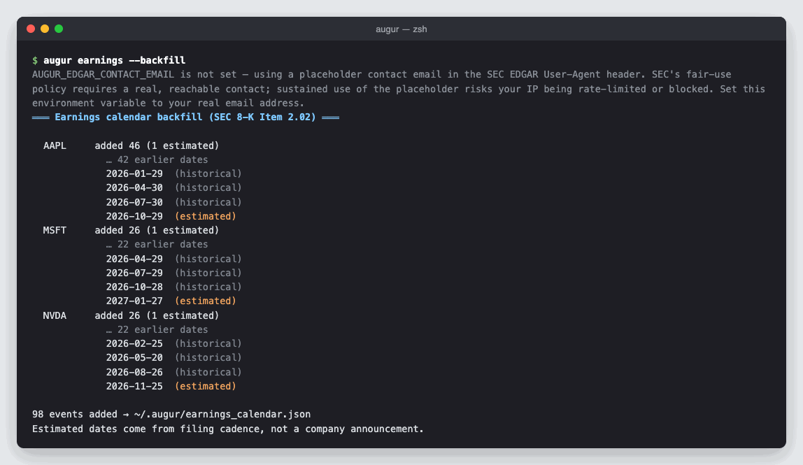
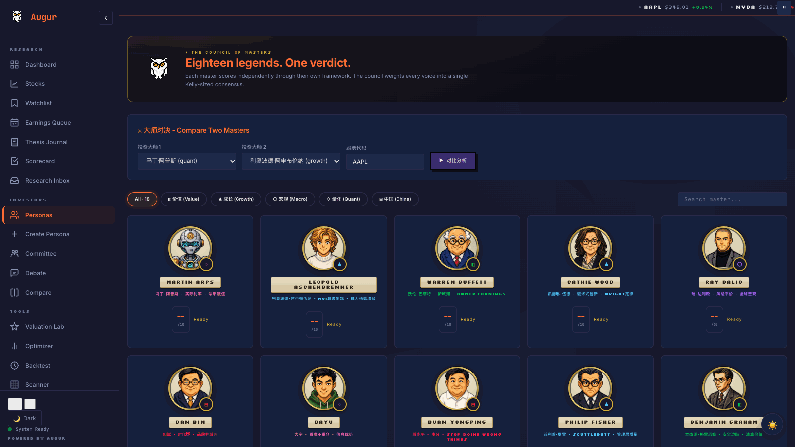
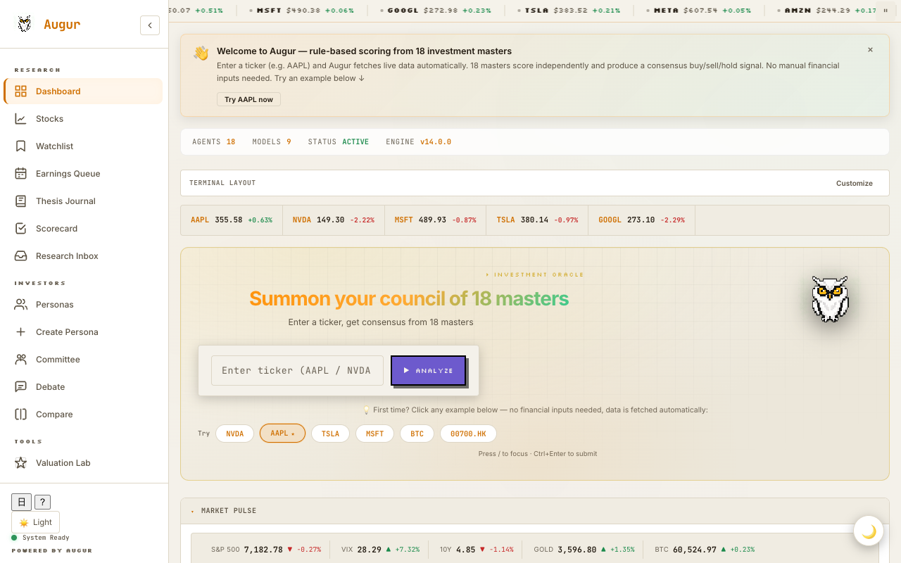
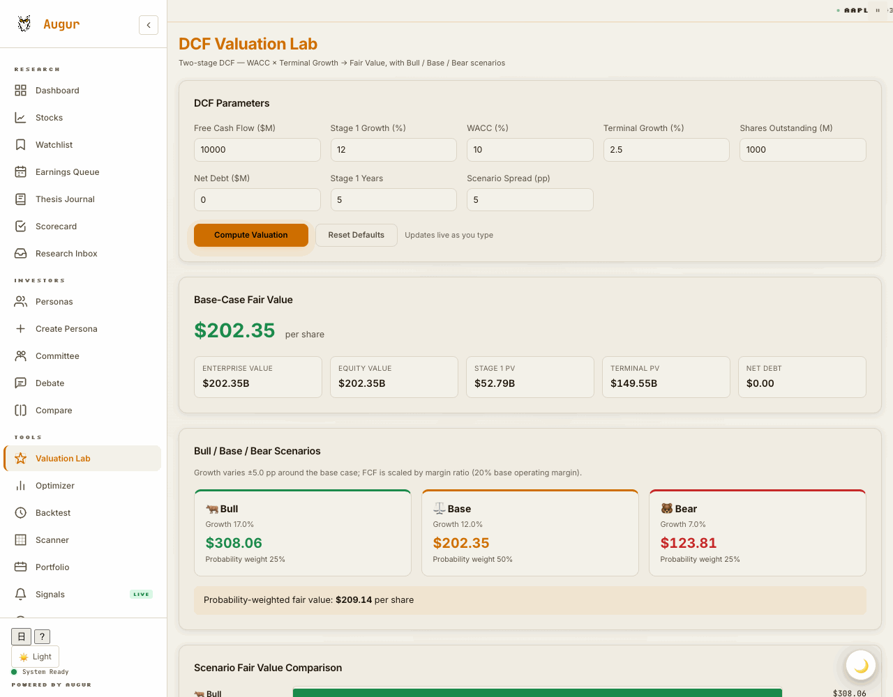

🇨🇳 中文 | [🇺🇸 English](README_EN.md) | [🇯🇵 日本語](README_JA.md)

<div align="center">


# 🦉 Augur

**在本机运行的投资研究工具：18 位投资大师的规则化打分，加上可以事后复查的研究记录。**

[](CHANGELOG.md)
[](https://github.com/BruceLanLan/augur/actions/workflows/tests.yml)
[](#-18-位投资大师)
[](#-接入-claude--agent)
[](#-数据与隐私)
[](LICENSE)

</div>

Augur 用 18 套按公开投资理念写成的确定性规则（下文称"大师"）分析股票，汇总成共识信号和 Kelly 仓位建议。每次运行连同证据来源存成不可变的记录，几个月后你仍能查到当时知道什么、后来什么变了、大师们在哪些事实上有分歧。打分不调用大模型，数据保存在本机。

**v14 的主要变化是 ETF 原生分析。** Augur 现在能识别 ETF，输出 ETF 概况（规模、费率、净值、溢价折价等）和体检清单，不再把基金当成公司打分。规则依赖公司财务数据的大师会对基金弃权；v14.1 起 Dalio、Marks、Soros、ARPS 这 4 位用技术面和行情给出基金读数，合成一个不带仓位建议的"基金共识"，技术指标缺失时不出共识。v14 还把 RSI 改为 Wilder 平滑、ATR 改用真实波幅，并把非美元标的的金额换算成美元。详见 [v14 新功能](#-v14-新功能)。

试一下（需要 Python 3.10+）：

```bash
git clone https://github.com/BruceLanLan/augur.git && cd augur
python3 -m venv .venv && source .venv/bin/activate && pip install -e ".[data]"
augur analyze AAPL     # 18 位大师各自的判断、共识与 Kelly 仓位
augur consensus SPY    # ETF：基金共识、ETF 概况、体检清单、哪些大师适用
```

> ⚠️ **仅供学习研究，不构成投资建议。** 大师是对公开投资理念的规则化模拟，不代表本人观点。所有分数、Kelly 仓位和估值都取决于数据质量和模型假设。

**目录**：[为什么不一样](#-为什么-augur-不一样) · [安装与上手](#-安装与上手) · [v14 新功能](#-v14-新功能) · [Augur 怎么用大模型](#-augur-怎么用大模型) · [财报研究流程](#-财报研究流程) · [18 位大师](#-18-位投资大师) · [Dashboard](#-dashboard) · [接入 Claude / Agent](#-接入-claude--agent) · [CLI 速查](#-cli-速查) · [功能成熟度](#-功能成熟度与已知限制) · [升级说明](#-升级说明) · [数据与隐私](#-数据与隐私) · [开发](#-开发) · [文档](#-文档) · [更新日志](#-更新日志)

---

## 🤔 为什么 Augur 不一样

大多数 AI 荐股工具让大模型直接给出答案。Augur 的分析不调用大模型，给你的是可以复查的研究记录。

| | 大模型荐股工具 | Augur |
|---|---|---|
| 结论怎么来 | 大模型生成，同一个问题每次可能不同 | 规则打分，同样的输入得到同样的分数，可以回测 |
| 给你什么 | 一段"一方面……另一方面……" | 18 位大师的独立判断，以及他们在哪里一致、在哪里分歧 |
| 数据从哪来 | 不清楚 | 每条证据带来源、业务时点、可得时点和获取时点 |
| 缺失数据 | 静默填 0 | 标为 `missing`，依赖该字段的大师弃权（`abstain`）并说明原因 |
| 三个月后回头看 | 不记得上次说了什么 | 每次运行存为不可变的 RunBundle，可以导出、比较和复查 |
| 数据在哪 | 云端 | 本地 `~/.augur`（可用 `AUGUR_DATA_DIR` 修改），无遥测 |

---

## 🚀 安装与上手

需要 Python 3.10+。

```bash
git clone https://github.com/BruceLanLan/augur.git && cd augur
python3 -m venv .venv && source .venv/bin/activate
pip install -e ".[data]"            # 核心 + yfinance 实时数据
# 可选：pip install -e ".[data,mcp]"  MCP server
#       pip install -e ".[export]"    PDF 导出

# SEC EDGAR 要求请求里带真实联系邮箱（用于美股财报数据）
export AUGUR_EDGAR_CONTACT_EMAIL="you@example.com"
```

打开 Dashboard：

```bash
augur serve --open                 # http://localhost:8000，⌘K 打开命令面板
```

常用命令：

```bash
augur analyze AAPL                 # 18 位大师同时分析 + 加权共识 + Kelly 仓位
augur fetch SPY                    # ETF：ETF 概况（规模、费率、净值、溢价折价）+ 体检清单
augur consensus SPY                # ETF：4 位大师的基金共识（无仓位）；技术指标缺失、适用不足 3 位时不给共识
augur workflow AAPL                # 多步分析，保存 RunBundle，末尾打印 Run ID
augur report from-run AAPL         # 基于最近一次运行生成报告：共识、分歧图、来源信息
augur export AAPL --format md      # 导出最近一次运行（md / json / evidence-pack / pdf）
augur committee AAPL --preset value -q "护城河是在变宽还是变窄？"
augur valuation AAPL               # 两阶段 DCF，自动取 FCF、股本和净负债并注明来源
augur skill run earnings-prep AAPL # 内置研究 Skill：财报前 dossier（共 4 个，见下文）
augur watchlist add AAPL           # 加入自选
augur earnings --backfill          # 从 SEC 8-K 回填自选股的财报日期（需联网）
augur cycle                        # 自选股的财报周期：谁准备好了、缺什么、下一步做什么
```

除 `augur earnings --backfill` 外，上面的命令都在 CI 的离线冒烟测试里从全新安装跑过。没有网络时，`augur analyze NVDA --pe 60 --roe 0.45` 可以手动传入指标，`augur backtest AAPL --demo` 使用离线合成数据，`augur cycle` 只读本地状态。


`augur analyze AAPL`：自动取实时数据，18 位大师各自打分后汇总成共识信号、分数、置信度和 Kelly 仓位（中性共识的仓位为 0），再列出要点和多空中性各有哪些大师。要点直接取自大师规则的输出，目前多数是中文。

---

## ✨ v14 新功能

### ETF 原生分析


`augur consensus SPY` 的输出（2026-11-26 实时数据）：基金共识为 NEUTRAL 5.0/10、置信度 43%，18 位中 4 位适用，Kelly 仓位为 n/a；下面是 ETF 概况、体检清单、4 位适用大师的读数和 14 位弃权的大师。

- **怎么识别 ETF**：yfinance 的 `quoteType` 为 ETF 或 MUTUALFUND，或者是 A 股基金代码（上交所 51 / 56 / 58 开头，深交所 15 开头）。`fetch`、`analyze`、`consensus`、`report` 对基金输出 ETF 概况，不再输出公司基本面。
- **ETF 概况**：规模（美元）、费率、分红率、类别、净值和净值日期、溢价折价（用净值日期当天的收盘价计算）、前十大持仓占比、买卖价差、成分股 PE。
- **体检清单**：费率高于 0.50% 或 1.00%、规模低于 5000 万美元（有清盘风险）、溢价折价绝对值超过 1%、前十大占比超过 50%、买卖价差超过 0.5% 时提示。缺数据无法检查的项列为"未检查"，不猜。
- **大师弃权**：规则读取公司财务数据的大师对基金返回"不适用"，不打分。哪些大师适用由一个测试决定：在 ETF 上改动公司字段，分数跟着变的大师就不适用。v14.0 只有 Dalio 适用；v14.1 起 Marks、Soros、ARPS 也有了基金读法，只看技术面、行情和 ETF 概况（相对 50 / 200 日均线、52 周区间、RSI、MACD、20 日波动率），共 4 位适用。
- **基金共识**：适用的大师至少 3 位时输出"基金共识"：等权，按数据覆盖率打折，不用为股票调过的行业权重、学习权重和新闻情绪调整；不给 Kelly 仓位，也不写入学习记录。价格、均线或 MACD 缺失时（例如只手填了价格），这几位以"技术指标缺失"弃权，共识为 WITHHELD，输出里分开列出"规则不适用"和"技术指标缺失"两类弃权。
- **数据来源和限制**：美股和港股 ETF 的净值来自 yfinance，不带日期，Augur 按最新一根 K 线的前一个交易日推断，并标注"推断"。A 股 ETF 的单位净值和真实净值日期来自新浪公开行情接口；免费数据源没有 A 股 ETF 的规模、费率和持仓，这几项显示为"未检查"。溢价折价只看最新一天，没有历史和跟踪误差。


`augur fetch 510300.SS`：A 股 ETF 有净值、净值日期和溢价折价；规模、费率和前十大占比显示为 `unknown`，体检清单把相关项列为 `Not checked (no data)`。


Dashboard 股票页（`/stocks`）对 ETF 显示 ETF 概况卡片；共识卡片标为 Fund Consensus（中文界面为"基金共识"），仓位为 n/a，下方说明是几位大师的读数、不含公司基本面。

### 正确性修复

- **RSI 改为 Wilder 平滑**（与 TA-Lib 一致）。此前只看最近 14 个变化。读 RSI 的大师（arps、dalio、marks、munger、soros、serenity、dayu 和自定义的 `da-yu.yaml`）分数会变。
- **非美元标的的金额换算成美元**：市值、FCF、营收等按汇率换算。腾讯（0700.HK）的市值此前被读成 $3,097.6B，现在约为 $397.5B。拿不到汇率时不换算，输出标明原币种。
- **大师规则**：大宇的波动率规则此前单位错误，从未触发；Thiel 和共识引擎的行业加权现在把 Communication Services（GOOGL、META、腾讯）算作科技；中性共识的仓位为 0。
- **输出**：`--json` 时 stdout 只有 JSON，进度提示改走 stderr；Dashboard 恐惧贪婪指数重新校准（VIX 28 显示为 Fear）；回测页不再用命中率推算收益、回撤和夏普，改为显示"未计量"。

另外，README 新增了 [Augur 怎么用大模型](#-augur-怎么用大模型) 一节；`[llm]` extra 不再安装用不到的 `anthropic`；MCP 工具 `augur_configure` 弃用。完整列表见 [CHANGELOG](CHANGELOG.md)，升级影响见 [升级说明](#-升级说明)。

---

## 🧠 Augur 怎么用大模型

打分不用大模型，解读可以交给大模型。有三种用法：

| 模式 | 谁在思考 | 需要 API key 吗 | 怎么用 |
|---|---|---|---|
| 默认：确定性规则 | 18 位大师的规则和共识引擎 | 不需要 | `augur analyze` / `consensus` / `workflow` / Dashboard；手动传入指标时可以离线运行 |
| MCP / Skill：宿主 Agent 负责解读 | 你正在用的 Agent（如 Claude Code、Claude Desktop、Hermes）调用 Augur 的工具拿到分数和证据，再用它自己的模型解读 | 由宿主负责，Augur 不需要 | `claude mcp add augur -- augur-mcp`，或在 Claude Desktop 里配置 `augur-mcp`（见 [接入 Claude / Agent](#-接入-claude--agent)） |
| 可选：自带 key 的大师聊天 | 你配置的 OpenAI 兼容接口 | 需要 `OPENAI_API_KEY` | `pip install -e ".[llm]"`，设置 `OPENAI_API_KEY`，可选 `OPENAI_BASE_URL` 和 `AUGUR_CHAT_MODEL`（默认 `gpt-4o`）；用于 `augur chat` 和 Dashboard 的 `/chat`。不配置时聊天返回模板回复 |

还有一项默认关闭的付费功能：设置 `AUGUR_EDGAR_GUIDANCE_EXTRACTION=1` 后，`augur guidance` 会用同一个 OpenAI 兼容接口从 10-K / 10-Q 中抽取管理层展望。

---

## 📖 财报研究流程

下面按实际使用顺序走一遍：加自选、回填财报日期、跑财报周期、查看研究产物。截图来自 AAPL、MSFT、NVDA 的真实数据（实时行情和 SEC EDGAR），终端截图只截取了输出的主要部分。

### 加入自选，回填财报日期

```bash
augur watchlist add AAPL
augur watchlist add MSFT
augur watchlist add NVDA
augur earnings --backfill
```

自选列表是财报周期的输入，`augur earnings`、`augur cycle` 和 Dashboard 的财报队列都从这里读取股票。



`augur earnings --backfill` 从 SEC 8-K（Item 2.02，业绩公告）读取每只自选股过去的财报日期，再按最近几次的发布间隔估算下一次，标为 `estimated`，不会标成"已确认"。你手工写进财报日历的条目不会被覆盖。需要联网并设置 `AUGUR_EDGAR_CONTACT_EMAIL`；用 `-t AAPL` 可以只回填指定股票。

### 一条命令跑完财报周期


`augur cycle` 对未来 N 天（默认 30 天，用 `--days` 修改）内要发财报的每只自选股，依次给出 dossier 是否就绪、dossier 内容、最近两次运行之间的变化和投资论文的变化，最后汇总 `ready X/Y` 和每只股票的下一步。它只读本地已保存的状态，不联网；缺什么会直接写出来，并给出补齐的命令。

### 研究产物

`augur dossier AAPL` 生成财报前 dossier，`augur report from-run AAPL` 基于最近一次运行生成研究报告，`augur skill run` 运行内置的研究 Skill。下面 `skill run earnings-prep` 和 `report from-run` 两张截图拍摄于 v14；`filing-delta`、`risk-review`、`eval personas` 三张拍摄于 v11，版面结构与现在相同，其中的数值和个别措辞来自旧版本。


`augur skill run earnings-prep AAPL`：18 位大师的共识，分歧点逐条引用证据 ID，没有证据支撑的分歧单独标为 "evidence gap"，并与上一次运行对比。下次财报日期取自本地财报日历，注明是 `confirmed` 还是 `estimated`；日历里没有时直接说明。执行前会检查每一步要用的能力、网络域名和本地资源是否在清单里声明过，有一项不通过就不执行。每次执行存为 RunBundle。


`augur skill run filing-delta AAPL`：自动取最近两份 10-K 的 XBRL 数据，列出变化不小于 5% 的项目。另外两个内置 Skill 是 `debt-covenant-review`（杠杆与利息覆盖率）和 `insider-cluster-review`（Form 4 内部人集中交易），详见 [Skill 使用指南](docs/skills-guide.md)。


`augur report from-run AAPL`（先用 `augur workflow AAPL` 保存一次运行）：多空投票、大师在哪些维度上分歧（每条引用证据 ID，并写出什么事实能消除分歧）、大师一致的地方、缺证据的分歧，以及运行 ID、代码版本、步骤状态和证据覆盖率。


`augur risk-review AAPL`：对比最近两份 10-K 的风险因素章节，列出新增、删除和措辞升级的风险。基于规则匹配，措辞小改可能同时显示为"新增"和"删除"。


`augur eval personas AAPL`：基于 `augur backtest` 生成的历史记录，逐个去掉一位大师，看共识 IC 变好还是变差；分数恒定、没有信息量的大师单独列出。远期收益逐日重叠，置信区间偏乐观，只能用于筛查，不能直接当作权重。`augur eval factors` 给出每位大师的分数作为因子时的 IC 和 t 检验。

---

## 🎭 18 位投资大师

每位大师是对一种公开投资理念的规则化实现，覆盖价值、成长、宏观和中国市场。目前多数大师的理由和要点用中文输出。

| 流派 | 大师 |
|------|------|
| 🏦 经典价值 | Warren Buffett · Benjamin Graham · Charlie Munger · Philip Fisher |
| 🚀 成长创新 | Peter Lynch · Cathie Wood · Peter Thiel · Leopold Aschenbrenner |
| 🌍 宏观周期 | Ray Dalio · George Soros · Howard Marks · ARPS（加密 / 黄金） |
| 🇨🇳 中国价值 | 段永平 · 张磊 · 李录 · 但斌 · 大宇 |
| ⚙️ 特殊策略 | Serenity（AI 算力供应链） |

共识引擎按置信度、数据覆盖度和行业相关性加权，给出信号、分数、置信度和 Kelly 仓位建议。`augur list-personas` 列出全部大师 ID。



---

## 📊 Dashboard

`augur serve --open` 启动并打开 http://localhost:8000。侧边栏分为研究、大师、工具、系统四组。

| 页面 | 路径 | 功能 |
|---|---|---|
| 首页 | `/` | 行情和大师概览 |
| 股票分析 | `/stocks` | 输入代码，18 位大师同时分析；ETF 显示 ETF 概况卡片 |
| 大师 / 委员会 / 辩论 / 对比 | `/personas` · `/committee` · `/debate` · `/compare` | 大师一览、预设委员会、多轮辩论、五维雷达图 |
| 财报队列 / 记分卡 | `/earnings` · `/scorecard` | 财报事件和 dossier 缺项、财报后记分卡 |
| Thesis Journal / 研究收件箱 | `/thesis` · `/inbox` | 投资论文、证伪条件、决策日志；待处理事件 |
| 估值实验室 | `/valuation` | 两阶段 DCF 和敏感度网格 |
| 历史 / 组合 / 自选 / 设置 | `/history` · `/portfolio` · `/watchlist` · `/settings` | 运行历史、Kelly 配置、定时分析、布局和大师子集 |



<details>
<summary>更多页面截图：财报队列、记分卡、Thesis Journal、估值实验室</summary>


`/earnings`：财报队列，与 `augur earnings` 读同一份自选和财报日历。每只股票列出 dossier 还缺哪些项，以及补齐每一项的命令；估算的日期标为 `estimated`。


`/scorecard`：财报后记分卡，对照财报前后两次运行各回答了哪些研究问题。数据不够时显示 `unavailable` 和原因。目前 Dashboard 还没有地方保存"财报前 / 财报后"的运行配对，所以页面上还生成不了完整的记分卡；命令行的 `augur scorecard` 可以用。


`/thesis`：记录投资论文的催化剂、风险和证伪条件，旁边是待回答的研究问题和决策日志。研究问题保存在本地，`augur dossier` 也能读到。截图里的内容是手工录入的示例。



`/valuation`：两阶段 DCF，修改输入后即时重算，给出牛市、基准、熊市三种情景和概率加权的公允价值，下方是 WACC × 永续增长率的敏感度网格。截图里的参数是示例输入。

</details>

---

## 🔌 接入 Claude / Agent

MCP server 提供 14 个工具（包括运行内置 Skill 的 `augur_run_skill`）、7 个研究 prompt 和 5 类只读资源（`augur://evidence/{id}`、`augur://runs/{id}`、`augur://thesis/{id}`、`augur://decisions/{id}`、`augur://ledger/{ticker}/{quarter}`），在 `mcp` 1.x 和 2.x 下都用真实的 stdio 会话验证过。

```bash
pip install -e ".[data,mcp]"
claude mcp add augur -- augur-mcp   # Claude Code：注册为 stdio MCP 服务器
```

Claude Desktop 配置示例：

```json
{
  "mcpServers": {
    "augur": { "command": "augur-mcp", "env": { "AUGUR_EDGAR_CONTACT_EMAIL": "you@example.com" } }
  }
}
```

分析、共识、辩论、委员会四个工具接受 `asset_type` 参数（`equity` / `etf` / `fund`，留空自动识别）。另外有 Hermes / OpenClaw 技能包（`src/skills/`，见 [docs/hermes-setup-guide.md](docs/hermes-setup-guide.md)），以及 Telegram、Slack、飞书和微信机器人。完整说明见 [docs/agent-integration-guide.md](docs/agent-integration-guide.md)。

---

## 💻 CLI 速查

```bash
# 分析
augur analyze AAPL [--persona buffett] [--json]
augur consensus SPY · augur fetch 510300.SS · augur report SPY   # ETF 同样适用
augur workflow TSLA --steps fetch,analyze,consensus,committee,debate,sentiment
augur committee NVDA --agents buffett,munger,dalio
augur batch AAPL MSFT NVDA

# 研究产物
augur report from-run AAPL [--format json]      # 共识 + 分歧图 + 来源与耗时
augur export AAPL --format md|json|evidence-pack|pdf [-o 路径] [--run-id ...]
augur records verify-pack pack.zip              # 校验证据包每个文件的 SHA-256
augur dossier AAPL                              # 财报前 dossier
augur valuation AAPL [--fcf 100e9 --shares 15e9 --growth 0.08 --wacc 0.10]
augur risk-review AAPL                          # 最近两份 10-K 的风险因素变化
augur records ledger AAPL                       # 最近两次运行之间变了什么
augur thesis-delta AAPL                         # 有效的投资论文对照最近两次运行（离线）
augur scorecard AAPL [--pre RUN --post RUN]     # 财报后记分卡
augur cycle [--days 30] [--format markdown]     # 自选股的财报周期
augur filing-delta AAPL --new q3.json --prev q2.json

# 内置研究 Skill（执行前检查权限，结果存为 RunBundle）
augur skill list · augur skill show filing-delta
augur skill run earnings-prep|filing-delta|debt-covenant-review|insider-cluster-review AAPL

# 评估（基于 augur backtest 生成的记录）
augur backtest AAPL --days 120 [--demo] · augur eval ic
augur eval personas AAPL [--horizon 20]         # 共识 IC、命中率、逐个去掉大师的边际贡献
augur eval factors AAPL                         # 每位大师分数作为因子的 IC、t 值、p 值

# 研究记录
augur records decisions list|resolve|report     # 决策结果与胜率
augur records comments add|list|resolve         # 对运行、论文、决策、证据的评论
augur records citations report|list|accept|reject|fixed   # 引用纠错队列
augur records audit [--action ...]              # 审计日志

# 数据
augur fetch AAPL · augur sentiment AAPL · augur insider AAPL · augur doctor
augur earnings --days 30 · augur earnings --backfill

# 监控与服务
augur watchlist add AAPL · augur watchlist show · augur watchlist watch AAPL NVDA --interval 60
augur cron run · augur cron start
augur serve [--port 8000] · augur mcp-server · augur skill profiles · augur skill compat
```

`augur --help` 列出全部 38 个顶层命令（pip 安装时不显示 `augur update`，为 37 个）。v12.2 起命令按组归类（`watchlist` / `cron` / `report` / `records` / `eval` / `skill`）。旧的平铺写法（如 `watchlist-add`、`research-report`、`ic-report`、`ledger`）在 v14 中仍然可用，执行时会在 stderr 提示新写法。`augur report AAPL` 等同于 `augur report run AAPL`。


---

## 🧭 功能成熟度与已知限制

如实标注，避免把"有代码"当成"能用"。

| 状态 | 范围 |
|---|---|
| 稳定 | 18 位大师的分析与共识、上面列出的命令行研究流程、Dashboard 主要页面、MCP server、RunBundle 与导出、数据源链（yfinance，SEC EDGAR 覆盖美股财报字段） |
| 可用，有明确边界 | ETF 分析：4 位大师给基金读数，基金共识等权、不给仓位、不写学习记录；大师的分析文字只有中文；A 股 ETF 只有净值和溢价折价；溢价折价只看最新一天；v14.1 之前的精简历史记录里，不出共识的基金仍存成 5.0。<br>内置 Skill（4 个）：只运行内置清单；债务约束默认用参考阈值，不是信贷协议条款。<br>分歧图：按大师的分维度评分推导并引用证据，维度到指标的映射是固定表。<br>`augur risk-review`：规则匹配，措辞小改可能同时显示为"新增"和"删除"。<br>`augur eval`：单只股票的时间序列 IC，远期收益重叠，显著性偏乐观，只用于筛查。<br>`augur guidance`：需要 `AUGUR_EDGAR_GUIDANCE_EXTRACTION=1`，会调用付费大模型。<br>PDF 导出：需要 `[export]`。 |
| 实验（默认关闭） | rolling-IC 动态权重（`AUGUR_FORCE_RIC=1`）、学习权重（`AUGUR_FORCE_LEARNED=1`）。两者都还没有通过预注册的样本外验证 |
| 只有代码、没有入口 | `augur.experimental` 下的会计质量、资本配置、辩论引擎（Dashboard 的 `/debate` 用的是另一套实现）、相对估值、组合风险。有单元测试，但 CLI、Dashboard 和 MCP 都没有调用，可以当库用，不算产品功能 |
| 尚未计量 | 运行记录里的 token 用量（目前只记录耗时） |

---

## 🔄 升级说明

### 从 v14.0 升级到 v14.1

命令用法不变。需要注意的变化：

| 变化 | 影响与处理 |
|---|---|
| ETF 有了真实的基金共识 | 多数 ETF 现在有信号和分数（不给仓位）；解析输出的脚本不要再假定 ETF 一律 WITHHELD。自选盯盘和 `augur cron` 的提醒对 ETF 也可能触发，不出共识时不会提醒 |
| ATR 改用真实波幅，阈值重校 | Munger（>3% → >5.75%）和 Dalio（<2 / >5 → <3.75 / >9.25）在个别标的上的分数会变，整体触发率不变。见 [ATR 重校说明](docs/research/ATR_RECALIBRATION_2026-11.md) |
| 回测与实盘同口径 | 回测和分市况 IC 的数字和旧版本对不上；在意可比性的话升级后重跑基线 |
| 收盘后预测按下一交易日收盘入场 | 只影响新写入的学习记录 |

### 从 v13 升级到 v14

命令用法不变，但有些分数和输出会变：

| 变化 | 影响与处理 |
|---|---|
| RSI 改为 Wilder 平滑 | arps、dalio、marks、munger、soros、serenity、dayu 和自定义 `da-yu.yaml` 的分数会变，RSI 在 30 / 70 附近的标的变化最明显。如果你保存了 v13 的分数做对比，请注意这一项 |
| 大宇的波动率规则开始生效 | 仓位风险维度相对 v13 的变化：20 日波动率低于 15% 不变，15–25% 减 1，25–40% 减 2，40–60% 减 3，高于 60% 减 4；该维度占大宇总分的 20% |
| 非美元标的的金额按美元计 | 港股、A 股以及财报货币不是美元的标的（如部分 ADR）：`market_cap`、`fcf`、`revenue` 等是十亿美元，价格仍是交易货币。自己读取 `MarketContext` 的代码请注意单位 |
| Communication Services 算作科技 | Thiel 和共识引擎的行业加权对 GOOGL、META、腾讯等的判断会变 |
| 中性共识的仓位为 0 | 此前 `analyze` 会给出 0.6% 这样的小仓位 |
| ETF 不再给 18 位大师的共识 | 输出 ETF 概况、体检清单和适用大师的读数，v14.0 的共识为 WITHHELD（v14.1 起 4 位适用大师给出基金共识）。基金的 `pe` / `pb` 为 0，成分股口径的值在 `etf` 字典里。以前把 ETF 当股票分析得到的结果不要再沿用 |
| `--json` 时进度提示改走 stderr | stdout 只有 JSON。从 stdout 解析提示文字的脚本请改读 stderr |
| `[llm]` 不再安装 `anthropic`；MCP `augur_configure` 弃用 | 代码从未用到它们。自定义代码需要 `anthropic` 时请自行安装 |
| Dashboard 回测接口的收益、回撤、夏普为 `null` | 此前是用命中率推算的，不是实测值 |

学习数据的 schema 仍是 2，不会作废。按旧 RSI 记下的待结算预测照常结算。v14 之前分析 ETF 时写入的学习记录还留在原处，会给相关大师的准确率混入少量噪声，清理工具会在后续版本提供。

### 从更早版本升级

依次完成各版本的迁移步骤，要点如下：

- **v13**：需要 Python 3.10+；五个没有产品入口的模块移到 `augur.experimental.<同名>`（如 `augur.accounting` → `augur.experimental.accounting`）；删除兼容转发模块 `augur.coordinator`、`augur.skill_spec`、`augur.mcp_entry`。
- **v12**：学习权重文件升级为 schema 2，首次加载时 v11 记下的结算结果作废（待结算的预测保留）；命令分组，旧的平铺写法仍可用。
- **v11**：见 [docs/RELEASE_NOTES_v11.md](docs/RELEASE_NOTES_v11.md)，包括 `Optional` 持股字段、默认关闭的动态权重、默认只监听 `127.0.0.1` 等。

每一版的完整说明见 [CHANGELOG.md](CHANGELOG.md)。

---

## 🔒 数据与隐私

- 所有状态保存在本地数据目录（默认 `~/.augur`，用 `AUGUR_DATA_DIR` 修改）。没有遥测；默认单用户、无需注册（可用 `AUGUR_MULTI_USER=1` 开启多用户模式）。
- 会发出的网络请求：行情、基本面和汇率（yfinance、SEC EDGAR）；A 股 ETF 净值（新浪行情 `hq.sinajs.cn`）；可选的大模型调用（只在你设置了 `OPENAI_API_KEY` 并使用聊天或 guidance 抽取时）；Dashboard 页面从 jsDelivr CDN 加载 Chart.js。
- Dashboard 默认只监听本机。需要对外开放时先设置 `AUGUR_API_TOKEN`，详见 [docs/self-hosted-guide.md](docs/self-hosted-guide.md)。

主要环境变量：

| 变量 | 作用 |
|---|---|
| `AUGUR_DATA_DIR` | 数据目录 |
| `AUGUR_EDGAR_CONTACT_EMAIL` | SEC EDGAR 要求的联系邮箱（未设置时使用占位值并告警） |
| `AUGUR_API_TOKEN` / `AUGUR_MULTI_USER` | Dashboard `/api/*` 鉴权 |
| `AUGUR_CORS_ORIGINS` | 允许的跨域来源 |
| `AUGUR_FORCE_RIC` / `AUGUR_FORCE_LEARNED` | 打开实验性的动态权重 |
| `AUGUR_SKIP_MACRO_FETCH` | 跳过 VIX / SPY 宏观数据拉取（离线或 CI） |
| `AUGUR_EDGAR_GUIDANCE_EXTRACTION` | 启用基于大模型的 guidance 抽取（付费，使用下面的 OpenAI 兼容接口） |
| `OPENAI_API_KEY` / `OPENAI_BASE_URL` | 可选：大师聊天和 guidance 抽取用的 OpenAI 兼容接口（需要 `[llm]`；不设地址时使用 OpenAI 官方） |
| `AUGUR_CHAT_MODEL` / `AUGUR_CHAT_MAXTOK` | 可选：聊天用的模型名（默认 `gpt-4o`）和最大输出 token（默认 1024） |

---

## 🔧 开发

```bash
python3 -m venv .venv && source .venv/bin/activate
pip install -e ".[dev,data,mcp]" "ruff>=0.16,<0.17" build

make verify     # 全量测试 + ruff + 构建 wheel / sdist 并输出 sha256
make lint       # ruff（规则集固定为 E4/E7/E9/F）
make test-wheel # 在全新虚拟环境里安装构建产物并做冒烟检查
```

- 测试使用独立的临时 `AUGUR_DATA_DIR`，不会写入你的 `~/.augur`，在完全断网的环境下也能全部通过。
- CI：`Tests` 在 Python 3.10 / 3.11 / 3.12 上跑全量测试；`Hermetic Smoke` 分别从 wheel 和 sdist 全新安装，跑 ruff、pip-audit 和上面列出的 README 命令。
- 贡献方式见 [CONTRIBUTING.md](CONTRIBUTING.md)。

---

## 📚 文档

| 文档 | 内容 |
|---|---|
| [docs/ROADMAP.md](docs/ROADMAP.md) | 路线图：当前阶段、每一步的验证点、v14 之后的候选与待决事项 |
| [docs/RELEASE_NOTES.md](docs/RELEASE_NOTES.md) | 面向用户的更新说明 |
| [CHANGELOG.md](CHANGELOG.md) | 每个版本的完整变更 |
| [docs/data-sources.md](docs/data-sources.md) | 数据源与字段来源 |
| [docs/schema-reference.md](docs/schema-reference.md) | EvidenceItem / Claim / StepResult / RunBundle / SkillSpec |
| [docs/api-reference-v11.md](docs/api-reference-v11.md) | Python API / REST / MCP |
| [docs/examples.md](docs/examples.md) | 实战示例 |
| [docs/self-hosted-guide.md](docs/self-hosted-guide.md) | Docker / systemd / 反向代理 / 鉴权 |
| [docs/reviews/](docs/reviews/) | 项目评审记录 |
| [docs/INDEX.md](docs/INDEX.md) | 全部文档索引 |

---

## 📝 更新日志

<details open>
<summary><strong>v14.1.0 — ETF 的真实基金共识、不再把占位的 5.0 当分数、真实波幅 ATR (current)</strong></summary>

- 基金共识：Marks、Soros、ARPS 加上 Dalio 共 4 位大师给 ETF 读数，合成不带仓位的"基金共识"；技术指标缺失时仍不出共识，弃权按原因分开写。
- 不出共识时，Dashboard、`augur cron`、`augur watchlist watch`、聊天机器人、Skill 和 MCP 都显示 WITHHELD，不再显示 5.0，也不再对占位值发提醒。
- 真实波幅 ATR 并重校 Munger / Dalio 阈值；回测上下文与实盘同口径；收盘后预测按下一交易日收盘入场；股息率单位修正。

</details>

<details>
<summary><strong>v14.0.0 — ETF 原生分析、正确性修复、讲清楚大模型的角色</strong></summary>

- ETF 原生分析：识别 ETF，输出规模、费率、净值（A 股带真实净值日期）、按净值日期对齐的溢价折价、前十大占比和体检清单；规则不适用的大师弃权，适用不足 3 位时不给共识和仓位，也不写学习记录。
- 正确性：Wilder RSI、非美元金额换算成美元、大宇波动率单位、Communication Services 算作科技、中性仓位为 0、`--json` 只输出 JSON、恐惧贪婪指数校准。
- 大模型的角色：新增 [Augur 怎么用大模型](#-augur-怎么用大模型)；`augur_configure` 弃用；`[llm]` 不再安装 `anthropic`。

</details>

<details>
<summary><strong>更早版本</strong></summary>

- v13.0.0：`augur earnings --backfill` 从 SEC 8-K 回填财报日期；需要 Python 3.10+；精简公开 API。
- v12.2.0：命令分组（`augur --help` 从 47 项减到 38 项），Dashboard 侧边栏分组并补上财报相关页面。
- v12.1.0：`augur cycle`、`augur scorecard`、`augur thesis-delta`。
- v12.0.0：每条学习预测按自己的日期结算；财报队列、dossier 接上真实的自选和运行记录；包含未单独发布的 v11.0.0 正式版内容。
- v11.0.0-rc1：研究底座（EvidenceItem、RunBundle、SkillSpec）、Thesis Journal、分歧图、估值实验室。
- v10.15.0 及更早：SEC EDGAR 基本面、`augur doctor`、终端界面、委员会、Hermes Agent 接入。

完整记录见 [CHANGELOG.md](CHANGELOG.md)。

</details>

---

<div align="center">

MIT License · 作者 [BruceLanLan](https://github.com/BruceLanLan)（X：[@BruceBlue](https://x.com/BruceBlue)）

*仅供学习研究，不构成投资建议*

</div>
