🇨🇳 中文 | [🇺🇸 English](README_EN.md)

<div align="center">

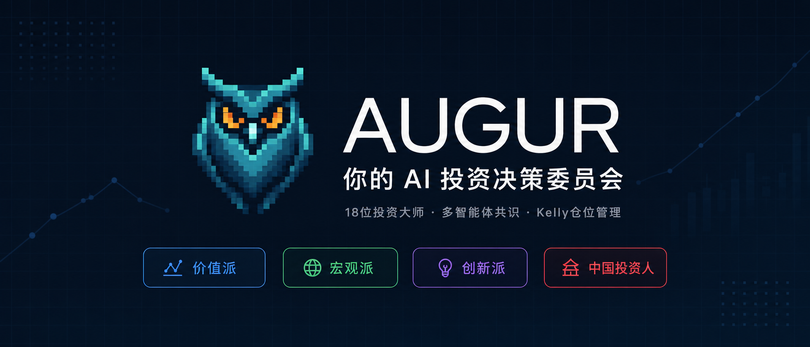

# 🦉 Augur

**不是又一个 AI 荐股工具。是一个帮你记住"你何时知道什么、什么变了、谁在什么事实上分歧"的本地研究记忆系统。**

[](CHANGELOG.md)
[](https://github.com/BruceLanLan/augur/actions/workflows/tests.yml)
[](#-18-位投资大师)
[](#-接入-claude--agent)
[](#-数据与隐私)
[](LICENSE)

</div>

> ⚠️ **仅供学习研究，不构成投资建议。** 大师观点是基于公开投资理念的规则化模拟，不代表本人立场；所有分数、Kelly 仓位与估值都依赖数据质量和模型假设。

**目录**：[为什么不一样](#-为什么-augur-不一样) · [v13 新功能](#-v13-新功能一览) · [5 分钟上手](#-5-分钟上手) · [升级到 v13（含更早版本）](#-从-v12-升级到-v13) · [18 位大师](#-18-位投资大师) · [Dashboard](#-dashboard) · [接入 Claude / Agent](#-接入-claude--agent) · [CLI 速查](#-cli-速查) · [功能成熟度](#-功能成熟度) · [数据与隐私](#-数据与隐私) · [开发](#-开发) · [文档与路线图](#-文档与路线图)

---

## 🤔 为什么 Augur 不一样

大多数 AI 金融工具给你一个答案。Augur 给你的是**可复查的研究产物**。

| | 普通 AI 工具 | Augur |
|---|---|---|
| 给你什么 | 一段"一方面…另一方面…" | 18 位大师的独立判断 + 他们在哪里一致、在哪里打架 |
| 数据从哪来 | 不清楚 | 每条证据带来源、业务时点、可得时点、获取时点 |
| 缺失数据 | 静默填 0 | 显式标注 `missing`，依赖该字段的大师 `abstain` 并说明原因 |
| 三个月后回头看 | 不记得上次说了什么 | 每次运行存为不可变的 RunBundle，可以导出、比较、复查 |
| 数据在哪 | 云端 | 本地 `~/.augur`（可用 `AUGUR_DATA_DIR` 改），无遥测 |

---

## ✨ v13 新功能一览

下面按新用户的实际顺序走一遍：加自选 → 回填财报日期 → 跑财报周期 → 看研究产物 → 打开 Dashboard。v13 的截图都是 2026-10-29 用 AAPL / MSFT / NVDA 的真实数据（实时行情 + SEC EDGAR）运行的结果；按发布节奏推算出来的财报日期在输出和页面上都标为 `estimated`，不是公司公告的日期。终端截图只截取了输出的主要部分。

### 1. 加入自选：`augur watchlist add`

```bash
augur watchlist add AAPL
augur watchlist add MSFT
augur watchlist add NVDA
```

自选列表是财报周期的输入：`augur earnings`、`augur cycle` 和 Dashboard 的财报队列都从这里读取股票。

### 2. 回填财报日期：`augur earnings --backfill`

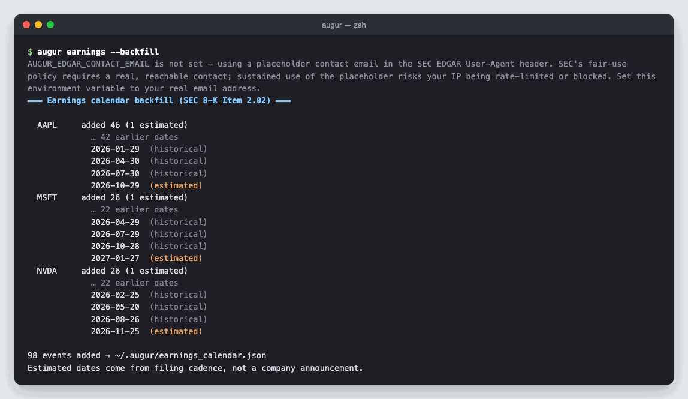

从 SEC 8-K（Item 2.02，业绩公告）读取每只自选股过去的财报日期，再按最近几次的发布间隔估算下一次日期，标为 `estimated`，不会标成"已确认"。你手工写进 `<数据目录>/earnings_calendar.json` 的条目不会被覆盖。需要联网，并设置 `AUGUR_EDGAR_CONTACT_EMAIL`；也可以用 `-t AAPL` 只回填指定股票。截图里每只股票只保留了最近几条日期，较早的日期被折叠成一行；三只股票各有一个 `estimated` 日期。

### 3. 一条命令跑完财报周期：`augur cycle`

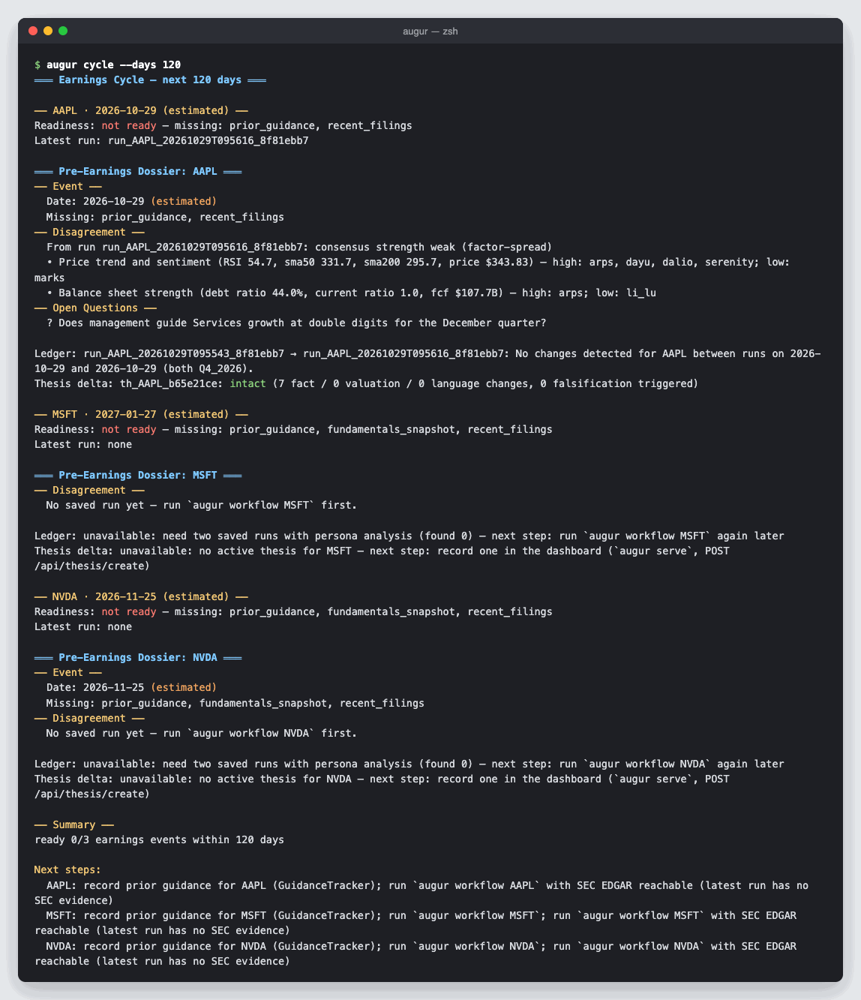

对未来 N 天（默认 30 天）内要发财报的每只自选股，依次给出 dossier 就绪状态、dossier、最近两次运行之间的变化和投资论文的变化，最后汇总 `ready X/Y` 和每只股票的下一步该做什么。它只读本地已保存的状态，不联网；缺什么会直接写出来，并给出补齐的命令。截图用 `--days 120` 把三只股票的估算日期都纳入窗口；当时三只都还没就绪（缺上一季 guidance 记录和 SEC 证据，MSFT / NVDA 还没有保存的运行），所以汇总是 `ready 0/3`，后面列出每只股票的下一步。

### 4. 研究产物：dossier、研究报告与内置 Skill

`augur dossier AAPL` 生成财报前 dossier；`augur report from-run AAPL` 基于最近一次运行生成研究报告；`augur skill run` 一次跑完整个研究流程。

下面这几张截图是 2026-09-17 对 AAPL 的真实运行。此后这些命令的输出格式没有改动，所以沿用原图。

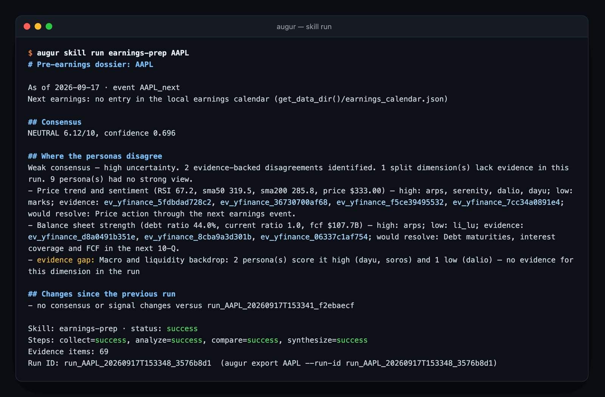

`augur skill run earnings-prep AAPL`：18 位大师的共识，**分歧点逐条引用证据 ID**，没有证据支撑的分歧单独标成"evidence gap"，并和上一次运行做对比。下次财报日期取自本地财报日历（可以用上一步的 `--backfill` 填充），会注明是 `confirmed` 还是 `estimated`；日历里没有记录时直接说明，不猜。执行前，执行器先检查每一步要用的能力、网络域名和本地资源是否都在清单里声明过，任何一项不通过都不会开始执行；每次执行存为 RunBundle，可以导出和复查。

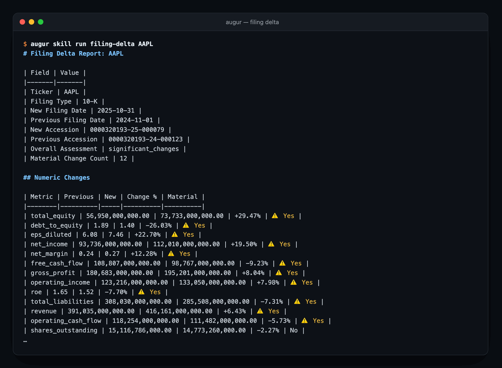

`augur skill run filing-delta AAPL`：自动取最近两份 10-K 的 XBRL 数据，列出变化 ≥5% 的实质性项目，不需要手填 accession 号。另外还有 `debt-covenant-review`（杠杆与利息覆盖率）和 `insider-cluster-review`（Form 4 内部人集群）。详见 [Skill 使用指南](docs/skills-guide.md)。

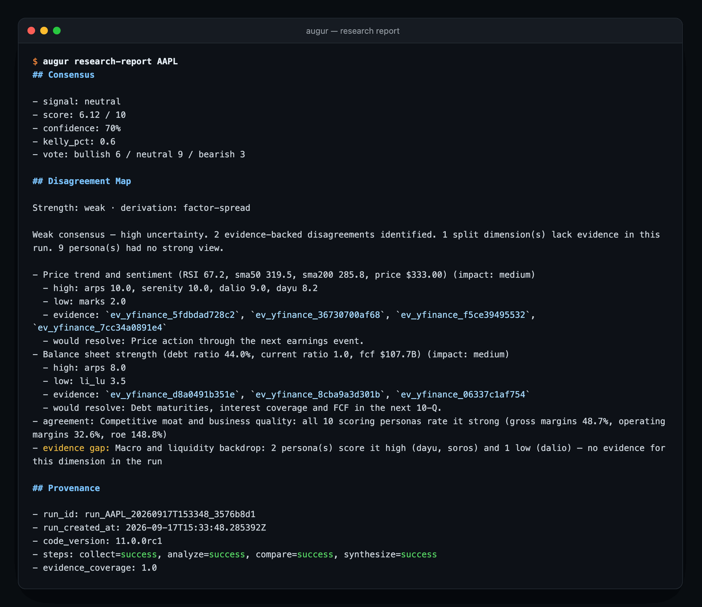

`augur report from-run AAPL`（截图拍摄时命令名还是 `augur research-report`，输出相同）：多空投票、大师在哪些维度上分歧（每条引用证据 ID，并写出什么事实能消除分歧）、大师一致的地方、缺证据的分歧，以及运行 ID、代码版本、步骤状态和证据覆盖率。

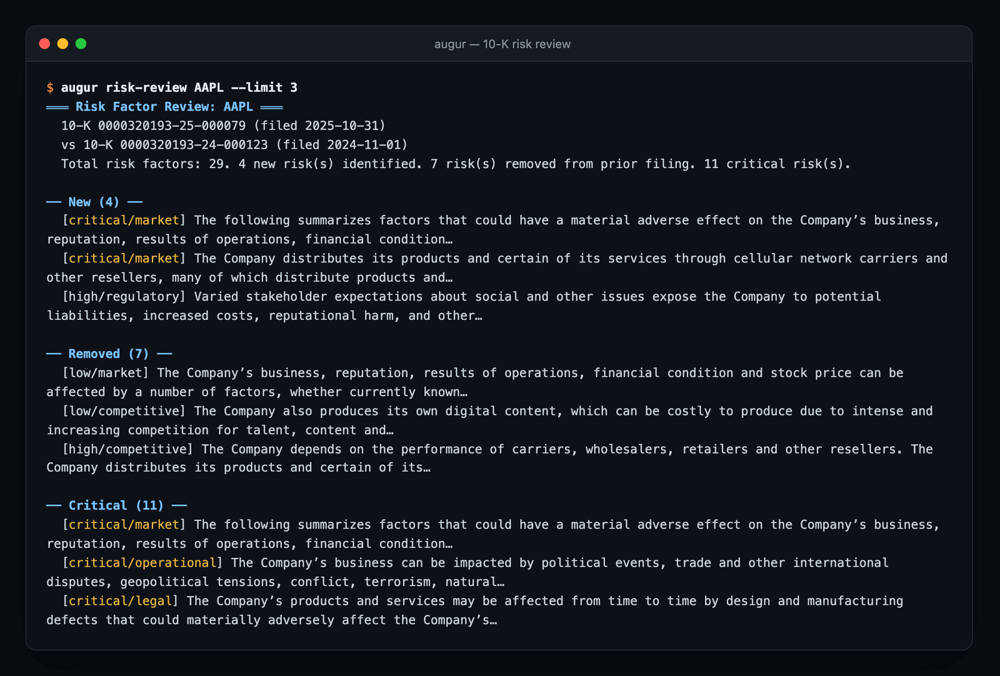

`augur risk-review AAPL`：对比最近两份 10-K 的风险因素章节，列出新增、删除和措辞升级的风险。基于规则匹配，措辞小改可能同时显示为"新增"和"删除"。

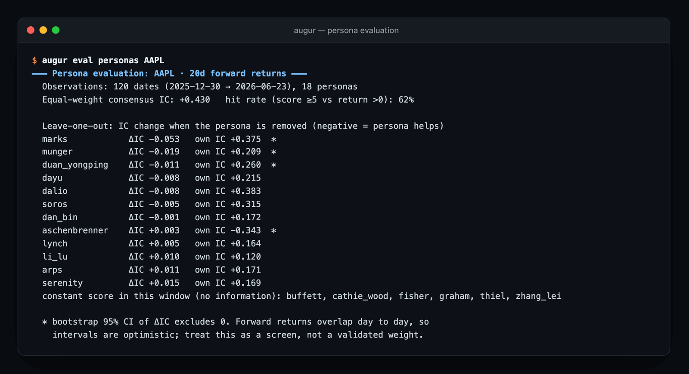

`augur eval personas AAPL`：用 `augur backtest` 生成的历史记录，逐个去掉某位大师，看共识 IC 变好还是变差；分数恒定、没有信息量的大师单独列出。远期收益逐日重叠，置信区间偏乐观，只能当筛查，不能直接当权重。`augur eval factors` 给出每位大师分数作为因子的 IC 与 t 检验。

### 5. Dashboard

`augur serve --open` 打开 http://localhost:8000。以下截图同样是 2026-10-29 用 AAPL / MSFT / NVDA 真实数据拍摄。

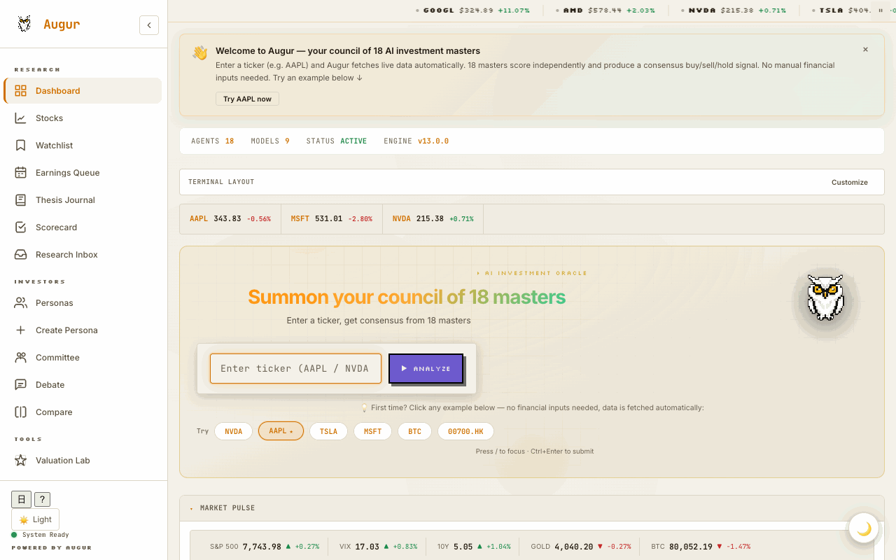

首页：行情和大师概览。侧边栏分为 研究 / 大师 / 工具 / 系统 四组。

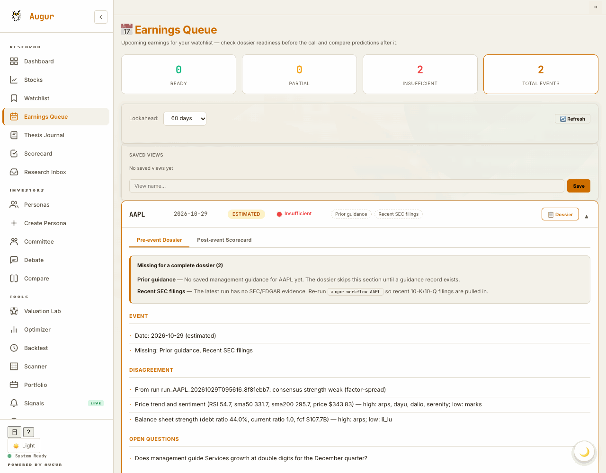

`/earnings`：财报队列，和 `augur earnings` 读同一份自选与财报日历。每只股票列出 dossier 还缺哪些项，以及补齐每一项的命令；估算出来的日期标为 `estimated`。

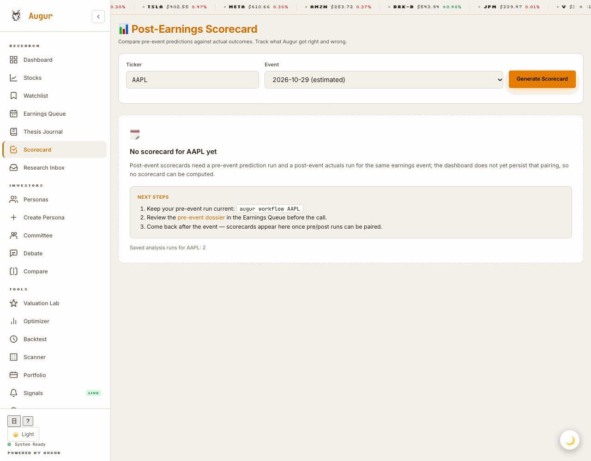

`/scorecard`：财报后记分卡，对照财报前后两次运行各回答了哪些研究问题。数据不够时显示 `unavailable` 和原因，不填假内容。截图里就是这种状态：目前 Dashboard 还没有保存"财报前 / 财报后"运行配对的地方，所以还不能生成真正的记分卡（命令行的 `augur scorecard` 可以用已回答的研究问题做对照）。

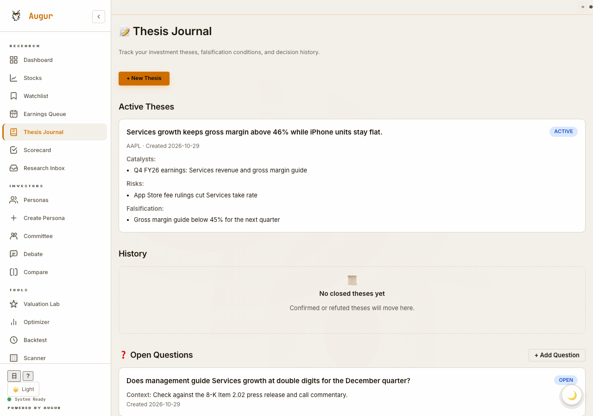

`/thesis`：记录投资论文的催化剂、风险和证伪条件，旁边是待回答的研究问题和决策日志。研究问题保存在本地，`augur dossier` 也能读到。截图里的论文和问题是拍摄时手工录入的示例，不是研究结论。

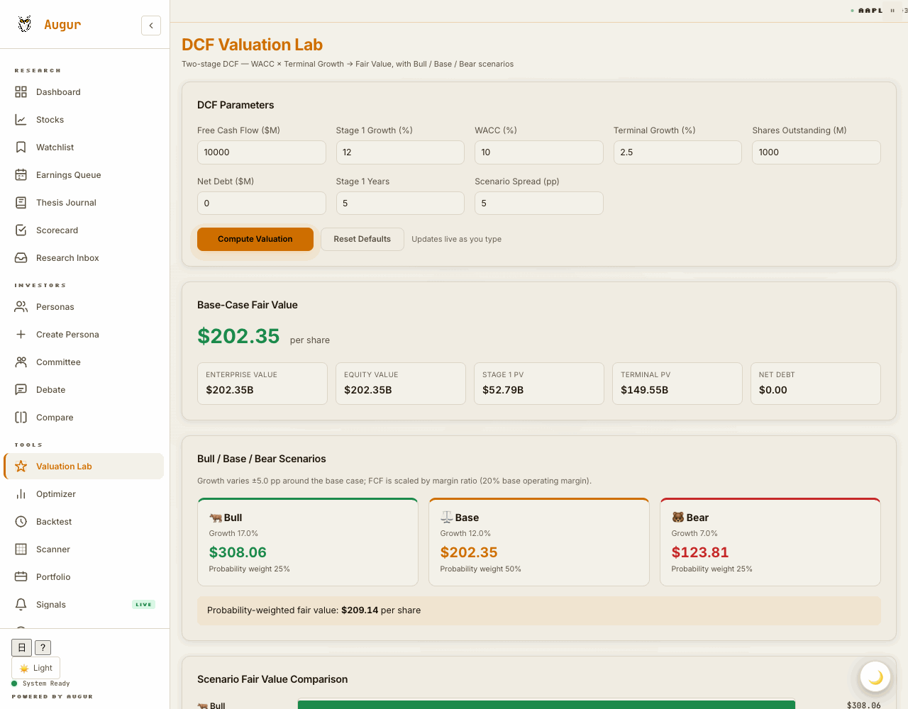

`/valuation`：两阶段 DCF，改动输入即时重算，给出牛 / 基准 / 熊三情景和概率加权公允价值，页面下方还有 WACC × 永续增长率敏感度网格。截图里的参数是示例输入，不是估值结论。

---

## 🚀 5 分钟上手

需要 Python 3.10+。

```bash
git clone https://github.com/BruceLanLan/augur.git && cd augur
python3 -m venv .venv && source .venv/bin/activate
pip install -e ".[data]"            # 核心 + yfinance 实时数据
# 可选：pip install -e ".[data,mcp]"  MCP server
#       pip install -e ".[export]"    PDF 导出

# SEC EDGAR 要求请求里带真实联系邮箱（用于美股财报数据）
export AUGUR_EDGAR_CONTACT_EMAIL="you@example.com"
```

**Dashboard：**

```bash
augur serve --open                 # http://localhost:8000 · ⌘K 命令面板
```

**命令行研究闭环**（以下命令均在全新安装上实测通过）：

```bash
augur analyze AAPL                 # 18 位大师同时分析 + 加权共识 + Kelly 仓位
augur workflow AAPL                # 带追踪的流水线，保存 RunBundle，末尾打印 Run ID
augur report from-run AAPL         # 基于最近一次运行：共识、分歧图、来源信息
augur export AAPL --format md      # 导出最近一次运行（md / json / evidence-pack / pdf）
augur committee AAPL --preset value -q "护城河是在变宽还是变窄？"
augur valuation AAPL               # 两阶段 DCF，自动取 FCF/股本/净负债并注明来源
augur skill run earnings-prep AAPL # 内置研究 Skill：财报前 dossier（另有 filing-delta 等 3 个）
augur watchlist add AAPL           # 加入自选
augur earnings --backfill          # 从 SEC 8-K 回填自选股的财报日期（需联网）
augur cycle                        # 自选股的财报周期一览：谁准备好了、缺什么、下一步做什么
```

没有网络？`augur analyze NVDA --pe 60 --roe 0.45` 可以手动传指标；`augur backtest AAPL --demo` 使用离线合成数据。`augur cycle` 只读本地状态，不联网。

---

## 🔄 从 v12 升级到 v13

v13 是一次清理加一个新功能。不兼容的地方只有下面三项，都在 import 层面，命令行用法不变。

| 变化 | 如何处理 |
|---|---|
| 需要 Python 3.10+（3.9 已于 2025 年 10 月停止官方支持） | 用 3.10 或更新的解释器重建虚拟环境 |
| `augur.accounting`、`augur.capital_allocation`、`augur.debate_engine`、`augur.relative_val`、`augur.portfolio_risk` 移到 `augur.experimental.<同名>` | 把 `from augur.accounting import ...` 改成 `from augur.experimental.accounting import ...`。这几个模块没有任何产品入口在用，API 可能变化 |
| 删除兼容转发模块 `augur.coordinator`、`augur.skill_spec`、`augur.mcp_entry` | 分别改为从 `augur.registry`、`augur.schemas.skill_spec`、`augur.mcp_server` 导入；`augur-mcp` 命令不受影响 |

新功能：`augur earnings --backfill` 从 SEC 8-K（Item 2.02 业绩公告）回填自选股的历史财报日期，并按最近的发布节奏估算下一次日期，标为 `estimated`，不会标成"已确认"。你手工写进日历的条目会保留。回填之后 `augur cycle` 就有事件可跑了。

<details>
<summary><strong>从 v11 升级到 v12</strong></summary>

12.0 修正确性，12.1 加了一条命令跑完财报周期（`augur cycle`），12.2 把命令分了组并整理了 Dashboard。v12 不加新大师、不加新页面，修的是两条闭环的衔接处：**财报研究周期**和**从历史预测中学习**。v11 里单个命令都能跑，但连起来是断的。

| 变化 | 影响 | 如何处理 |
|---|---|---|
| 学习权重文件升级为 schema 2 | 第一次加载时，v11 记下的结算结果和由它算出的准确率、权重会被作废（待结算的预测保留）。原因是 v11 把同一个"最近 30 天收益"套到了不同日期的预测上，这些结果对不上各自的预测 | 无需操作。学习权重默认本来就关闭（`AUGUR_FORCE_LEARNED`），分析结果不受影响 |
| 每条预测按自己的日期结算 | 收益从预测当天收盘算到 30 天后收盘；不再因为超过 60 天而作废；全部结算结果追加写入 `<数据目录>/prediction_outcomes.jsonl`，可以复核 | — |
| 同一天重复分析只记一条预测 | 之前每分析一次就给每位大师多记一条 | — |
| `augur earnings` 不带 `-t` 时读取真实 watchlist | 之前读错字段，队列永远为空 | 用 `augur watchlist add AAPL` 加入后即可 |
| Dashboard 财报页不再显示写死的内容 | 缺数据时明确写出原因和下一步，而不是显示假的风险条目 | — |
| 研究问题保存到 `<数据目录>/thesis/questions.json` | 重启 Dashboard 后问题还在，`augur dossier` 也能读到 | — |
| 命令分组（12.2） | `watchlist-add` → `watchlist add`、`cron-run` → `cron run`、`research-report` → `report from-run`、`ledger` / `citations` / `comments` / `audit` / `decisions` / `verify-pack` → `records ...`、`ic-report` → `eval ic`、`skills` → `skill profiles`、`compat` → `skill compat` | 旧名字在下一个大版本前都能用，只会在 stderr 多打一行提示；脚本解析 stdout 不受影响 |

完整列表见 [CHANGELOG.md](CHANGELOG.md)。

</details>

<details>
<summary><strong>从 v10 升级</strong></summary>

v11.0.0 正式版没有单独发布，它的内容随 v12.0.0 一起发布。v11 是一次**可信度与研究底座**升级，以下行为变化在 v12、v13 中依然有效：

| 变化 | 影响 | 如何处理 |
|---|---|---|
| `insider_ownership` / `institutional_ownership` 从 `0` 变为 `Optional[float]` | 缺失时是 `None`，依赖它们的 11 位大师会 abstain | 自定义代码里处理 `None` |
| rolling-IC 权重默认不混入共识 | 只有校准状态为 `validated-calibrated` 才生效 | 实验时设 `AUGUR_FORCE_RIC=1` |
| 学习权重（R6）默认不混入共识 | 数据太少时会把噪声当能力 | 实验时设 `AUGUR_FORCE_LEARNED=1` |
| SEC EDGAR 市值单位修正为十亿美元 | 此前覆盖层返回美元原值，市值/FCF 收益率相关判断失真；**v11 之前基于回放生成的因子/IC 结果含该误差** | 需要时重新生成回放产物 |
| `augur serve` / `augur api` 默认只监听 `127.0.0.1` | 局域网默认不可访问 | 对外暴露前先设 `AUGUR_API_TOKEN`，再加 `--host 0.0.0.0` |
| 旧格式回放记录（无 `field_availability`）会被拒绝 | 给出明确报错，而不是静默加载 | 重新生成 |
| MCP 支持 `mcp` 1.x 与 2.x | — | — |

另外还要完成上面 v11 → v12 和 v12 → v13 的步骤（包括 Python 3.10+）。完整说明见 [docs/RELEASE_NOTES_v11.md](docs/RELEASE_NOTES_v11.md) 与 [CHANGELOG.md](CHANGELOG.md)。

</details>

---

## 🎭 18 位投资大师

> 规则化实现的投资理念画像，覆盖价值 / 成长 / 宏观 / 中国市场。中国大师输出中文。

| 流派 | 大师 |
|------|------|
| 🏦 经典价值 | Warren Buffett · Benjamin Graham · Charlie Munger · Philip Fisher |
| 🚀 成长创新 | Peter Lynch · Cathie Wood · Peter Thiel · Leopold Aschenbrenner |
| 🌍 宏观周期 | Ray Dalio · George Soros · Howard Marks · ARPS（加密/黄金） |
| 🇨🇳 中国价值 | 段永平 · 张磊 · 李录 · 但斌 · 大宇 |
| ⚙️ 特殊策略 | Serenity（AI 算力供应链） |

共识引擎按置信度、数据覆盖度和行业相关性加权，给出信号、分数、置信度和 Kelly 仓位建议。`augur list-personas` 查看全部 ID。

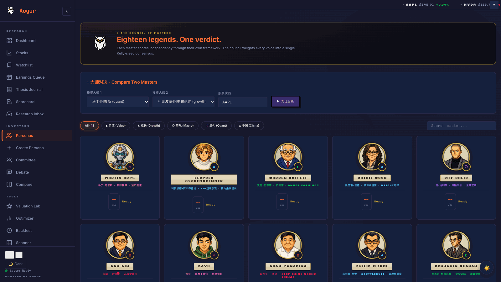

---

## 📊 Dashboard

`augur serve` 启动后访问 http://localhost:8000。

| 页面 | 路径 | 功能 |
|---|---|---|
| 首页 | `/` | 行情 + 大师概览 |
| 大师 | `/personas` | 18 位大师一览 |
| 股票分析 | `/stocks` | 输入 ticker，18 位大师同时分析 |
| 投资委员会 / 辩论 / 对比 | `/committee` · `/debate` · `/compare` | 预设委员会、多轮辩论、五维雷达图 |
| 历史 | `/history` | 运行历史与热力图 |
| Thesis Journal | `/thesis` | 投资论文、证伪条件、决策日志 |
| 财报 | `/earnings` · `/scorecard` | 财报事件队列、事后记分卡 |
| 研究收件箱 | `/inbox` | 聚合待处理事件 |
| 估值实验室 | `/valuation` | DCF 参数表单 + 敏感度网格 |
| 组合 / 自选 / 设置 | `/portfolio` · `/watchlist` · `/settings` | Kelly 配置、定时分析、布局与大师子集 |

---

## 🔌 接入 Claude / Agent

MCP server 提供 14 个工具（含 `augur_run_skill` 执行内置 Skill）、7 个研究 prompt、5 类只读资源（`augur://evidence/{id}`、`augur://runs/{id}`、`augur://thesis/{id}`、`augur://decisions/{id}`、`augur://ledger/{ticker}/{quarter}`），在 `mcp` 1.x 与 2.x 下都经过真实 stdio 会话验证。

```bash
pip install -e ".[data,mcp]"
```

Claude Desktop 配置示例：

```json
{
  "mcpServers": {
    "augur": { "command": "augur-mcp", "env": { "AUGUR_EDGAR_CONTACT_EMAIL": "you@example.com" } }
  }
}
```

另有 Hermes / OpenClaw 技能包（`src/skills/`，见 [docs/hermes-setup-guide.md](docs/hermes-setup-guide.md)）以及 Telegram / Slack / 飞书 / 微信机器人入口。

---

## 💻 CLI 速查

```bash
# 分析
augur analyze AAPL [--persona buffett] [--json]
augur workflow TSLA --steps fetch,analyze,consensus,committee,debate,sentiment
augur committee NVDA --agents buffett,munger,dalio
augur batch AAPL MSFT NVDA

# 研究产物
augur report from-run AAPL [--format json]    # 共识 + 证据化分歧图 + 来源与耗时
augur export AAPL --format md|json|evidence-pack|pdf [-o 路径] [--run-id ...]
augur records verify-pack pack.zip              # 校验证据包每个文件的 SHA-256
augur dossier AAPL                              # 财报前 dossier
augur valuation AAPL [--fcf 100e9 --shares 15e9 --growth 0.08 --wacc 0.10]
augur risk-review AAPL                          # 最近两份 10-K 的风险因素新增/删除/措辞升级
augur records ledger AAPL                       # 最近两次分析运行之间变了什么
augur thesis-delta AAPL                         # 当前有效论点 vs 最近两次运行（离线）
augur scorecard AAPL [--pre RUN --post RUN]     # 财报后记分卡：研究问题的事前回答 vs 事后结果
augur cycle [--days 30] [--format markdown]     # 观察列表跑一遍财报研究闭环：就绪度/dossier/ledger/论点变化
augur filing-delta AAPL --new q3.json --prev q2.json

# 内置研究 Skill（执行前检查权限，结果存为 RunBundle）
augur skill list · augur skill show filing-delta
augur skill run earnings-prep|filing-delta|debt-covenant-review|insider-cluster-review AAPL

# 评估（基于 augur backtest 生成的回测记录）
augur backtest AAPL --days 120 [--demo] · augur eval ic
augur eval personas AAPL [--horizon 20]         # 共识 IC、命中率、逐个剔除大师的边际贡献
augur eval factors AAPL                         # 每位大师分数作为因子的 IC、t 值、p 值

# 研究记录
augur records decisions list|resolve|report     # 决策结果与胜率
augur records comments add|list|resolve         # 对运行 / 论点 / 决策 / 证据的评论
augur records citations report|list|accept|reject|fixed # 引用纠错队列
augur records audit [--action ...]              # 审计日志

# 数据
augur fetch AAPL · augur sentiment AAPL · augur insider AAPL · augur earnings --days 30 · augur doctor
augur earnings --backfill          # 从 SEC 8-K Item 2.02 回填财报日历：历史日期 + 一个按节奏估算的下次日期（标 estimated，不覆盖手写条目）

# 监控与服务
augur watchlist add AAPL · augur watchlist show · augur watchlist watch AAPL NVDA --interval 60
augur cron run · augur cron start
augur serve [--port 8000] · augur mcp-server · augur skill profiles · augur skill compat
```

`augur --help` 列出全部 38 个顶层命令（pip 安装时隐藏 `augur update`，是 37 个）。从 v12.2 起相关命令按组归类（`watchlist` / `cron` / `report` / `records` / `eval` / `skill`）；旧的平铺名（如 `watchlist-add`、`research-report`、`ic-report`、`ledger`）在下一个大版本前仍可用，不出现在 `--help` 里，执行时会在 stderr 打印一行新写法提示。`augur report AAPL` 用法不变，等同于 `augur report run AAPL`。

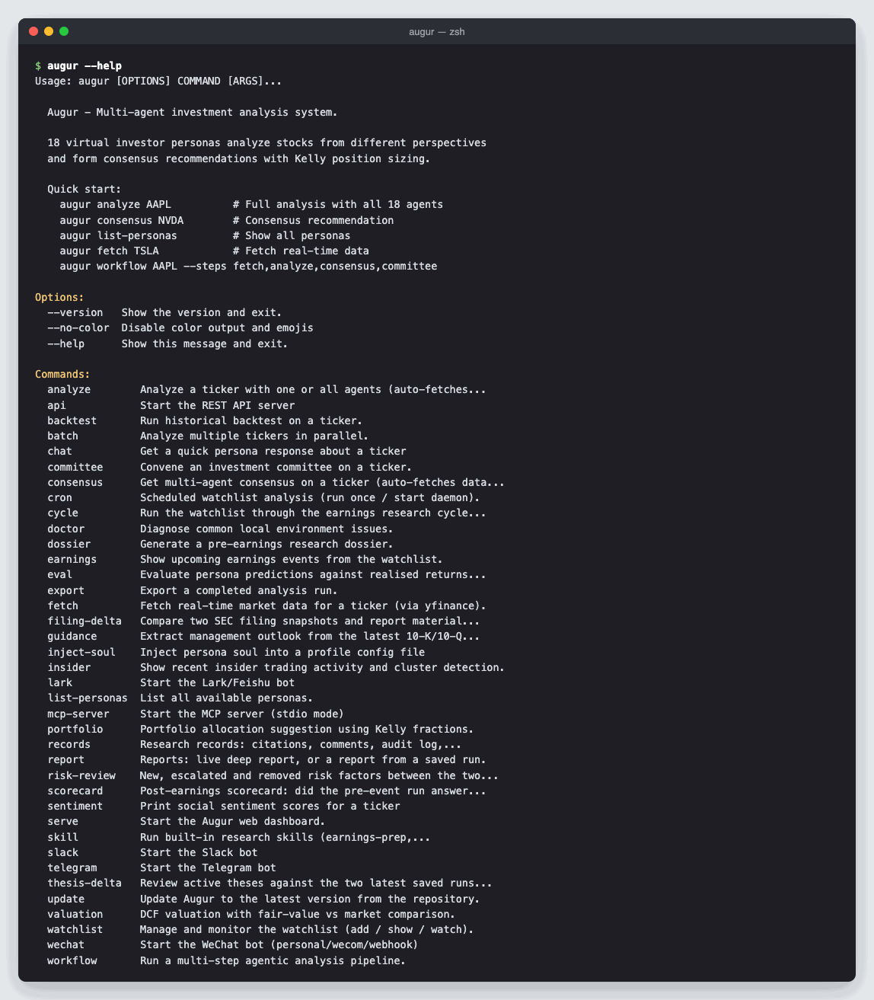

---

## 🧭 功能成熟度

如实标注，避免把"有代码"当成"能用"。

| 状态 | 范围 |
|---|---|
| **稳定** | 18 位大师分析与共识、CLI 研究闭环（上面实测过的命令）、Dashboard 主要页面、MCP server、RunBundle 与导出、数据源链（yfinance → SEC EDGAR 覆盖） |
| **可用，有明确边界** | 4 个内置 Skill（只运行内置清单；债务约束默认用参考阈值而非信贷协议条款；财报日期来自本地日历文件 `earnings_calendar.json`，可以手写，也可以用 `augur earnings --backfill` 从 SEC 8-K 回填，推算的下次日期标为 `estimated`）；分歧图（按大师的分维度评分推导并引用证据，维度到指标的映射是固定表）；`augur risk-review`（规则匹配，措辞小改可能同时显示为"新增"和"删除"）；`augur eval`（单只股票的时间序列 IC，远期收益重叠，显著性偏乐观，只作筛查）；`augur guidance`（需 `AUGUR_EDGAR_GUIDANCE_EXTRACTION=1`，会调用付费 LLM）；PDF 导出（需 `[export]`） |
| **实验（默认关闭）** | rolling-IC 动态权重（`AUGUR_FORCE_RIC=1`）、学习权重（`AUGUR_FORCE_LEARNED=1`）——都还没有通过预注册的样本外验证 |
| **只有代码、没有入口** | `augur.experimental.accounting`（会计质量）、`augur.experimental.capital_allocation`（资本配置）、`augur.experimental.debate_engine`（辩论引擎；Dashboard 的 `/debate` 用的是另一套实现）、`augur.experimental.relative_val`（相对估值）、`augur.experimental.portfolio_risk`（组合风险）——有单元测试，但 CLI、Dashboard 和 MCP 都没有调用它们，可以当库用，不算产品功能 |
| **尚未计量** | 运行记录中的 token 用量（目前只记录耗时） |

---

## 🔒 数据与隐私

- 所有状态保存在本地数据目录（默认 `~/.augur`，`AUGUR_DATA_DIR` 可改）。没有遥测；默认单用户、无需注册（可选开启多用户模式 `AUGUR_MULTI_USER=1`）。
- 会发出的网络请求：行情与基本面（yfinance、SEC EDGAR）；可选的 LLM 调用（仅在你配置 API key 并启用相关功能时）；Dashboard 页面从 jsDelivr CDN 加载 Chart.js。
- Dashboard 默认只监听本机。需要对外暴露时先设 `AUGUR_API_TOKEN`，详见 [docs/self-hosted-guide.md](docs/self-hosted-guide.md)。

主要环境变量：

| 变量 | 作用 |
|---|---|
| `AUGUR_DATA_DIR` | 数据目录 |
| `AUGUR_EDGAR_CONTACT_EMAIL` | SEC EDGAR 要求的联系邮箱（未设置会使用占位值并告警） |
| `AUGUR_API_TOKEN` / `AUGUR_MULTI_USER` | Dashboard `/api/*` 鉴权 |
| `AUGUR_CORS_ORIGINS` | 允许的跨域来源 |
| `AUGUR_FORCE_RIC` / `AUGUR_FORCE_LEARNED` | 打开实验性动态权重 |
| `AUGUR_SKIP_MACRO_FETCH` | 跳过 VIX/SPY 宏观数据拉取（离线或 CI） |
| `AUGUR_EDGAR_GUIDANCE_EXTRACTION` | 启用基于 LLM 的 guidance 抽取（付费） |

---

## 🔧 开发

```bash
python3 -m venv .venv && source .venv/bin/activate
pip install -e ".[dev,data,mcp]" "ruff>=0.16,<0.17" build

make verify     # 一条命令：全量测试 + ruff + 构建 wheel/sdist 并输出 sha256
make lint       # ruff（规则集固定为 E4/E7/E9/F）
make test-wheel # 在全新虚拟环境里安装构建产物并做冒烟检查
```

- 测试使用独立的临时 `AUGUR_DATA_DIR`，不会写入你的 `~/.augur`；在完全断网的环境下也能全部通过。
- CI（`.github/workflows/`）：`Tests` 在 Python 3.10 / 3.11 / 3.12 上跑全量测试并断言收集数；`Hermetic Smoke` 从 wheel 和 sdist 分别全新安装并跑 ruff 与 pip-audit。
- 贡献方式见 [CONTRIBUTING.md](CONTRIBUTING.md)。

---

## 📚 文档与路线图

| 文档 | 内容 |
|---|---|
| [docs/ROADMAP.md](docs/ROADMAP.md) | 唯一权威路线图：当前阶段、每一步的验证点、v13 之后的候选与待决事项 |
| [docs/RELEASE_NOTES_v11.md](docs/RELEASE_NOTES_v11.md) | v11 发布说明与迁移指南（v12、v13 的变化见 [CHANGELOG.md](CHANGELOG.md)） |
| [docs/reviews/](docs/reviews/) | 项目评审记录（含每条问题的证据等级与修复） |
| [docs/schema-reference.md](docs/schema-reference.md) | EvidenceItem / Claim / StepResult / RunBundle / SkillSpec |
| [docs/api-reference-v11.md](docs/api-reference-v11.md) | Python API / REST / MCP |
| [docs/examples.md](docs/examples.md) | 实战示例 |
| [docs/self-hosted-guide.md](docs/self-hosted-guide.md) | Docker / systemd / 反向代理 / 鉴权 |
| [docs/INDEX.md](docs/INDEX.md) | 全部文档索引 |

---

## 📝 更新日志

<details open>
<summary><strong>v13.0.0 — SEC 财报日期回填、Python 3.10、精简公开 API (current)</strong></summary>

- **财报日期回填**：`augur earnings --backfill` 从 SEC 8-K（Item 2.02）补齐历史财报日期，并按发布节奏估算下一次（标为 estimated）；`augur cycle` 不再依赖手工日历
- **不兼容变化**：需要 Python 3.10+；5 个没有产品入口的模块移到 `augur.experimental`；删除 3 个兼容转发模块。迁移方法见上方"从 v12 升级到 v13"

</details>

<details>
<summary><strong>v12.2.0 — 命令分组与 Dashboard 整理</strong></summary>

- **命令分组**：`watchlist` / `cron` / `report` / `records` / `eval` / `skill` 六个分组，`augur --help` 从 47 项减到 38 项；旧命令名保留，会提示新写法
- **Dashboard**：侧边栏按 研究 / 大师 / 工具 / 系统 分组，补上财报队列、投资论文、记分卡、研究收件箱四个入口；财报页把缺失项写成人话并给出补齐命令；记分卡页的事件下拉不再卡在 Loading；Thesis Journal 的空状态、报错和手机布局都重新整理
- **学习数据**：Dashboard 和定时任务同时写学习文件时不再互相覆盖

</details>

<details>
<summary><strong>v12.1.0 — 一条命令跑完财报周期</strong></summary>

- `augur cycle`：自选股里即将发财报的每只票，依次给出就绪状态、dossier、两次运行之间的变化、投资论文变化，最后汇总 `ready X/Y` 和每只票的下一步
- `augur scorecard`：财报前后两次运行各回答了哪些研究问题
- `augur thesis-delta`：投资论文和最近两次运行对照

</details>

<details>
<summary><strong>v12.0.0 — 财报闭环与诚实的学习结算</strong></summary>

- **学习结算修正**：每条大师预测按自己的日期结算 30 天收益（v11 把同一个"最近 30 天收益"套到不同日期的预测上）；不再过期丢弃、按日历日判断、全部结果追加写入 `prediction_outcomes.jsonl` 可复核；同日重复分析只记一条。v11 记录的结算结果在首次加载时作废，待结算预测保留
- **财报闭环接线**：财报队列读取真实 watchlist、dossier 就绪判断改用真实运行记录、Dashboard 不再显示写死的财报内容
- **研究记录**：研究问题落盘、同一秒多次运行的排序修正、运行记录写入真实版本号
- **首次发布 2026-09-17 的三轮工作**（v11.0.0 正式版没有单独发布）：内置 Skill 执行器（`augur skill run`，执行前检查权限）、分歧图改为按大师分维度评分推导并引用证据、`augur eval` 基于回测记录评估大师、`augur risk-review` 对比两份 10-K 的风险因素、`augur ledger` 对比两次运行、研究记录命令（决策结果 / 评论 / 引用纠错 / 审计日志）、证据包摘要校验；以及从全新安装实测发现的修复：`workflow` 断点保存崩溃、证据时间戳时区错误、`export` / `research-report` / `dossier` 接上真实运行记录、`committee` 命令崩溃、SEC EDGAR 市值单位错 10⁹ 倍、估值命令编造输入、服务默认暴露到局域网、wheel 安装下头像 404、MCP 支持 `mcp` 2.x、CI 假绿修复
- 详见 [CHANGELOG](CHANGELOG.md) 与 [ROADMAP 2026-10 阶段](docs/ROADMAP.md)

</details>

<details>
<summary><strong>v11.0.0-rc1 — Research Memory System</strong></summary>

- **研究底座**：EvidenceItem 三类时间语义、Claim、StepResult、不可变 RunBundle、声明式 SkillSpec v1
- **研究闭环**：Thesis Journal、Filing Delta、分歧图、Guidance Tracker、研究收件箱、DCF 估值实验室
- **可信度**：缺失数据显式传播、校准状态标注、未验证的动态权重默认关闭

详见 [CHANGELOG.md](CHANGELOG.md)。
</details>

<details>
<summary><strong>v10.15.0 — 公开同步发布</strong></summary>

SEC EDGAR 真实基本面、三处可信度修复、`augur doctor` 环境诊断。
</details>

<details>
<summary><strong>v10.0.0 及更早</strong></summary>

v10：Bloomberg 风格终端 + 工作流 + MCP 工具 · v9：Hermes Agent + 委员会体系 · v8：HD-2D 设计系统
</details>

---

<div align="center">

MIT License · 作者 [BruceLanLan](https://github.com/BruceLanLan)（X：[@BruceBlue](https://x.com/BruceBlue)）

*仅供学习研究，不构成投资建议*

</div>
