[🇨🇳 中文](README.md) | 🇺🇸 English | [🇯🇵 日本語](README_JA.md)

<div align="center">

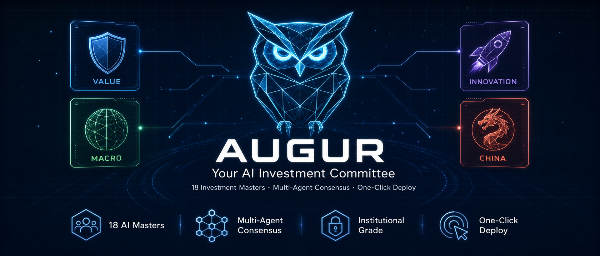

# 🦉 Augur

**Not another AI stock picker. A local research memory system that remembers what you knew, when you knew it, what changed, and who disagrees — and why.**

[](CHANGELOG.md)
[](https://github.com/BruceLanLan/augur/actions/workflows/tests.yml)
[](#-18-investment-masters)
[](#-claude--agent-integration)
[](#-data--privacy)
[](LICENSE)

</div>

> ⚠️ **For research and education only. Not investment advice.** The masters are rule-based simulations of publicly known investment philosophies, not the views of those people. Every score, Kelly size and valuation depends on data quality and model assumptions.

**Contents**: [Why Augur](#-why-augur) · [How Augur uses LLMs](#-how-augur-uses-llms) · [What's new in v14](#-whats-new-in-v14) · [Research walkthrough](#-research-walkthrough) · [Quick Start](#-quick-start-5-minutes) · [Upgrading to v14 (and older upgrades)](#-upgrading-from-v13-to-v14) · [18 Masters](#-18-investment-masters) · [Dashboard](#-dashboard) · [Claude / Agent](#-claude--agent-integration) · [CLI](#-cli-cheat-sheet) · [Feature Maturity](#-feature-maturity) · [Data & Privacy](#-data--privacy) · [Development](#-development) · [Docs & Roadmap](#-docs--roadmap)

---

## 🤔 Why Augur

Most AI stock pickers ask a large language model for an answer. Augur's analysis does not call an LLM: the 18 masters are deterministic rules written from each investor's public philosophy, and what you get is **research artifacts you can check later**.

| | LLM stock picker | Augur |
|---|---|---|
| How the verdict is made | Generated by an LLM; the same question can get a different answer | Rule-based scoring; the same inputs give the same scores, so it can be backtested |
| What you get | "On one hand… on the other…" | 18 independent master verdicts, where they agree and where they fight |
| Where data came from | Unclear | Every evidence item carries its source, business time, availability time and retrieval time |
| Missing data | Silently zero | Marked `missing`; masters that need the field `abstain` and say why |
| Three months later | No memory | Each run is an immutable RunBundle you can export, compare and audit |
| Where your data lives | Someone's cloud | Locally in `~/.augur` (override with `AUGUR_DATA_DIR`), no telemetry |

---

## 🧠 How Augur uses LLMs

In one line: **scoring never uses an LLM; interpretation can be handed to one.** There are three modes:

| Mode | Who does the thinking | API key? | How |
|---|---|---|---|
| Default: deterministic rules | The 18 masters' rules (`src/augur/personas/`) and the consensus engine | No | `augur analyze` / `consensus` / `workflow` / dashboard; works offline with manual metrics |
| MCP / skills: the host agent is the LLM | The agent you already use (Claude Code, Claude Desktop, Hermes, ...) calls Augur's tools for scores and evidence and interprets them with its own model | Handled by the host; Augur needs none | `claude mcp add augur -- augur-mcp`, or add `augur-mcp` to Claude Desktop (see [Claude / Agent Integration](#-claude--agent-integration)) |
| Optional: bring-your-own-key persona chat | The OpenAI-compatible endpoint you configure | `OPENAI_API_KEY` | `pip install -e ".[llm]"`, set `OPENAI_API_KEY`, optionally `OPENAI_BASE_URL` (any OpenAI-compatible service) and `AUGUR_CHAT_MODEL` (default `gpt-4o`); used by `augur chat` and the dashboard `/chat`. Without a key, chat falls back to template replies |

One more paid feature is off by default: with `AUGUR_EDGAR_GUIDANCE_EXTRACTION=1`, `augur guidance` uses the same OpenAI-compatible endpoint to extract management outlook from 10-K/10-Q filings. The MCP tool `augur_configure` is deprecated in v14: Augur's scoring never called a model and nothing read the setting it wrote, so it now only returns a note.

---

## ✨ What's new in v14

### 1. ETF-native analysis

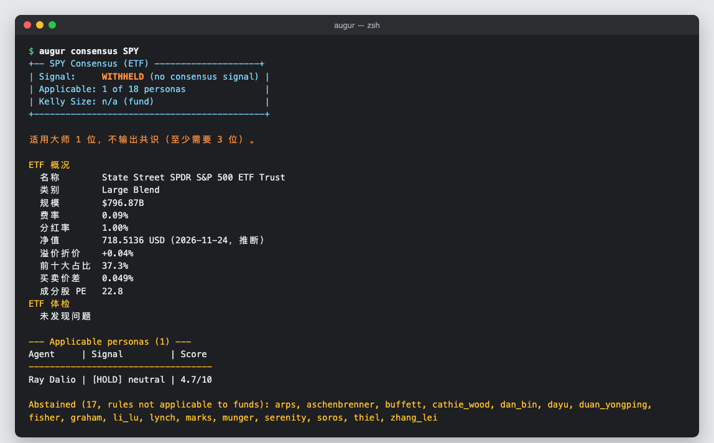

`augur consensus SPY`: Augur recognises ETFs (yfinance `quoteType`; A-shares by code prefix, `.SS` 51/56/58 and `.SZ` 15) and no longer scores a fund as if it were a company. Masters whose rules are built on company financials **abstain** on a fund and say why; in v14.0 only Dalio applies (decided by a test that changes company fields on an ETF and checks whose score moves). With fewer than 3 applicable masters there is **no consensus** (WITHHELD), no Kelly size, and nothing is written to the learning records. Below that are the ETF overview and health checklist: AUM in USD, expense ratio, yield, NAV and NAV date, premium/discount aligned to the NAV date, top-10 weight, bid/ask spread and look-through P/E. The screenshot is live data from 2026-11-26. US and HK ETF NAVs come without a date, so the date is inferred as the session before the latest bar and marked as inferred. The CLI labels of the ETF block are Chinese only for now.

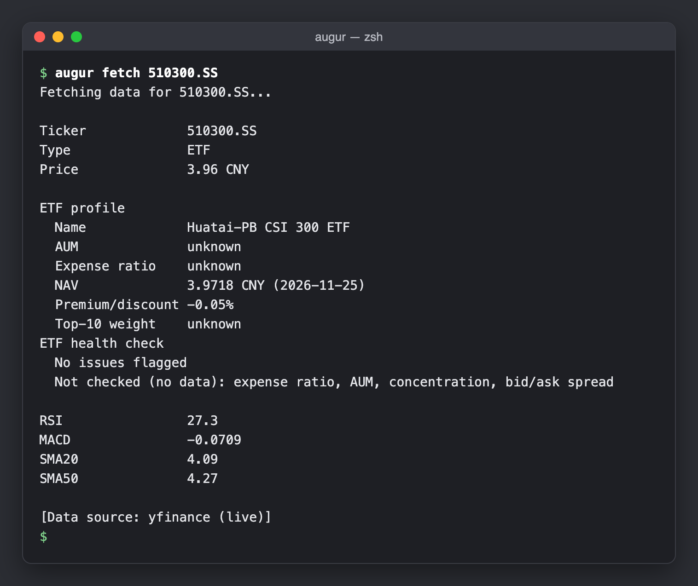

`augur fetch 510300.SS`: for A-share ETFs the unit NAV and its **real NAV date** come from Sina's public quote endpoint (yfinance has no NAV for mainland funds). yfinance gives no AUM, expense ratio or holdings for these funds, so the checklist lists those items as not checked instead of guessing.

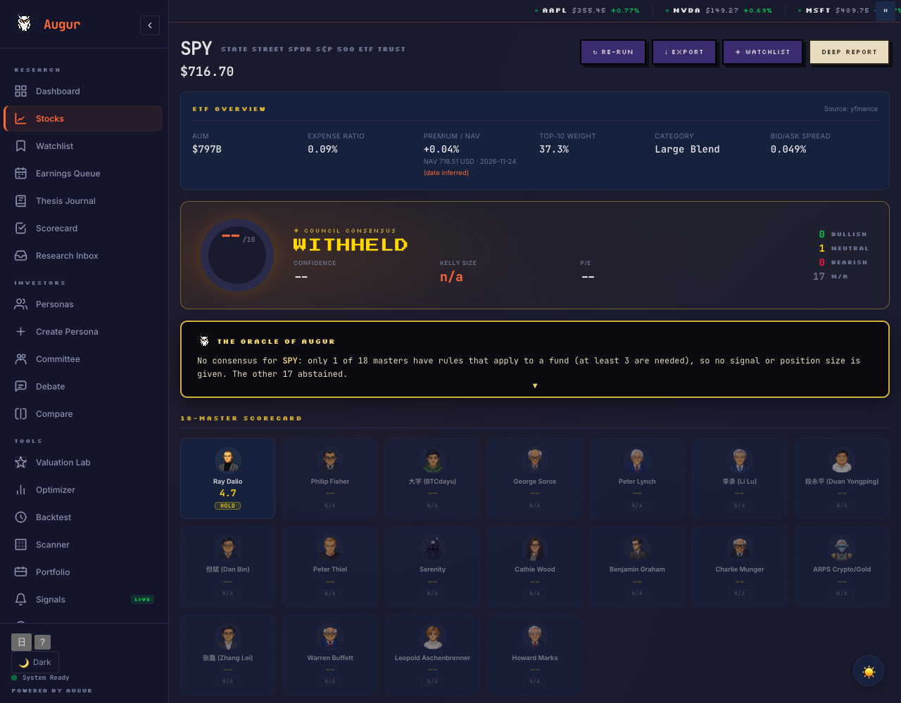

Dashboard `/stocks?ticker=SPY`: the stock page has an ETF Overview card, and the consensus card shows WITHHELD with no position size.

### 2. Correctness fixes

- **RSI now uses Wilder smoothing** (it was Cutler's RSI over the last 14 changes). Masters that read RSI (arps, dalio, marks, munger, soros, serenity, dayu and the custom `da-yu.yaml`) score differently.
- **Non-USD instruments are measured in USD**: market cap, FCF and other amounts are converted at the FX rate. Tencent (0700.HK) used to read as a $3,097.6B company; it now reads as about $397.5B.
- **Dayu's volatility rule** had a unit bug and never fired; **Thiel** and the sector weighting count Communication Services (GOOGL, META, Tencent) as tech; a neutral consensus sizes the position at 0.
- `--json` stdout is pure JSON; the dashboard fear/greed gauge is recalibrated (VIX 28 reads as Fear); the backtest page no longer derives drawdown and Sharpe from the hit rate. Full list in the [CHANGELOG](CHANGELOG.md).

### 3. A clear account of the LLM's role

See "[How Augur uses LLMs](#-how-augur-uses-llms)" above. The `[llm]` extra no longer installs the unused `anthropic` package.

---

## 📖 Research walkthrough

This section follows the order a new user actually works in: add tickers to the watchlist → backfill earnings dates → run the earnings cycle → read the research artifacts → open the dashboard. The screenshots in this section were taken on 2026-10-29 with real AAPL / MSFT / NVDA data (live market data + SEC EDGAR). Earnings dates estimated from the reporting cadence are labelled `estimated` in both the CLI output and the dashboard; they are not dates the companies announced. Terminal shots show the main part of the output.

### 1. Build a watchlist: `augur watchlist add`

```bash
augur watchlist add AAPL
augur watchlist add MSFT
augur watchlist add NVDA
```

The watchlist is the input to the earnings cycle: `augur earnings`, `augur cycle` and the dashboard Earnings Queue all read their tickers from it.

### 2. Backfill earnings dates: `augur earnings --backfill`

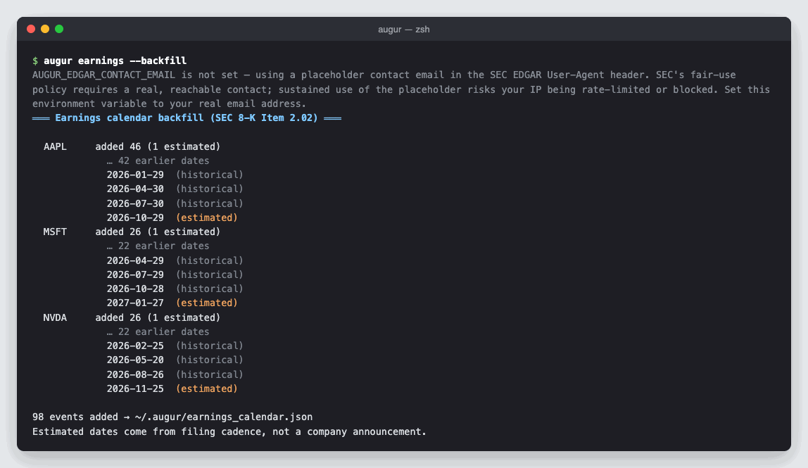

Reads each watchlist ticker's SEC 8-K filings with Item 2.02 (results of operations) to fill past earnings dates, then estimates the next date from the recent reporting cadence and marks it `estimated`, never confirmed. Entries you wrote in `<data dir>/earnings_calendar.json` are never overwritten. It needs network access and `AUGUR_EDGAR_CONTACT_EMAIL`; pass `-t AAPL` to backfill specific tickers only. The screenshot keeps only the latest few dates per ticker and folds the earlier ones into one line; each of the three tickers has one `estimated` date.

### 3. The earnings cycle in one command: `augur cycle`

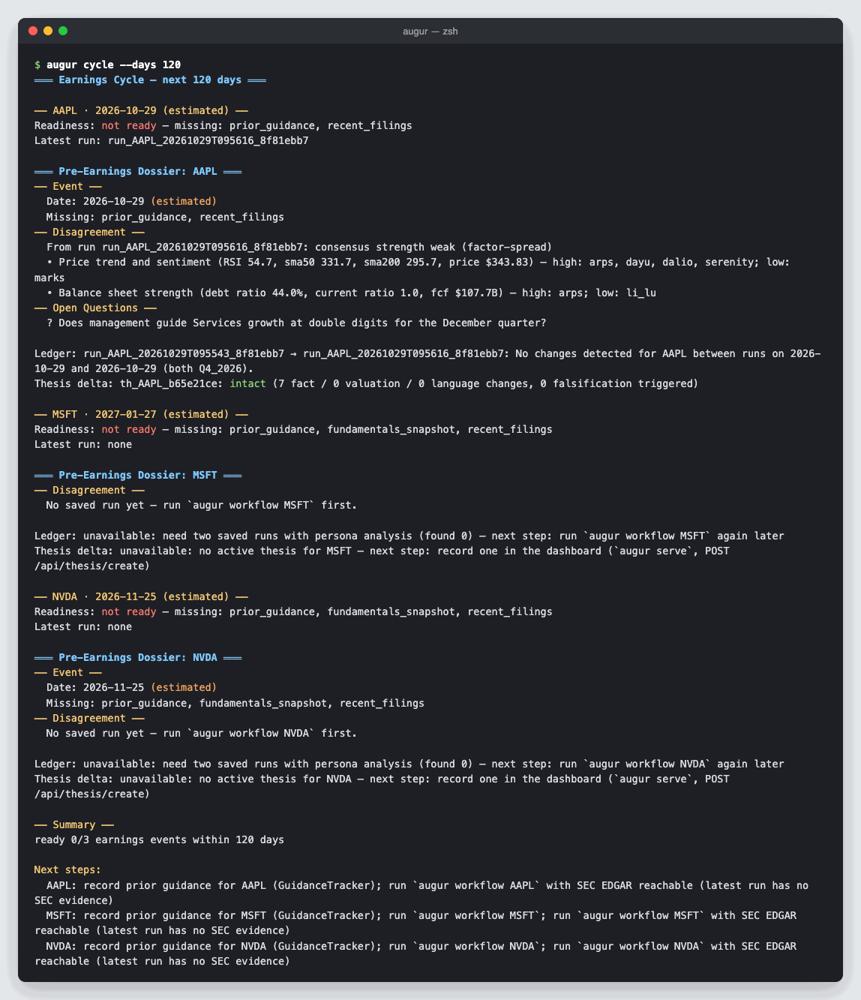

For every watchlist ticker reporting in the next N days (30 by default), it shows dossier readiness, the dossier, what changed between the two latest runs and the thesis delta, then ends with `ready X/Y` and a next step per ticker. It reads saved local state only and never goes to the network; anything missing is named together with the command that fills it. The screenshot uses `--days 120` so that all three estimated dates fall inside the window. None of the three was ready at the time (no prior guidance record and no SEC evidence; MSFT and NVDA had no saved run yet), so the summary reads `ready 0/3`, followed by a next step per ticker.

### 4. Research artifacts: dossier, research report and built-in skills

`augur dossier AAPL` builds the pre-earnings dossier, `augur report from-run AAPL` builds a research report from the latest run, and `augur skill run` runs a whole research workflow in one command.

The screenshots below are real AAPL runs from 2026-09-17. The output of these commands has not changed since, so the original images are kept.

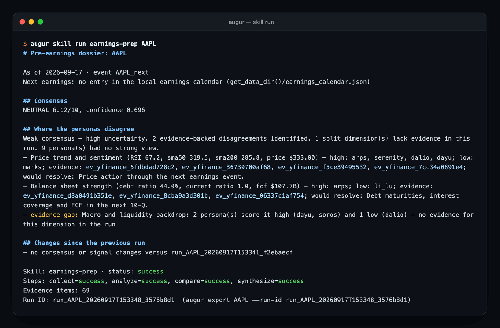

`augur skill run earnings-prep AAPL`: the 18-master consensus, **disagreements that cite evidence IDs one by one**, splits with no supporting evidence flagged as an "evidence gap", and a diff against the previous run. The next earnings date comes from the local earnings calendar (which the `--backfill` step above can fill) and is shown as `confirmed` or `estimated`; if the calendar has no entry, it says so instead of guessing. Before any step starts, the runner checks that every capability, network domain and local resource the workflow touches is declared in the manifest; if anything fails, nothing runs. Each run is saved as a RunBundle you can export and audit.


`augur skill run filing-delta AAPL`: pulls XBRL data for the two latest 10-Ks and lists material changes (≥5%), no accession numbers needed. Also built in: `debt-covenant-review` (leverage and interest coverage) and `insider-cluster-review` (Form 4 insider clusters). See the [Skill guide](docs/skills-guide.md) (Chinese).

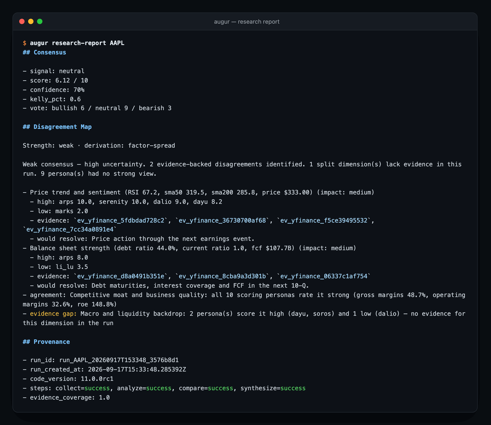

`augur report from-run AAPL` (the screenshot predates the rename from `augur research-report`; the output is the same): the vote split, the dimensions the masters disagree on (each citing evidence IDs and saying what fact would settle it), where they agree, splits with no evidence, and the run ID, code version, step status and evidence coverage.


`augur risk-review AAPL`: compares the risk factor sections of the two latest 10-Ks and lists new, removed and escalated risks. It is rule-based, so a small wording change can show up as both "new" and "removed".

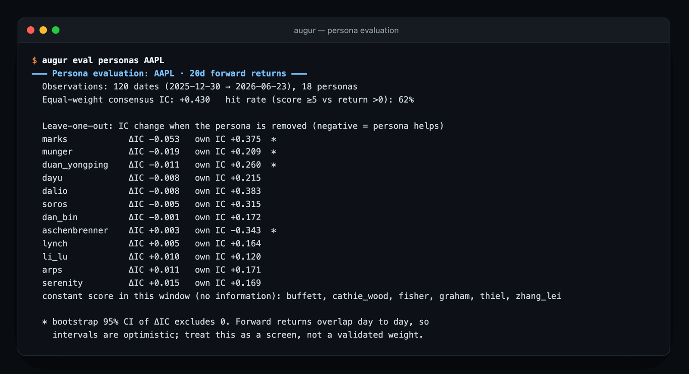

`augur eval personas AAPL`: using the records written by `augur backtest`, it removes one master at a time and shows whether the consensus IC gets better or worse; masters with a constant score (no information) are listed separately. Forward returns overlap day to day, so intervals are optimistic: treat it as a screen, not a validated weight. `augur eval factors` treats each master's score as a factor and gives its IC and t-test.

### 5. Dashboard

`augur serve --open` opens http://localhost:8000. These screenshots were also taken on 2026-10-29 with real AAPL / MSFT / NVDA data.

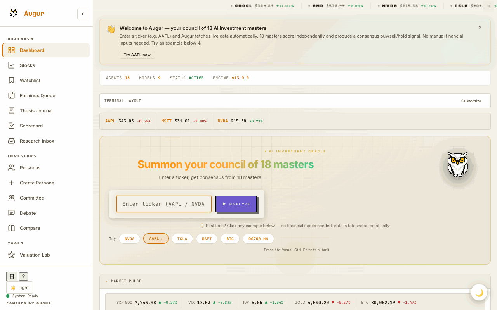

Home: market tape and masters overview. The sidebar is grouped into Research / Investors / Tools / System.

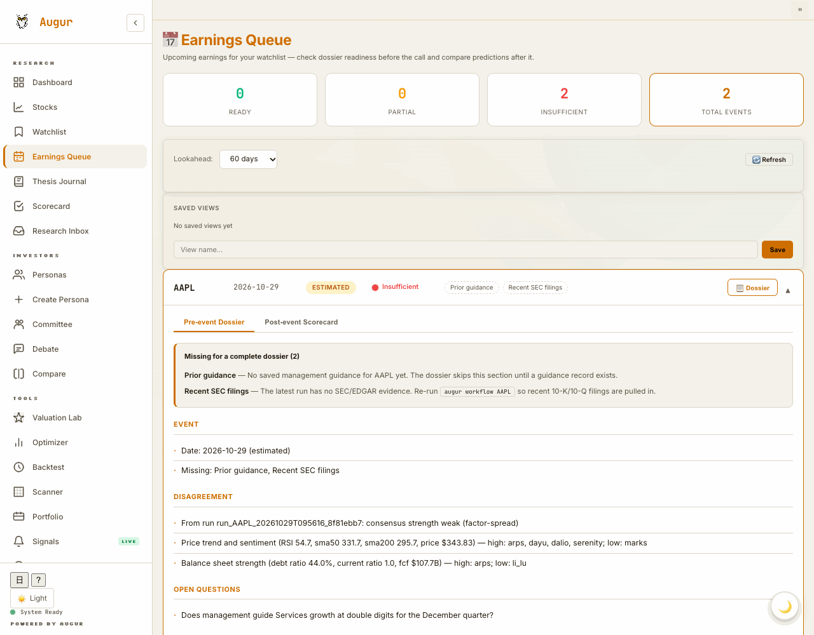

`/earnings`: the Earnings Queue reads the same watchlist and earnings calendar as `augur earnings`. Each ticker lists the dossier items that are still missing and the command that fills each one; estimated dates are labelled `estimated`.

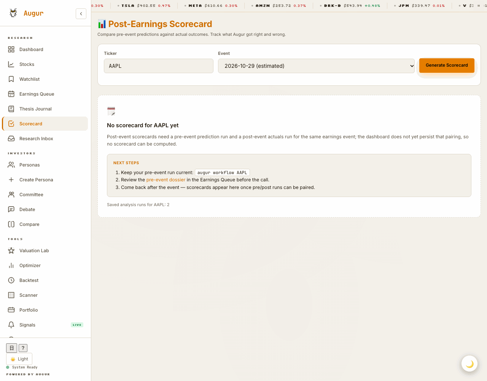

`/scorecard`: the post-earnings scorecard checks which research questions the pre- and post-event runs answered. Without enough data it shows `unavailable` with the reason instead of placeholder content. The screenshot shows exactly that state: the dashboard does not yet keep a pre-event/post-event run pairing, so it cannot build a real scorecard (the CLI `augur scorecard` can compare against answered research questions).


`/thesis`: record a thesis with catalysts, risks and falsification conditions, next to open research questions and a decision log. Research questions are stored locally and also appear in `augur dossier`. The thesis and question in the screenshot were entered by hand while taking it; they are examples, not research conclusions.

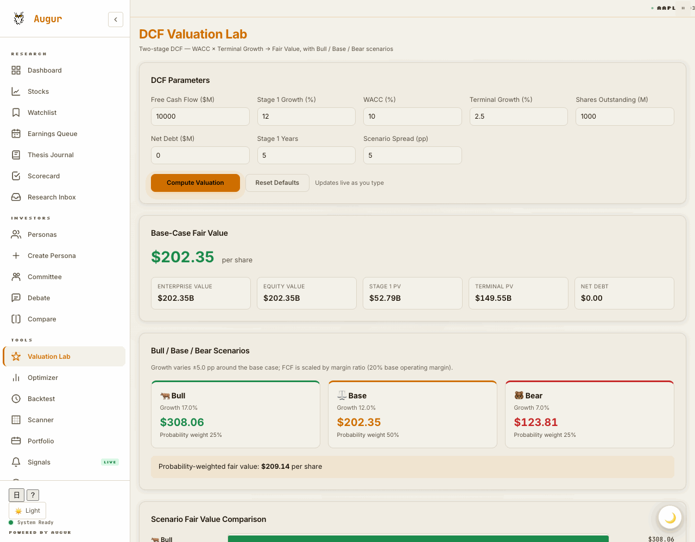

`/valuation`: a two-stage DCF that recomputes as you type, with bull / base / bear scenarios and a probability-weighted fair value, plus a WACC × terminal-growth sensitivity grid further down the page. The inputs in the screenshot are examples, not a valuation call.

---

## 🚀 Quick Start (5 minutes)

Python 3.10+.

```bash
git clone https://github.com/BruceLanLan/augur.git && cd augur
python3 -m venv .venv && source .venv/bin/activate
pip install -e ".[data]"            # core + live yfinance data
# optional: pip install -e ".[data,mcp]"  MCP server
#           pip install -e ".[export]"    PDF export

# SEC EDGAR requires a real contact address in requests (US fundamentals)
export AUGUR_EDGAR_CONTACT_EMAIL="you@example.com"
```

**Dashboard:**

```bash
augur serve --open                 # http://localhost:8000 · ⌘K command palette
```

**CLI research loop** (every command below was verified on a fresh install):

```bash
augur analyze AAPL                 # 18 masters + weighted consensus + Kelly size
augur fetch SPY                    # ETF: overview (AUM, expense ratio, NAV, premium/discount) + health checklist
augur consensus SPY                # ETF: applicable vs abstaining masters; no consensus below 3 applicable
augur workflow AAPL                # tracked pipeline, saves a RunBundle, prints the Run ID
augur report from-run AAPL         # from the latest run: consensus, disagreement map, provenance
augur export AAPL --format md      # export the latest run (md / json / evidence-pack / pdf)
augur committee AAPL --preset value -q "Is the moat widening or narrowing?"
augur valuation AAPL               # two-stage DCF, auto-fills FCF/shares/net debt and says so
augur skill run earnings-prep AAPL # built-in research skill: pre-earnings dossier (3 more skills)
augur watchlist add AAPL           # add to the watchlist
augur earnings --backfill          # backfill the watchlist's earnings dates from SEC 8-K (needs network)
augur cycle                        # earnings cycle for the watchlist: what is ready, what is missing, next step
```

Offline? `augur analyze NVDA --pe 60 --roe 0.45` takes manual metrics; `augur backtest AAPL --demo` uses synthetic data. `augur cycle` reads local state only and never goes to the network.

---

## 🔄 Upgrading from v13 to v14

v14 does not change how commands are used, but some scores and outputs change:

| Change | Effect | What to do |
|---|---|---|
| RSI uses Wilder smoothing | Scores of arps, dalio, marks, munger, soros, serenity, dayu and the custom `da-yu.yaml` change, most visibly for tickers with RSI near 30 / 70 | Nothing; keep it in mind if you compare against saved v13 scores |
| Dayu's volatility rule now fires | It compared an annualised fraction with percent thresholds, so every stock got the low-volatility bonus. Versus v13 the position-risk factor changes by: below 15% 20-day volatility 0, 15–25% −1, 25–40% −2, 40–60% −3, above 60% −4; the factor is 20% of Dayu's score | — |
| Non-USD amounts are in USD | HK and A-shares, and tickers that report in another currency (such as ADRs): `market_cap`, `fcf`, `revenue` and similar are USD billions; price stays in the trading currency. Without an FX rate nothing is converted and the output names the local currency | Check units if your code reads `MarketContext` |
| Communication Services counts as tech | Thiel and the engine's sector weighting judge GOOGL, META, Tencent and similar differently | — |
| A neutral consensus sizes the position at 0 | `analyze` used to show small sizes such as 0.6% | — |
| ETFs no longer get an 18-master consensus | You get the overview, health checklist and the applicable masters' readings; with fewer than 3 applicable (only Dalio in v14.0) the consensus is WITHHELD, with no position size and no learning record. Funds have `pe` / `pb` = 0; the look-through values are in the `etf` dict | Don't reuse earlier results that analysed an ETF as a stock |
| With `--json`, progress messages go to stderr | stdout is pure JSON | Scripts that parsed progress text from stdout should read stderr |
| The `[llm]` extra no longer installs `anthropic`; MCP `augur_configure` is deprecated | Nothing in the code used them | Install `anthropic` yourself if your own code needs it |
| Dashboard backtest API returns `null` for return, drawdown and Sharpe | They used to be derived from the hit rate, not measured | — |

The learning-data schema stays at 2 and nothing is discarded. Pending predictions recorded under the old RSI settle as usual (those calls were really made). Learning records written for ETFs before v14 stay where they are and add a little noise to the affected masters' accuracy; a clean-up tool is deferred.

<details>
<summary><strong>Upgrading from v12 to v13</strong></summary>

v13 is a cleanup plus one new feature. The only breaking changes are the three below, all at the import level; command-line usage is unchanged.

| Change | What to do |
|---|---|
| Python 3.10+ is required (3.9 reached end of life in October 2025) | Recreate your virtualenv with 3.10 or newer |
| `augur.accounting`, `augur.capital_allocation`, `augur.debate_engine`, `augur.relative_val` and `augur.portfolio_risk` moved to `augur.experimental.<same name>` | Change `from augur.accounting import ...` to `from augur.experimental.accounting import ...`. No product path uses these modules and their API may change |
| Compatibility modules `augur.coordinator`, `augur.skill_spec`, `augur.mcp_entry` removed | Import from `augur.registry`, `augur.schemas.skill_spec` and `augur.mcp_server` instead; the `augur-mcp` command is unaffected |

New: `augur earnings --backfill` fills past earnings dates for your watchlist from SEC 8-K filings (Item 2.02, results of operations) and estimates the next date from the recent cadence, marked `estimated`, never confirmed. Entries you wrote in the calendar are kept. After a backfill, `augur cycle` has events to work on.

</details>

<details>
<summary><strong>Upgrading from v11 to v12</strong></summary>

12.0 fixes correctness, 12.1 adds one command for the whole earnings cycle (`augur cycle`), and 12.2 groups the CLI and tidies the dashboard. v12 adds no masters and no pages. It fixes the joints of the two loops Augur is built around: the **earnings research cycle** and **learning from past predictions**. In v11 each command worked alone, but the chain was broken.

| Change | Effect | What to do |
|---|---|---|
| Learned-weights file moves to schema 2 | On first load, outcomes recorded by v11 and the accuracy/weights built on them are discarded (pending predictions are kept). v11 applied one "latest 30-day return" to predictions made on different days, so those outcomes did not belong to the predictions they were stored on | Nothing. Learned weights are off by default (`AUGUR_FORCE_LEARNED`), so analysis results are unaffected |
| Each prediction resolves at its own horizon | Return from the close on the prediction day to the close 30 days later; nothing expires after 60 days; every outcome is appended to `<data dir>/prediction_outcomes.jsonl` for audit | — |
| One prediction per master per day | Re-analysing a ticker used to add another prediction each time | — |
| `augur earnings` without `-t` reads the real watchlist | It read the wrong key and the queue was always empty | Add tickers with `augur watchlist add AAPL` |
| Dashboard earnings pages show no hard-coded content | Missing data is shown with the reason and next step instead of placeholder risks | — |
| Research questions are saved to `<data dir>/thesis/questions.json` | They survive a dashboard restart and appear in `augur dossier` | — |
| Grouped commands (12.2) | `watchlist-add` → `watchlist add`, `cron-run` → `cron run`, `research-report` → `report from-run`, `ledger` / `citations` / `comments` / `audit` / `decisions` / `verify-pack` → `records ...`, `ic-report` → `eval ic`, `skills` → `skill profiles`, `compat` → `skill compat` | Old names keep working until the next major release and only add one note line on stderr; scripts that parse stdout are unaffected |

Full list in [CHANGELOG.md](CHANGELOG.md).

</details>

<details>
<summary><strong>Upgrading from v10</strong></summary>

v11.0.0 was never released on its own; its contents shipped with v12.0.0. v11 is a **trust and research-foundation** release, and these behaviour changes still apply in v12 through v14:

| Change | Effect | What to do |
|---|---|---|
| `insider_ownership` / `institutional_ownership` go from `0` to `Optional[float]` | Missing values are `None`; the 11 masters that use them abstain | Handle `None` in custom code |
| Rolling-IC weights are no longer blended by default | Only applied when calibration status is `validated-calibrated` | `AUGUR_FORCE_RIC=1` to experiment |
| Learned (R6) weights are no longer blended by default | With little data they turn noise into "skill" | `AUGUR_FORCE_LEARNED=1` to experiment |
| SEC EDGAR market cap is now in billions of USD | The overlay used to return raw USD, distorting size and FCF-yield checks; **replay-derived factor/IC results produced before v11 carry that error** | Regenerate replay artifacts if you rely on them |
| `augur serve` / `augur api` bind to `127.0.0.1` by default | Not reachable from the LAN out of the box | Set `AUGUR_API_TOKEN`, then pass `--host 0.0.0.0` |
| Legacy replay records without `field_availability` are rejected | Clear error instead of silent loading | Regenerate |
| MCP works with `mcp` 1.x and 2.x | — | — |

Then follow the v11 → v12, v12 → v13 and v13 → v14 steps above (including Python 3.10+). Full details: [docs/RELEASE_NOTES_v11.md](docs/RELEASE_NOTES_v11.md) and [CHANGELOG.md](CHANGELOG.md).

</details>

---

## 🎭 18 Investment Masters

> Rule-based portraits of investment philosophies across value, growth, macro and Chinese markets. Chinese masters answer in Chinese.

| School | Masters |
|--------|---------|
| 🏦 Classic Value | Warren Buffett · Benjamin Graham · Charlie Munger · Philip Fisher |
| 🚀 Growth & Innovation | Peter Lynch · Cathie Wood · Peter Thiel · Leopold Aschenbrenner |
| 🌍 Macro & Cycles | Ray Dalio · George Soros · Howard Marks · ARPS (crypto/gold) |
| 🇨🇳 Chinese Value | Duan Yongping · Zhang Lei · Li Lu · Dan Bin · Dayu |
| ⚙️ Special | Serenity (AI compute supply chain) |

The consensus engine weights by confidence, data coverage and sector relevance, and outputs a signal, score, confidence and Kelly position size. `augur list-personas` shows all IDs.

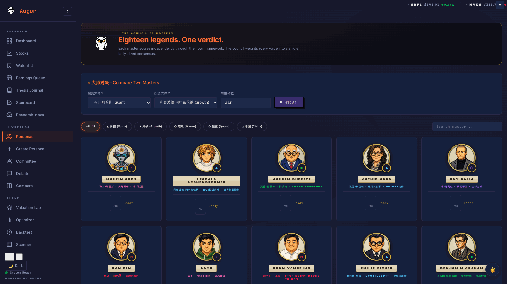

---

## 📊 Dashboard

Run `augur serve`, then open http://localhost:8000.

| Page | Path | What it does |
|---|---|---|
| Home | `/` | Market tape + masters overview |
| Masters | `/personas` | All 18 masters |
| Stock analysis | `/stocks` | Enter a ticker, 18 masters analyze it |
| Committee / Debate / Compare | `/committee` · `/debate` · `/compare` | Preset committees, multi-round debate, radar comparison |
| History | `/history` | Run history and heatmap |
| Thesis Journal | `/thesis` | Theses, falsification conditions, decision log |
| Earnings | `/earnings` · `/scorecard` | Earnings queue, post-earnings scorecard |
| Research inbox | `/inbox` | Aggregated items needing attention |
| Valuation lab | `/valuation` | DCF inputs + sensitivity grid |
| Portfolio / Watchlist / Settings | `/portfolio` · `/watchlist` · `/settings` | Kelly allocation, scheduled analysis, layout and master subsets |

---

## 🔌 Claude / Agent Integration

The MCP server exposes 14 tools (including `augur_run_skill` for the built-in skills), 7 research prompts and 5 read-only resource types (`augur://evidence/{id}`, `augur://runs/{id}`, `augur://thesis/{id}`, `augur://decisions/{id}`, `augur://ledger/{ticker}/{quarter}`). It was verified with real stdio client sessions on both `mcp` 1.x and 2.x.

```bash
pip install -e ".[data,mcp]"
claude mcp add augur -- augur-mcp   # Claude Code: register as a stdio MCP server
```

Claude Desktop config:

```json
{
  "mcpServers": {
    "augur": { "command": "augur-mcp", "env": { "AUGUR_EDGAR_CONTACT_EMAIL": "you@example.com" } }
  }
}
```

The analyze, consensus, debate and committee tools accept `asset_type` (`equity` / `etf` / `fund`; empty = detect). There are also Hermes / OpenClaw skill packs (`src/skills/`, see [docs/hermes-setup-guide.md](docs/hermes-setup-guide.md)) and Telegram / Slack / Lark / WeChat bot entry points. Full setup: [docs/en/agent-integration-guide.md](docs/en/agent-integration-guide.md).

---

## 💻 CLI Cheat Sheet

```bash
# Analysis
augur analyze AAPL [--persona buffett] [--json]
augur workflow TSLA --steps fetch,analyze,consensus,committee,debate,sentiment
augur committee NVDA --agents buffett,munger,dalio
augur batch AAPL MSFT NVDA

# Research artifacts
augur report from-run AAPL [--format json]    # consensus + evidence-derived disagreement + provenance and latency
augur export AAPL --format md|json|evidence-pack|pdf [-o PATH] [--run-id ...]
augur records verify-pack pack.zip              # check every file's SHA-256 in an evidence pack
augur dossier AAPL                              # pre-earnings dossier
augur valuation AAPL [--fcf 100e9 --shares 15e9 --growth 0.08 --wacc 0.10]
augur risk-review AAPL                          # new / removed / escalated risk factors across the last two 10-Ks
augur records ledger AAPL                       # what changed between the two latest analysed runs
augur thesis-delta AAPL                         # active theses vs the two latest runs (offline)
augur scorecard AAPL [--pre RUN --post RUN]     # post-earnings scorecard: pre-event answers vs outcomes
augur cycle [--days 30] [--format markdown]     # watchlist through the earnings cycle: readiness / dossier / ledger / thesis delta
augur filing-delta AAPL --new q3.json --prev q2.json

# Built-in research skills (permission-checked, saved as RunBundles)
augur skill list · augur skill show filing-delta
augur skill run earnings-prep|filing-delta|debt-covenant-review|insider-cluster-review AAPL

# Evaluation (on records written by augur backtest)
augur backtest AAPL --days 120 [--demo] · augur eval ic
augur eval personas AAPL [--horizon 20]         # consensus IC, hit rate, leave-one-out contribution per master
augur eval factors AAPL                         # each master's score as a factor: IC, t, p

# Research records
augur records decisions list|resolve|report     # decision outcomes and win rate
augur records comments add|list|resolve         # comments on runs / theses / decisions / evidence
augur records citations report|list|accept|reject|fixed # citation-correction queue
augur records audit [--action ...]              # audit log

# Data
augur fetch AAPL · augur sentiment AAPL · augur insider AAPL · augur earnings --days 30 · augur doctor
augur fetch SPY · augur consensus SPY · augur report SPY   # ETF: overview, health checklist, applicable / abstaining masters
augur earnings --backfill          # backfill the earnings calendar from SEC 8-K Item 2.02: past dates + one cadence-estimated next date (tagged estimated; never overwrites hand-written entries)

# Monitoring & servers
augur watchlist add AAPL · augur watchlist show · augur watchlist watch AAPL NVDA --interval 60
augur cron run · augur cron start
augur serve [--port 8000] · augur mcp-server · augur skill profiles · augur skill compat
```

`augur --help` lists all 38 top-level commands (37 in a pip install, where `augur update` is hidden). Since v12.2 related commands are grouped (`watchlist` / `cron` / `report` / `records` / `eval` / `skill`); the old flat names (e.g. `watchlist-add`, `research-report`, `ic-report`, `ledger`) still work in v14, are hidden from `--help`, and print a one-line hint with the new form on stderr. `augur report AAPL` is unchanged and is the same as `augur report run AAPL`.

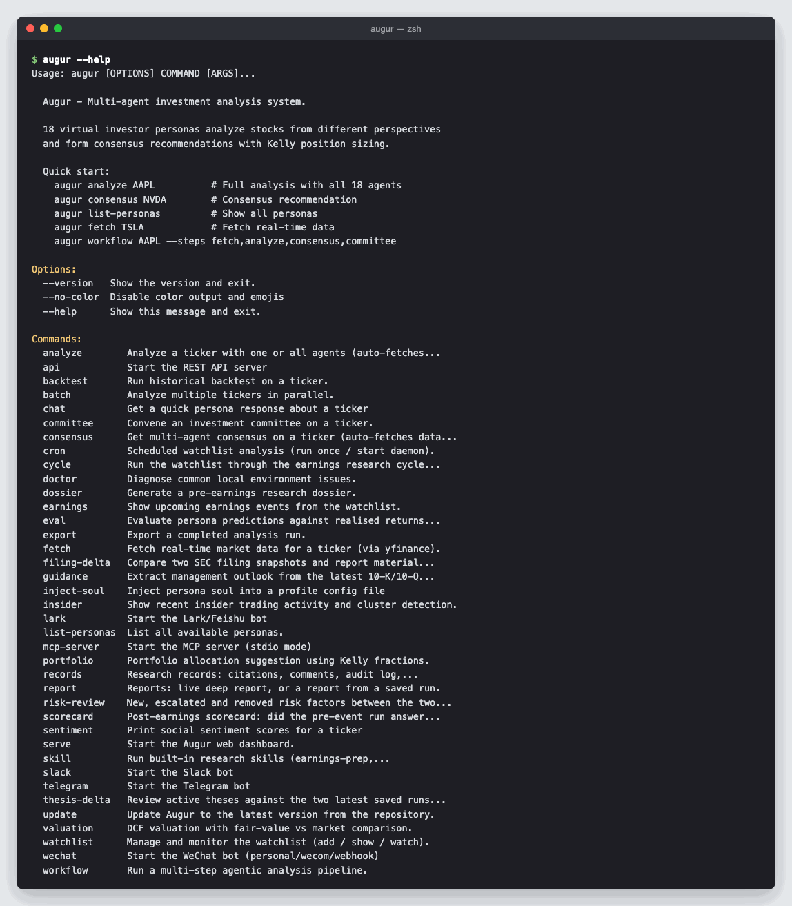

---

## 🧭 Feature Maturity

Stated plainly, so "there is code for it" is not mistaken for "it works".

| Status | Scope |
|---|---|
| **Stable** | 18-master analysis and consensus, the CLI research loop above, main dashboard pages, MCP server, RunBundles and export, the data-source chain (yfinance → SEC EDGAR overlay) |
| **Works, with stated limits** | ETF analysis (only Dalio applies in v14.0, so the consensus is always WITHHELD; A-share ETFs have NAV and premium/discount only, with no AUM, expense ratio, holdings or live IOPV; premium/discount is the latest day only, with no history or tracking error; the CLI ETF labels are Chinese only); the four built-in skills (only built-in manifests run; covenant review defaults to reference thresholds, not the company's credit agreements; earnings dates come from the local calendar file `earnings_calendar.json`, which you can write by hand or fill from SEC 8-K with `augur earnings --backfill`; the estimated next date is labelled `estimated`); the disagreement map (derived from per-dimension master scores and cites evidence, with a fixed dimension-to-metric table); `augur risk-review` (rule-based: a reworded risk factor can show as one new plus one removed item); `augur eval` (single-ticker time-series IC with overlapping forward returns — optimistic significance, a screen only); `augur guidance` (needs `AUGUR_EDGAR_GUIDANCE_EXTRACTION=1` and calls a paid LLM); PDF export (needs the `[export]` extra) |
| **Experimental (off by default)** | Rolling-IC dynamic weights (`AUGUR_FORCE_RIC=1`), learned weights (`AUGUR_FORCE_LEARNED=1`) — neither has passed a pre-registered out-of-sample test |
| **Code only, no entry point** | `augur.experimental.accounting` (accounting quality), `augur.experimental.capital_allocation`, `augur.experimental.debate_engine` (the dashboard `/debate` page uses a different implementation), `augur.experimental.relative_val` (relative valuation), `augur.experimental.portfolio_risk` — unit-tested, but no CLI, dashboard or MCP path calls them; usable as a library, not product features |
| **Not instrumented yet** | Token usage in run records (only latency is recorded) |

---

## 🔒 Data & Privacy

- All state lives in a local data directory (`~/.augur` by default, `AUGUR_DATA_DIR` to change it). No telemetry. Single-user with no sign-up by default (optional multi-user mode via `AUGUR_MULTI_USER=1`).
- Network requests Augur makes: market, fundamentals and FX data (yfinance, SEC EDGAR); A-share ETF NAV (Sina quotes, `hq.sinajs.cn`); optional LLM calls, only when you set `OPENAI_API_KEY` and use chat or guidance extraction; dashboard pages load Chart.js from the jsDelivr CDN.
- The dashboard listens on localhost only by default. Set `AUGUR_API_TOKEN` before exposing it; see [docs/self-hosted-guide.md](docs/self-hosted-guide.md).

Key environment variables:

| Variable | Purpose |
|---|---|
| `AUGUR_DATA_DIR` | Data directory |
| `AUGUR_EDGAR_CONTACT_EMAIL` | Contact address SEC EDGAR requires (a placeholder with a warning is used if unset) |
| `AUGUR_API_TOKEN` / `AUGUR_MULTI_USER` | Dashboard `/api/*` authentication |
| `AUGUR_CORS_ORIGINS` | Allowed CORS origins |
| `AUGUR_FORCE_RIC` / `AUGUR_FORCE_LEARNED` | Turn on experimental dynamic weights |
| `AUGUR_SKIP_MACRO_FETCH` | Skip the VIX/SPY macro fetch (offline or CI) |
| `AUGUR_EDGAR_GUIDANCE_EXTRACTION` | Enable LLM-based guidance extraction (paid; uses the OpenAI-compatible endpoint below) |
| `OPENAI_API_KEY` | Optional: key for the OpenAI-compatible endpoint used by persona chat and guidance extraction (needs `[llm]`) |
| `OPENAI_BASE_URL` | Optional: URL of an OpenAI-compatible service (default: OpenAI) |
| `AUGUR_CHAT_MODEL` / `AUGUR_CHAT_MAXTOK` | Optional: chat model name (default `gpt-4o`) and max output tokens (default 1024) |

---

## 🔧 Development

```bash
python3 -m venv .venv && source .venv/bin/activate
pip install -e ".[dev,data,mcp]" "ruff>=0.16,<0.17" build

make verify     # full test suite + ruff + wheel/sdist build with sha256 digests
make lint       # ruff (rule set pinned to E4/E7/E9/F)
make test-wheel # install the built wheel into a fresh venv and smoke-test it
```

- Tests run against a temporary `AUGUR_DATA_DIR`, never write to your `~/.augur`, and pass with the network fully blocked.
- CI (`.github/workflows/`): `Tests` runs the full suite on Python 3.10 / 3.11 / 3.12 and asserts the collected test count; `Hermetic Smoke` installs from the wheel and the sdist into fresh venvs and runs ruff and pip-audit.
- See [CONTRIBUTING.md](CONTRIBUTING.md).

---

## 📚 Docs & Roadmap

| Document | Contents |
|---|---|
| [docs/ROADMAP.md](docs/ROADMAP.md) | The single authoritative roadmap: current phase, verification point for each step, candidates after v14 and open decisions (Chinese) |
| [docs/en/RELEASE_NOTES.md](docs/en/RELEASE_NOTES.md) | Plain-language release notes (v14 at the top) |
| [docs/RELEASE_NOTES_v11.md](docs/RELEASE_NOTES_v11.md) | v11 release notes and migration guide (v12 and v13 changes are in [CHANGELOG.md](CHANGELOG.md)) |
| [docs/reviews/](docs/reviews/) | Project reviews, each finding with its evidence level and fix (Chinese) |
| [docs/schema-reference.md](docs/schema-reference.md) | EvidenceItem / Claim / StepResult / RunBundle / SkillSpec |
| [docs/api-reference-v11.md](docs/api-reference-v11.md) | Python API / REST / MCP |
| [docs/examples.md](docs/examples.md) | Worked examples |
| [docs/self-hosted-guide.md](docs/self-hosted-guide.md) | Docker / systemd / reverse proxy / auth |
| [docs/INDEX.md](docs/INDEX.md) | Full documentation index |

---

## 📝 Changelog

<details open>
<summary><strong>v14.0.0 — ETF-native analysis, correctness fixes, a clear LLM role (current)</strong></summary>

- **ETF-native analysis**: ETFs are recognised and shown with AUM, expense ratio, NAV (real NAV date from Sina for A-shares), premium/discount aligned to the NAV date, top-10 weight and a health checklist; masters whose rules don't apply abstain, and with fewer than 3 applicable there is no consensus, no position size and no learning record
- **Correctness**: Wilder RSI, non-USD amounts converted to USD, Dayu volatility units, Communication Services counted as tech, neutral size 0, pure-JSON `--json` stdout, recalibrated fear/greed
- **LLM role**: new README section "How Augur uses LLMs"; `augur_configure` deprecated; `[llm]` no longer installs `anthropic`. See "Upgrading from v13 to v14" above

</details>

<details>
<summary><strong>v13.0.0 — Earnings dates from SEC, Python 3.10, smaller public API</strong></summary>

- **Earnings date backfill**: `augur earnings --backfill` fills past earnings dates from SEC 8-K filings (Item 2.02) and estimates the next one from the cadence (marked estimated); `augur cycle` no longer depends on a hand-written calendar
- **Breaking**: Python 3.10+; five modules with no product entry point moved to `augur.experimental`; three compatibility modules removed. See "Upgrading from v12 to v13" above

</details>

<details>
<summary><strong>v12.2.0 — One command tree, clearer dashboard</strong></summary>

- **Grouped CLI**: `watchlist` / `cron` / `report` / `records` / `eval` / `skill` groups; `augur --help` goes from 47 to 38 entries; old names still work and point to the new form
- **Dashboard**: sidebar grouped into Research / Investors / Tools / System with the Earnings Queue, Thesis Journal, Scorecard and Research Inbox now linked; earnings rows show readable missing items and the command that fills each; the scorecard event picker no longer hangs on Loading; Thesis Journal empty states, errors and phone layout reworked
- **Learning data**: the dashboard and the cron job no longer overwrite each other's writes

</details>

<details>
<summary><strong>v12.1.0 — The earnings cycle in one command</strong></summary>

- `augur cycle`: for each watchlist ticker reporting soon — readiness, dossier, change since the last run, thesis delta — ending with `ready X/Y` and a next step per ticker
- `augur scorecard`: which research questions the pre- and post-event runs answered
- `augur thesis-delta`: active theses against the two latest runs

</details>

<details>
<summary><strong>v12.0.0 — Earnings loop and honest learning</strong></summary>

- **Learning outcomes fixed**: each master prediction resolves at its own 30-day horizon (v11 applied one "latest 30-day return" to predictions made on different days); nothing ages out, the boundary is by calendar day, and every outcome is appended to `prediction_outcomes.jsonl` for audit; one prediction per master per day. Outcomes recorded by v11 are discarded on first load; pending predictions are kept
- **Earnings loop wiring**: the earnings queue reads the real watchlist, dossier readiness uses saved runs, and the dashboard no longer shows hard-coded earnings content
- **Research records**: research questions persist, same-second run ordering fixed, runs record the real package version
- **Three 2026-09-17 rounds shipped for the first time** (v11.0.0 GA was never released): built-in skill runner (`augur skill run`, permission-checked before any step), disagreement map derived from per-dimension master scores with cited evidence, `augur eval` over backtest records, `augur risk-review` across two 10-Ks, `augur ledger` between two runs, research-record commands (decision outcomes / comments / citation corrections / audit log), evidence-pack digest verification; plus fixes found by running everything from a fresh install: `workflow` checkpoint crash, evidence timestamp timezone bug, `export` / `research-report` / `dossier` wired to real runs, `committee` crash, SEC EDGAR market cap off by 10⁹, valuation inventing inputs, servers exposed on the LAN by default, avatars 404 in pip installs, MCP support for `mcp` 2.x, CI false-green fixed
- See [CHANGELOG](CHANGELOG.md) and [ROADMAP](docs/ROADMAP.md)

</details>

<details>
<summary><strong>v11.0.0-rc1 — Research Memory System</strong></summary>

- **Research foundation**: EvidenceItem with three time semantics, Claim, StepResult, immutable RunBundle, declarative SkillSpec v1
- **Research loop**: Thesis Journal, Filing Delta, disagreement map, Guidance Tracker, research inbox, DCF valuation lab
- **Trust**: missing data propagated explicitly, calibration status labels, unvalidated dynamic weights off by default

See [CHANGELOG.md](CHANGELOG.md).
</details>

<details>
<summary><strong>v10.15.0 — public sync release</strong></summary>

Real SEC EDGAR fundamentals, three credibility fixes, `augur doctor` environment diagnostics.
</details>

<details>
<summary><strong>v10.0.0 and earlier</strong></summary>

v10: Bloomberg-style terminal + workflows + MCP tools · v9: Hermes Agent + committees · v8: HD-2D design system
</details>

---

<div align="center">

MIT License · Created by [BruceLanLan](https://github.com/BruceLanLan) (X: [@BruceBlue](https://x.com/BruceBlue))

*For research and education only. Not investment advice.*

</div>
