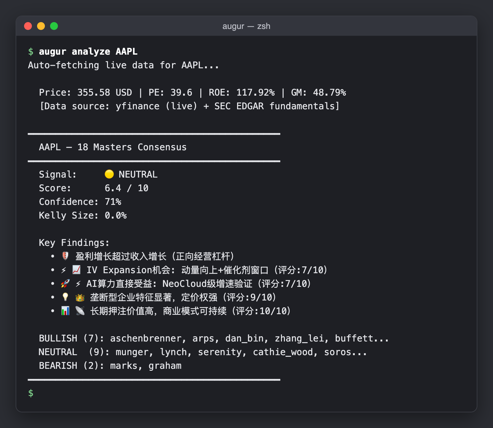
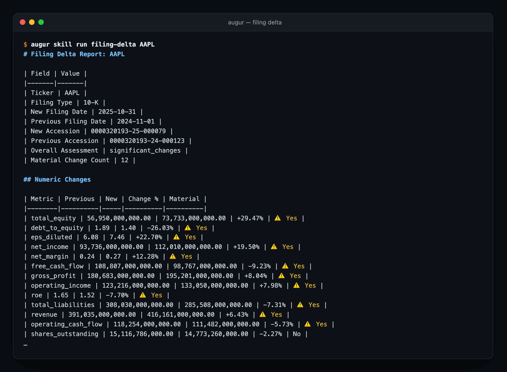
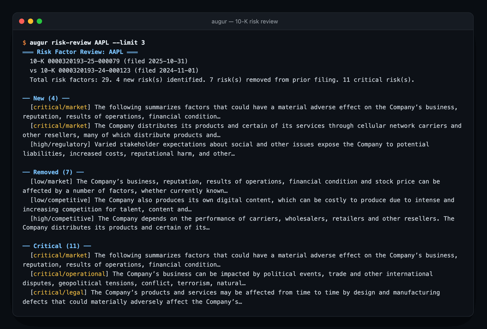
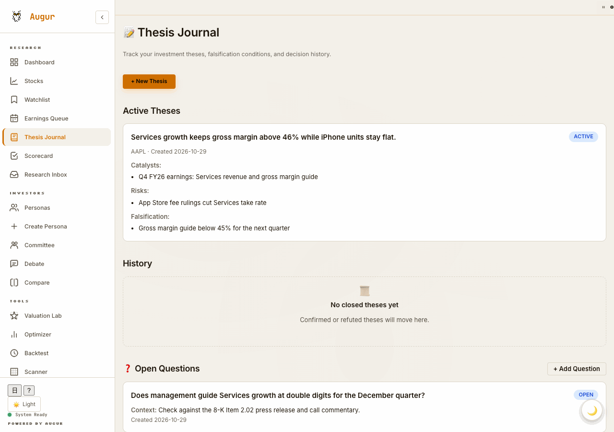

[🇨🇳 中文](README.md) | 🇺🇸 English | [🇯🇵 日本語](README_JA.md)

<div align="center">


# 🦉 Augur

**A local investment research tool: rule-based scoring from 18 investment masters, plus a research record you can check later.**

[](CHANGELOG.md)
[](https://github.com/BruceLanLan/augur/actions/workflows/tests.yml)
[](#-18-investment-masters)
[](#-claude--agent-integration)
[](#-data--privacy)
[](LICENSE)

</div>

Augur analyzes stocks with 18 sets of deterministic rules, each written from a well-known investor's public philosophy (the "masters"), and combines them into a consensus signal and a Kelly position size. Every run is saved with its evidence and sources as an immutable record, so months later you can still see what you knew at the time, what changed since, and which facts the masters disagree on. Scoring never calls an LLM, and your data stays on your machine.

**The headline of v14 is ETF-native analysis.** Augur now recognizes ETFs and shows an ETF overview (AUM, expense ratio, NAV, premium/discount and more) with a health checklist, instead of scoring a fund as if it were a company. Masters whose rules depend on company financials abstain on funds. In v14.0 only Dalio applies, short of the 3 that a consensus needs, so ETFs currently never get a consensus. v14 also switches RSI to Wilder smoothing and converts amounts for non-USD listings to US dollars. See [What's new in v14](#-whats-new-in-v14).

Try it (Python 3.10+):

```bash
git clone https://github.com/BruceLanLan/augur.git && cd augur
python3 -m venv .venv && source .venv/bin/activate && pip install -e ".[data]"
augur analyze AAPL     # each master's verdict, the consensus and a Kelly size
augur consensus SPY    # an ETF: overview, health checklist, which masters apply
```

> ⚠️ **For research and education only. Not investment advice.** The masters are rule-based simulations of publicly known investment philosophies, not the views of those people. Every score, Kelly size and valuation depends on data quality and model assumptions.

**Contents**: [Why Augur](#-why-augur) · [Install and first steps](#-install-and-first-steps) · [What's new in v14](#-whats-new-in-v14) · [How Augur uses LLMs](#-how-augur-uses-llms) · [Earnings research walkthrough](#-earnings-research-walkthrough) · [18 masters](#-18-investment-masters) · [Dashboard](#-dashboard) · [Claude / Agent](#-claude--agent-integration) · [CLI](#-cli-cheat-sheet) · [Maturity](#-feature-maturity-and-known-limits) · [Upgrading](#-upgrading) · [Data & privacy](#-data--privacy) · [Development](#-development) · [Docs](#-docs) · [Changelog](#-changelog)

---

## 🤔 Why Augur

Most AI stock pickers ask a large language model for the answer. Augur's analysis does not call an LLM; what you get is a research record you can check later.

| | LLM stock picker | Augur |
|---|---|---|
| How the verdict is made | Generated by an LLM; the same question can get a different answer | Rule-based scoring; the same inputs give the same scores, so it can be backtested |
| What you get | "On one hand… on the other…" | 18 independent verdicts, and where the masters agree and disagree |
| Where the data came from | Unclear | Every evidence item carries its source, business time, availability time and retrieval time |
| Missing data | Silently zero | Marked `missing`; masters that need the field abstain (`abstain`) and say why |
| Three months later | No memory of what it said | Each run is an immutable RunBundle you can export, compare and review |
| Where your data lives | Someone's cloud | Locally in `~/.augur` (override with `AUGUR_DATA_DIR`), no telemetry |

---

## 🚀 Install and first steps

Requires Python 3.10+.

```bash
git clone https://github.com/BruceLanLan/augur.git && cd augur
python3 -m venv .venv && source .venv/bin/activate
pip install -e ".[data]"            # core + live data via yfinance
# optional: pip install -e ".[data,mcp]"  MCP server
#           pip install -e ".[export]"    PDF export

# SEC EDGAR requires a real contact email in requests (US filings data)
export AUGUR_EDGAR_CONTACT_EMAIL="you@example.com"
```

Open the dashboard:

```bash
augur serve --open                 # http://localhost:8000, ⌘K opens the command palette
```

Common commands:

```bash
augur analyze AAPL                 # all 18 masters + weighted consensus + Kelly size
augur fetch SPY                    # ETF: overview (AUM, expense ratio, NAV, premium/discount) + health checklist
augur consensus SPY                # ETF: applicable and abstaining masters; no consensus with fewer than 3
augur workflow AAPL                # multi-step analysis, saves a RunBundle, prints the Run ID
augur report from-run AAPL         # report from the latest run: consensus, disagreement map, provenance
augur export AAPL --format md      # export the latest run (md / json / evidence-pack / pdf)
augur committee AAPL --preset value -q "Is the moat widening or narrowing?"
augur valuation AAPL               # two-stage DCF; fetches FCF, shares and net debt and cites them
augur skill run earnings-prep AAPL # built-in research skill: pre-earnings dossier (4 in total, see below)
augur watchlist add AAPL           # add to the watchlist
augur earnings --backfill          # backfill watchlist earnings dates from SEC 8-K (needs network)
augur cycle                        # watchlist earnings cycle: who is ready, what is missing, what next
```

Except for `augur earnings --backfill`, these commands run from a fresh install in the offline smoke test in CI. Without a network, `augur analyze NVDA --pe 60 --roe 0.45` takes metrics by hand, `augur backtest AAPL --demo` uses offline synthetic data, and `augur cycle` reads local state only.



`augur analyze AAPL`: fetches live data, has the 18 masters score independently, and prints the consensus signal, score, confidence and Kelly size (0 for a neutral consensus), followed by key findings and which masters are bullish, neutral or bearish. Key findings are taken verbatim from the masters' rule output, which is mostly in Chinese for now.

---

## ✨ What's new in v14

### ETF-native analysis


`augur consensus SPY`: the consensus is WITHHELD, followed by the ETF overview, the health checklist, and the applicable and abstaining masters.

- **How ETFs are recognized**: yfinance `quoteType` ETF or MUTUALFUND, or an A-share fund code (Shanghai codes starting 51 / 56 / 58, Shenzhen codes starting 15). `fetch`, `analyze`, `consensus` and `report` show an ETF overview for funds instead of company fundamentals.
- **ETF overview**: AUM in USD, expense ratio, yield, category, NAV and its date, premium/discount (against the close on the NAV date), top-10 weight, bid/ask spread and look-through P/E.
- **Health checklist**: flags an expense ratio above 0.50% or 1.00%, AUM below $50M (closure risk), a premium/discount beyond ±1%, a top-10 weight above 50%, and a spread above 0.5%. Items that cannot be checked for lack of data are listed as unchecked rather than guessed.
- **Abstention**: masters whose rules read company financials return "not applicable" on a fund instead of a score. Which masters apply is decided by a test: change company fields on an ETF and see whose score moves; those masters do not apply. In v14.0 only Dalio applies, and a consensus needs at least 3 applicable masters, so every ETF's consensus is currently WITHHELD: no signal, no Kelly size, and nothing written to the learning records.
- **Data sources and limits**: US and Hong Kong ETFs take NAV from yfinance, which gives no date; Augur infers it as the trading day before the latest bar and marks it as inferred. A-share ETFs take unit NAV and its real date from Sina's public quote endpoint; free sources do not provide AUM, expense ratio or holdings for A-share ETFs, so those show as unchecked. Premium/discount covers the latest day only, with no history or tracking error.


`augur fetch 510300.SS`: an A-share ETF has NAV, NAV date and premium/discount; AUM, expense ratio and top-10 weight show as unknown, and the checklist lists those checks as unchecked (no data).


The dashboard stock page (`/stocks`) shows an ETF overview card for funds; the consensus card shows WITHHELD and the position as n/a.

### Correctness fixes

- **RSI uses Wilder smoothing** (matches TA-Lib); before, it looked only at the last 14 changes. Scores change for the masters that read RSI (arps, dalio, marks, munger, soros, serenity, dayu and the custom `da-yu.yaml`).
- **Amounts for non-USD listings are in US dollars**: market cap, FCF, revenue and so on are converted at the exchange rate. Tencent (0700.HK) used to read as a $3,097.6B company and now reads as about $397.5B. If no rate is available nothing is converted and the output names the local currency.
- **Master rules**: Dayu's volatility rule had a unit error and never fired; Thiel and the consensus engine's sector weighting now count Communication Services (GOOGL, META, Tencent) as tech; a neutral consensus sizes the position at 0.
- **Output**: with `--json`, stdout carries only JSON and progress goes to stderr; the dashboard fear/greed gauge is recalibrated (VIX 28 reads as Fear); the backtest page no longer derives return, drawdown and Sharpe from the hit rate and shows them as not measured.

This README also gained a [How Augur uses LLMs](#-how-augur-uses-llms) section; the `[llm]` extra no longer installs the unused `anthropic` package; and the MCP tool `augur_configure` is deprecated. Full list in the [CHANGELOG](CHANGELOG.md); upgrade impact under [Upgrading](#-upgrading).

---

## 🧠 How Augur uses LLMs

Scoring never uses an LLM; interpretation can be handed to one. There are three modes:

| Mode | Who does the thinking | API key? | How |
|---|---|---|---|
| Default: deterministic rules | The 18 masters' rules and the consensus engine | No | `augur analyze` / `consensus` / `workflow` / dashboard; runs offline when you pass metrics by hand |
| MCP / skills: the host agent interprets | The agent you already use (such as Claude Code, Claude Desktop or Hermes) calls Augur's tools for scores and evidence and interprets them with its own model | Handled by the host; Augur needs none | `claude mcp add augur -- augur-mcp`, or add `augur-mcp` to Claude Desktop (see [Claude / Agent integration](#-claude--agent-integration)) |
| Optional: bring-your-own-key master chat | The OpenAI-compatible endpoint you configure | `OPENAI_API_KEY` | `pip install -e ".[llm]"`, set `OPENAI_API_KEY`, optionally `OPENAI_BASE_URL` and `AUGUR_CHAT_MODEL` (default `gpt-4o`); used by `augur chat` and the dashboard `/chat`. Without a key, chat returns template replies |

One paid feature is off by default: with `AUGUR_EDGAR_GUIDANCE_EXTRACTION=1`, `augur guidance` uses the same OpenAI-compatible endpoint to extract management outlook from 10-K / 10-Q filings.

---

## 📖 Earnings research walkthrough

Here is the order a new user would follow: build a watchlist, backfill earnings dates, run the earnings cycle, and look at the research output. The screenshots come from real data for AAPL, MSFT and NVDA (live quotes and SEC EDGAR); terminal screenshots show the main part of the output.

### Build a watchlist and backfill earnings dates

```bash
augur watchlist add AAPL
augur watchlist add MSFT
augur watchlist add NVDA
augur earnings --backfill
```

The watchlist drives the earnings cycle: `augur earnings`, `augur cycle` and the dashboard Earnings Queue all read tickers from it.


`augur earnings --backfill` reads each watchlist ticker's past earnings dates from SEC 8-K filings (Item 2.02, results of operations), then estimates the next date from the recent reporting cadence and marks it `estimated`, never confirmed. Entries you wrote into the earnings calendar by hand are kept. It needs a network connection and `AUGUR_EDGAR_CONTACT_EMAIL`; `-t AAPL` limits it to one ticker.

### The earnings cycle in one command


For every watchlist ticker reporting within the next N days (30 by default; change it with `--days`), `augur cycle` shows whether the dossier is ready, the dossier itself, what changed between the last two runs and how the thesis moved, then ends with `ready X/Y` and a next step per ticker. It reads saved local state only and makes no network calls; when something is missing it says so and gives the command that fills it.

### Research output

`augur dossier AAPL` builds a pre-earnings dossier, `augur report from-run AAPL` writes a research report from the latest run, and `augur skill run` runs a built-in research skill. The `skill run earnings-prep` and `report from-run` screenshots below were taken on v14; the `filing-delta`, `risk-review` and `eval personas` ones were taken on v11 and have the same layout as today, but some numbers and wording come from the older version.


`augur skill run earnings-prep AAPL`: the consensus of all 18 masters, with each disagreement citing evidence IDs, disagreements without supporting evidence flagged as "evidence gap", and a comparison with the previous run. The next earnings date comes from the local earnings calendar and is marked `confirmed` or `estimated`; if the calendar has no entry, it says so. Before running, the runner checks that every capability, network domain and local resource a step uses is declared in the manifest, and refuses to start if any check fails. Each run is saved as a RunBundle.



`augur skill run filing-delta AAPL`: pulls XBRL data from the two most recent 10-Ks and lists items that changed by 5% or more. The other two built-in skills are `debt-covenant-review` (leverage and interest coverage) and `insider-cluster-review` (Form 4 insider clusters); see the [skills guide](docs/skills-guide.md) (Chinese).


`augur report from-run AAPL` (after `augur workflow AAPL` has saved a run): the bull/bear vote, the dimensions on which masters disagree (each citing evidence IDs and naming the fact that would settle it), where they agree, disagreements that lack evidence, and the run ID, code version, step status and evidence coverage.



`augur risk-review AAPL`: compares the risk-factor sections of the two most recent 10-Ks and lists new, removed and escalated risks. It is rule-based, so a slightly reworded risk can appear as both "new" and "removed".


`augur eval personas AAPL`: using the records `augur backtest` produces, drops one master at a time to see whether the consensus IC gets better or worse, and lists masters whose scores never change and so carry no information. Forward returns overlap day to day, so the confidence intervals are optimistic; treat it as a screen, not as weights. `augur eval factors` gives each master's score as a factor, with IC and t-test.

---

## 🎭 18 Investment Masters

Each master is a rule-based implementation of a public investment philosophy, spanning value, growth, macro and the Chinese market. Most masters write their reasoning and findings in Chinese for now.

| School | Masters |
|------|------|
| 🏦 Classic value | Warren Buffett · Benjamin Graham · Charlie Munger · Philip Fisher |
| 🚀 Growth & innovation | Peter Lynch · Cathie Wood · Peter Thiel · Leopold Aschenbrenner |
| 🌍 Macro & cycles | Ray Dalio · George Soros · Howard Marks · ARPS (crypto / gold) |
| 🇨🇳 Chinese value | Duan Yongping · Zhang Lei · Li Lu · Dan Bin · Dayu |
| ⚙️ Special strategy | Serenity (AI compute supply chain) |

The consensus engine weights each master by confidence, data coverage and sector relevance, and returns a signal, score, confidence and Kelly position size. `augur list-personas` lists every master ID.


---

## 📊 Dashboard

`augur serve --open` starts the server and opens http://localhost:8000. The sidebar has four groups: Research, Investors, Tools and System.

| Page | Path | What it does |
|---|---|---|
| Home | `/` | Market data and masters overview |
| Stock analysis | `/stocks` | Enter a ticker and all 18 masters analyze it; ETFs get an ETF overview card |
| Personas / Committee / Debate / Compare | `/personas` · `/committee` · `/debate` · `/compare` | All masters, preset committees, multi-round debate, five-axis radar |
| Earnings Queue / Scorecard | `/earnings` · `/scorecard` | Earnings events and missing dossier items, post-earnings scorecard |
| Thesis Journal / Research Inbox | `/thesis` · `/inbox` | Theses, falsification conditions, decision log; pending events |
| Valuation Lab | `/valuation` | Two-stage DCF and sensitivity grid |
| History / Portfolio / Watchlist / Settings | `/history` · `/portfolio` · `/watchlist` · `/settings` | Run history, Kelly settings, scheduled analysis, layout and master subset |


<details>
<summary>More screenshots: Earnings Queue, Scorecard, Thesis Journal, Valuation Lab</summary>


`/earnings`: the Earnings Queue reads the same watchlist and earnings calendar as `augur earnings`. For each ticker it lists the dossier items still missing and the command that fills each; estimated dates are marked `estimated`.


`/scorecard`: the post-earnings scorecard checks which research questions the pre- and post-earnings runs answered. When data is missing it shows `unavailable` and the reason. The dashboard does not yet have a place to save a pre/post run pair, so it cannot produce a full scorecard; `augur scorecard` on the command line can.



`/thesis`: record a thesis's catalysts, risks and falsification conditions, next to open research questions and the decision log. Research questions are stored locally and `augur dossier` reads them too. The content in the screenshot is a hand-entered example.


`/valuation`: a two-stage DCF that recalculates as you edit inputs, with bull, base and bear scenarios, a probability-weighted fair value, and a WACC × terminal growth sensitivity grid below. The parameters in the screenshot are example inputs.

</details>

---

## 🔌 Claude / Agent Integration

The MCP server provides 14 tools (including `augur_run_skill`, which runs the built-in skills), 7 research prompts and 5 kinds of read-only resources (`augur://evidence/{id}`, `augur://runs/{id}`, `augur://thesis/{id}`, `augur://decisions/{id}`, `augur://ledger/{ticker}/{quarter}`). It is tested with real stdio sessions on both `mcp` 1.x and 2.x.

```bash
pip install -e ".[data,mcp]"
claude mcp add augur -- augur-mcp   # Claude Code: register as a stdio MCP server
```

Claude Desktop configuration:

```json
{
  "mcpServers": {
    "augur": { "command": "augur-mcp", "env": { "AUGUR_EDGAR_CONTACT_EMAIL": "you@example.com" } }
  }
}
```

The analyze, consensus, debate and committee tools accept `asset_type` (`equity` / `etf` / `fund`; empty means auto-detect). There are also Hermes / OpenClaw skill packs (`src/skills/`, see [docs/en/hermes-setup-guide.md](docs/en/hermes-setup-guide.md)) and Telegram, Slack, Lark/Feishu and WeChat bots. Full guide: [docs/en/agent-integration-guide.md](docs/en/agent-integration-guide.md).

---

## 💻 CLI Cheat Sheet

```bash
# Analysis
augur analyze AAPL [--persona buffett] [--json]
augur consensus SPY · augur fetch 510300.SS · augur report SPY   # ETFs work too
augur workflow TSLA --steps fetch,analyze,consensus,committee,debate,sentiment
augur committee NVDA --agents buffett,munger,dalio
augur batch AAPL MSFT NVDA

# Research output
augur report from-run AAPL [--format json]      # consensus + disagreement map + provenance and timing
augur export AAPL --format md|json|evidence-pack|pdf [-o PATH] [--run-id ...]
augur records verify-pack pack.zip              # verify the SHA-256 of every file in an evidence pack
augur dossier AAPL                              # pre-earnings dossier
augur valuation AAPL [--fcf 100e9 --shares 15e9 --growth 0.08 --wacc 0.10]
augur risk-review AAPL                          # risk-factor changes between the last two 10-Ks
augur records ledger AAPL                       # what changed between the last two runs
augur thesis-delta AAPL                         # active theses against the last two runs (offline)
augur scorecard AAPL [--pre RUN --post RUN]     # post-earnings scorecard
augur cycle [--days 30] [--format markdown]     # watchlist earnings cycle
augur filing-delta AAPL --new q3.json --prev q2.json

# Built-in research skills (permissions checked before running; results saved as RunBundles)
augur skill list · augur skill show filing-delta
augur skill run earnings-prep|filing-delta|debt-covenant-review|insider-cluster-review AAPL

# Evaluation (on records produced by augur backtest)
augur backtest AAPL --days 120 [--demo] · augur eval ic
augur eval personas AAPL [--horizon 20]         # consensus IC, hit rate, leave-one-out contribution per master
augur eval factors AAPL                         # each master's score as a factor: IC, t-stat, p-value

# Research records
augur records decisions list|resolve|report     # decision outcomes and win rate
augur records comments add|list|resolve         # comments on runs, theses, decisions and evidence
augur records citations report|list|accept|reject|fixed   # citation correction queue
augur records audit [--action ...]              # audit log

# Data
augur fetch AAPL · augur sentiment AAPL · augur insider AAPL · augur doctor
augur earnings --days 30 · augur earnings --backfill

# Monitoring and services
augur watchlist add AAPL · augur watchlist show · augur watchlist watch AAPL NVDA --interval 60
augur cron run · augur cron start
augur serve [--port 8000] · augur mcp-server · augur skill profiles · augur skill compat
```

`augur --help` lists all 38 top-level commands (37 on a pip install, which hides `augur update`). Since v12.2 related commands are grouped (`watchlist` / `cron` / `report` / `records` / `eval` / `skill`). The old flat names (such as `watchlist-add`, `research-report`, `ic-report`, `ledger`) still work in v14 and print the new spelling on stderr. `augur report AAPL` is the same as `augur report run AAPL`.


---

## 🧭 Feature Maturity and Known Limits

Labelled honestly, so that "there is code for it" is not mistaken for "it works".

| Status | Scope |
|---|---|
| Stable | Analysis and consensus by the 18 masters, the command-line research flow listed above, the main dashboard pages, the MCP server, RunBundles and export, the data-source chain (yfinance, with SEC EDGAR overriding US filing fields) |
| Usable, with clear limits | ETF analysis: only Dalio applies in v14.0, so the consensus is always WITHHELD; A-share ETFs have only NAV and premium/discount; premium/discount covers the latest day only; these places still show the withheld fund consensus as 5.0: the dashboard watchlist, portfolio, scanner, history and Signals page (notifications and live feed), `augur cron` summaries, the chat bots and the built-in skills (the CLI, MCP and the dashboard stock, home and committee pages show WITHHELD).<br>Built-in skills (4): only the built-in manifests run; the debt covenant review uses reference thresholds, not the terms of a credit agreement.<br>Disagreement map: derived from each master's per-dimension scores with evidence citations; the dimension-to-metric mapping is a fixed table.<br>`augur risk-review`: rule matching; a slightly reworded risk can show as both "new" and "removed".<br>`augur eval`: single-ticker time-series IC with overlapping forward returns, so significance is optimistic; a screen only.<br>`augur guidance`: needs `AUGUR_EDGAR_GUIDANCE_EXTRACTION=1` and calls a paid LLM.<br>PDF export: needs `[export]`. |
| Experimental (off by default) | Rolling-IC dynamic weights (`AUGUR_FORCE_RIC=1`) and learned weights (`AUGUR_FORCE_LEARNED=1`). Neither has passed pre-registered out-of-sample validation |
| Code only, no entry point | Accounting quality, capital allocation, the debate engine (the dashboard `/debate` uses a different implementation), relative valuation and portfolio risk under `augur.experimental`. They have unit tests, but no CLI, dashboard or MCP path calls them; usable as a library, not product features |
| Not measured yet | Token usage in run records (only timing is recorded) |

---

## 🔄 Upgrading

### From v13 to v14

Commands are used the same way, but some scores and outputs change:

| Change | Impact and what to do |
|---|---|
| RSI uses Wilder smoothing | Scores change for arps, dalio, marks, munger, soros, serenity, dayu and the custom `da-yu.yaml`, most visibly for tickers with RSI near 30 / 70. Keep this in mind if you compare against saved v13 scores |
| Dayu's volatility rule now fires | Change in the position-risk factor versus v13: 20-day volatility below 15% unchanged, 15–25% −1, 25–40% −2, 40–60% −3, above 60% −4; the factor is 20% of Dayu's score |
| Amounts for non-USD listings are in USD | Hong Kong and A-share listings, and anything whose financials are not in USD (such as some ADRs): `market_cap`, `fcf`, `revenue` and the like are USD billions; price stays in the trading currency. Mind the units if your code reads `MarketContext` |
| Communication Services counts as tech | Thiel and the consensus engine's sector weighting change for GOOGL, META, Tencent and similar |
| A neutral consensus sizes at 0 | `analyze` used to show small sizes such as 0.6% |
| ETFs no longer get an 18-master consensus | You get the ETF overview, the health checklist and the applicable masters' readings; the consensus is WITHHELD. Fund `pe` / `pb` are 0; look-through values are in the `etf` dict. Do not reuse results from analyzing ETFs as stocks |
| `--json` progress goes to stderr | stdout carries JSON only. Scripts that parse progress text from stdout should read stderr |
| `[llm]` no longer installs `anthropic`; MCP `augur_configure` deprecated | Nothing in the code used them. Install `anthropic` yourself if your own code needs it |
| Dashboard backtest API returns `null` for return, drawdown, Sharpe | They used to be derived from the hit rate, not measured |

The learning data schema stays at 2 and is not reset. Pending predictions recorded under the old RSI resolve as usual. Learning records written while analyzing ETFs before v14 remain in place and add a little noise to the affected masters' accuracy; a clean-up tool will come in a later release.

### From older versions

Apply each version's migration in turn. The main points:

- **v13**: requires Python 3.10+; five modules with no product entry point moved to `augur.experimental.<same name>` (for example `augur.accounting` → `augur.experimental.accounting`); the re-export modules `augur.coordinator`, `augur.skill_spec` and `augur.mcp_entry` are gone.
- **v12**: the learned-weights file moved to schema 2, and outcomes recorded by v11 are discarded on first load (pending predictions are kept); commands are grouped, and the old flat names still work.
- **v11**: see [docs/RELEASE_NOTES_v11.md](docs/RELEASE_NOTES_v11.md), covering `Optional` ownership fields, dynamic weights off by default, binding to `127.0.0.1` by default and more.

Full details for every version are in [CHANGELOG.md](CHANGELOG.md).

---

## 🔒 Data & Privacy

- All state lives in a local data directory (`~/.augur` by default, change it with `AUGUR_DATA_DIR`). No telemetry; single-user by default with no sign-up (multi-user mode with `AUGUR_MULTI_USER=1`).
- Network requests Augur makes: quotes, fundamentals and FX rates (yfinance, SEC EDGAR); A-share ETF NAV (Sina quotes, `hq.sinajs.cn`); optional LLM calls (only when you set `OPENAI_API_KEY` and use chat or guidance extraction); the dashboard loads Chart.js from the jsDelivr CDN.
- The dashboard listens on localhost only by default. Set `AUGUR_API_TOKEN` before exposing it; see [docs/self-hosted-guide.md](docs/self-hosted-guide.md).

Main environment variables:

| Variable | Purpose |
|---|---|
| `AUGUR_DATA_DIR` | Data directory |
| `AUGUR_EDGAR_CONTACT_EMAIL` | Contact email SEC EDGAR requires (a placeholder with a warning if unset) |
| `AUGUR_API_TOKEN` / `AUGUR_MULTI_USER` | Dashboard `/api/*` authentication |
| `AUGUR_CORS_ORIGINS` | Allowed CORS origins |
| `AUGUR_FORCE_RIC` / `AUGUR_FORCE_LEARNED` | Turn on the experimental dynamic weights |
| `AUGUR_SKIP_MACRO_FETCH` | Skip the VIX / SPY macro fetch (offline or CI) |
| `AUGUR_EDGAR_GUIDANCE_EXTRACTION` | Enable LLM-based guidance extraction (paid; uses the OpenAI-compatible endpoint below) |
| `OPENAI_API_KEY` / `OPENAI_BASE_URL` | Optional: OpenAI-compatible endpoint for master chat and guidance extraction (needs `[llm]`; OpenAI's own API if no URL is set) |
| `AUGUR_CHAT_MODEL` / `AUGUR_CHAT_MAXTOK` | Optional: chat model name (default `gpt-4o`) and max output tokens (default 1024) |

---

## 🔧 Development

```bash
python3 -m venv .venv && source .venv/bin/activate
pip install -e ".[dev,data,mcp]" "ruff>=0.16,<0.17" build

make verify     # full tests + ruff + build wheel / sdist and print sha256
make lint       # ruff (rule set pinned to E4/E7/E9/F)
make test-wheel # install the built artifacts in a fresh venv and smoke-test them
```

- Tests use their own temporary `AUGUR_DATA_DIR`, never write to your `~/.augur`, and all pass with no network.
- CI: `Tests` runs the full suite on Python 3.10 / 3.11 / 3.12; `Hermetic Smoke` installs from the wheel and the sdist separately and runs ruff, pip-audit and the README commands listed above.
- See [CONTRIBUTING.md](CONTRIBUTING.md) for how to contribute.

---

## 📚 Docs

| Document | Contents |
|---|---|
| [docs/ROADMAP.md](docs/ROADMAP.md) | Roadmap: current phase, verification for each step, candidates and open decisions after v14 (Chinese) |
| [docs/en/RELEASE_NOTES.md](docs/en/RELEASE_NOTES.md) | User-facing release notes |
| [CHANGELOG.md](CHANGELOG.md) | Full changes for every version |
| [docs/en/data-sources.md](docs/en/data-sources.md) | Data sources and where each field comes from |
| [docs/schema-reference.md](docs/schema-reference.md) | EvidenceItem / Claim / StepResult / RunBundle / SkillSpec |
| [docs/api-reference-v11.md](docs/api-reference-v11.md) | Python API / REST / MCP |
| [docs/examples.md](docs/examples.md) | Worked examples |
| [docs/self-hosted-guide.md](docs/self-hosted-guide.md) | Docker / systemd / reverse proxy / auth |
| [docs/reviews/](docs/reviews/) | Project review records |
| [docs/INDEX.md](docs/INDEX.md) | Index of all docs |

---

## 📝 Changelog

<details open>
<summary><strong>v14.0.0 — ETF-native analysis, correctness fixes, a clear account of the LLM's role (current)</strong></summary>

- ETF-native analysis: recognizes ETFs and shows AUM, expense ratio, NAV (with the real NAV date for A-shares), premium/discount aligned to the NAV date, top-10 weight and a health checklist; masters whose rules do not apply abstain, and with fewer than 3 applicable there is no consensus, no position size and no learning record.
- Correctness: Wilder RSI, non-USD amounts converted to USD, Dayu's volatility units, Communication Services counted as tech, zero size for a neutral consensus, JSON-only `--json` output, recalibrated fear/greed gauge.
- The LLM's role: new [How Augur uses LLMs](#-how-augur-uses-llms) section; `augur_configure` deprecated; `[llm]` no longer installs `anthropic`.

</details>

<details>
<summary><strong>Earlier versions</strong></summary>

- v13.0.0: `augur earnings --backfill` fills earnings dates from SEC 8-K; Python 3.10+; smaller public API.
- v12.2.0: grouped commands (`augur --help` went from 47 entries to 38); grouped dashboard sidebar with the earnings pages linked.
- v12.1.0: `augur cycle`, `augur scorecard`, `augur thesis-delta`.
- v12.0.0: each learning prediction resolves on its own date; the earnings queue and dossier use the real watchlist and saved runs; includes the v11.0.0 work, which was never released on its own.
- v11.0.0-rc1: research foundation (EvidenceItem, RunBundle, SkillSpec), Thesis Journal, disagreement map, Valuation Lab.
- v10.15.0 and earlier: SEC EDGAR fundamentals, `augur doctor`, terminal UI, committees, Hermes Agent integration.

Full history in [CHANGELOG.md](CHANGELOG.md).

</details>

---

<div align="center">

MIT License · by [BruceLanLan](https://github.com/BruceLanLan) (X: [@BruceBlue](https://x.com/BruceBlue))

*For research and education only. Not investment advice.*

</div>
