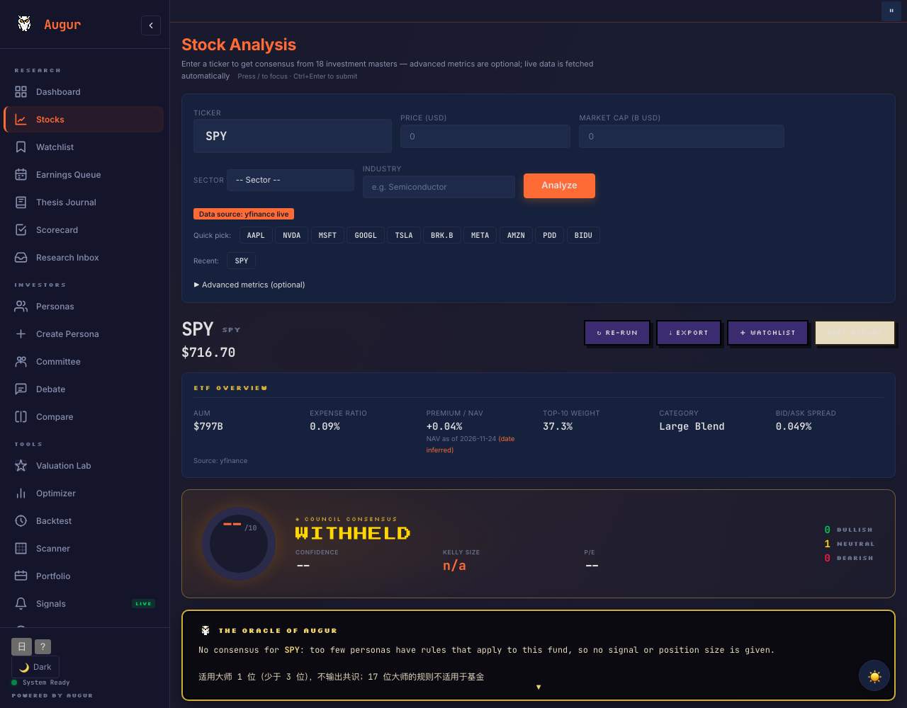
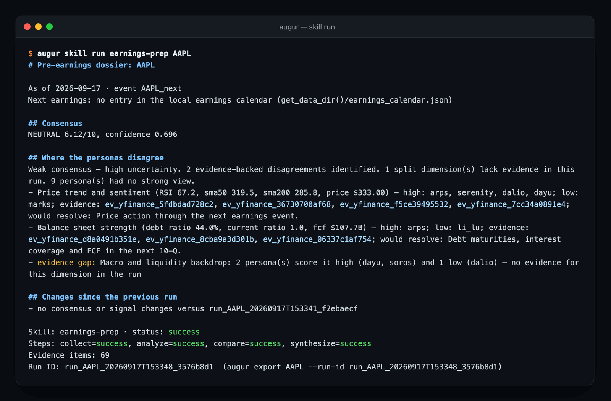
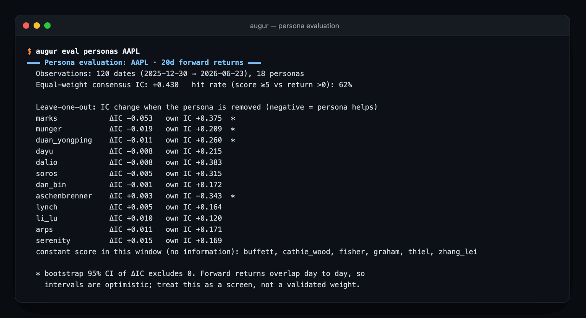
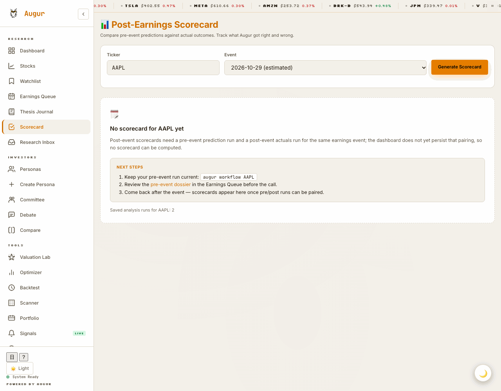
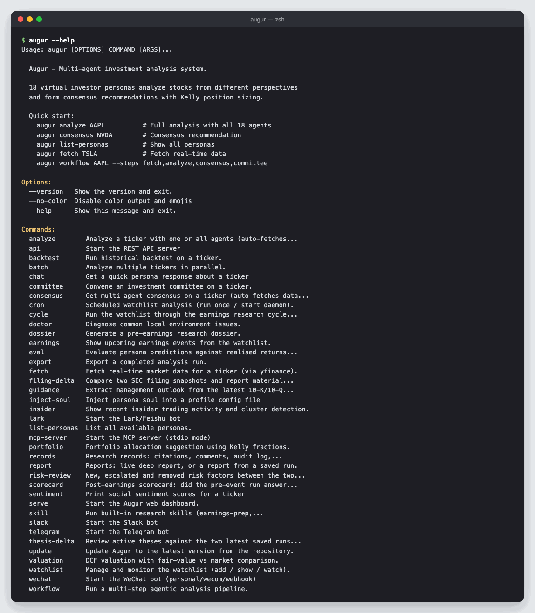

[🇨🇳 中文](README.md) | [🇺🇸 English](README_EN.md) | 🇯🇵 日本語

<div align="center">


# 🦉 Augur

**よくある AI 銘柄推奨ツールではありません。「いつ何を知っていたか、何が変わったか、誰がなぜ異なる見解を持っているか」を記憶する、ローカルのリサーチ記憶システムです。**

[](CHANGELOG.md)
[](https://github.com/BruceLanLan/augur/actions/workflows/tests.yml)
[](#-18-人の投資マスター)
[](#-claude--agent-連携)
[](#-データとプライバシー)
[](LICENSE)

</div>

> ⚠️ **研究・教育目的のみです。投資助言ではありません。** マスターたちは公に知られた投資哲学をルールベースでシミュレーションしたものであり、本人の見解ではありません。すべてのスコア、Kelly ポジションサイズ、バリュエーションは、データの品質とモデルの前提に依存します。

**目次**: [なぜ Augur なのか](#-なぜ-augur-なのか) · [Augur の LLM の使い方](#-augur-の-llm-の使い方) · [v14 の新機能](#-v14-の新機能) · [リサーチの流れ](#-リサーチの流れ) · [クイックスタート](#-クイックスタート5分) · [v14 へのアップグレード（および以前のアップグレード）](#-v13-から-v14-へのアップグレード) · [18 人のマスター](#-18-人の投資マスター) · [ダッシュボード](#-ダッシュボード) · [Claude / Agent](#-claude--agent-連携) · [CLI](#-cli-チートシート) · [機能の成熟度](#-機能の成熟度) · [データとプライバシー](#-データとプライバシー) · [開発](#-開発) · [ドキュメントとロードマップ](#-ドキュメントとロードマップ)

---

## 🤔 なぜ Augur なのか

多くの AI 銘柄推奨ツールは大規模言語モデル（LLM）に答えを出させます。Augur の分析は LLM を呼び出しません。18 人のマスターは各投資家の公開された投資哲学から書かれた決定的なルールであり、Augur が返すのは**後から検証できるリサーチ成果物**です。

| | LLM 銘柄推奨ツール | Augur |
|---|---|---|
| 結論の出し方 | LLM が生成し、同じ質問でも答えが変わることがある | ルールによるスコアリング。同じ入力なら同じスコアになり、バックテストできる |
| 得られるもの | 「一方では…、他方では…」 | 18 人のマスターによる独立した判定と、どこで一致しどこで対立しているか |
| データの出どころ | 不明 | すべての証拠項目に、ソース、ビジネス時刻、利用可能時刻、取得時刻が付与される |
| 欠損データ | 黙ってゼロ扱い | `missing` と表示され、そのフィールドを必要とするマスターは `abstain`（棄権）して理由を述べる |
| 3 か月後 | 記憶なし | 各実行はイミュータブルな RunBundle となり、エクスポート・比較・監査できる |
| データの保存場所 | 誰かのクラウド | ローカルの `~/.augur`（`AUGUR_DATA_DIR` で変更可能）、テレメトリなし |

---

## 🧠 Augur の LLM の使い方

一言でいうと、**スコアリングに LLM は使いません。解釈は LLM に任せられます。** 使い方は 3 つです:

| モード | 考えるのは誰か | API キー | 使い方 |
|---|---|---|---|
| デフォルト: 決定的なルール | 18 人のマスターのルール（`src/augur/personas/`）とコンセンサスエンジン | 不要 | `augur analyze` / `consensus` / `workflow` / ダッシュボード。指標を手動で渡せばオフラインでも動きます |
| MCP / スキル: ホストのエージェントが LLM | 使っているエージェント（Claude Code、Claude Desktop、Hermes など）が Augur のツールでスコアと証拠を取得し、自分のモデルで解釈します | ホスト側で用意。Augur には不要 | `claude mcp add augur -- augur-mcp`、または Claude Desktop に `augur-mcp` を設定（[Claude / Agent 連携](#-claude--agent-連携)を参照） |
| オプション: 自分のキーでマスターと会話 | 設定した OpenAI 互換エンドポイント | `OPENAI_API_KEY` が必要 | `pip install -e ".[llm]"` の後、`OPENAI_API_KEY` を設定。必要なら `OPENAI_BASE_URL`（OpenAI 互換サービス）と `AUGUR_CHAT_MODEL`（デフォルト `gpt-4o`）も設定。`augur chat` とダッシュボードの `/chat` で使われます。キーがなければテンプレートの返答になります |

もう 1 つ、デフォルトでオフの有料機能があります。`AUGUR_EDGAR_GUIDANCE_EXTRACTION=1` のとき、`augur guidance` は同じ OpenAI 互換エンドポイントで 10-K/10-Q から経営陣の見通しを抽出します。MCP ツール `augur_configure` は v14 で非推奨になりました。Augur のスコアリングはモデルを呼び出さず、このツールが書いた設定は読まれていなかったため、現在は説明を返すだけです。

---

## ✨ v14 の新機能

### 1. ETF ネイティブ分析


`augur consensus SPY`: Augur は ETF を識別し（yfinance の `quoteType`、A 株はコードの先頭 `.SS` 51/56/58、`.SZ` 15）、ファンドを企業として採点しなくなりました。企業の財務に基づくルールを持つマスターはファンドに対して**棄権**し、理由を示します。v14.0 で適用されるのは Dalio だけです（ETF の企業フィールドを変えてスコアが動くかどうかを調べるテストで決めています）。適用されるマスターが 3 人未満のときは**コンセンサスを出しません**（WITHHELD）。Kelly サイズも出さず、学習記録にも書きません。その下は ETF の概要とヘルスチェックです: 純資産総額（米ドル）、経費率、分配利回り、NAV とその日付、NAV の日付にそろえた乖離率、上位 10 銘柄の比率、売買スプレッド、組入銘柄ベースの PE。スクリーンショットは 2026-11-26 のライブデータです。米国・香港の ETF の NAV には日付がないため、最新の足の前の取引日と推定し、「推定」と表示します。CLI の ETF ブロックのラベルは今のところ中国語のみです。


`augur fetch 510300.SS`: A 株 ETF の基準価額と**実際の NAV 日付**は Sina の公開相場エンドポイントから取得します（yfinance には中国本土のファンドの NAV がありません）。yfinance はこれらのファンドの純資産総額、経費率、保有銘柄を提供しないため、チェックリストはそれらを推測せず「未チェック」と表示します。



ダッシュボード `/stocks?ticker=SPY`: 銘柄ページに ETF Overview カードが加わり、コンセンサスのカードは WITHHELD、ポジションサイズは n/a と表示されます。

### 2. 正確性の修正

- **RSI を Wilder の平滑化に変更**（以前は直近 14 個の変化だけを見る Cutler の RSI）。RSI を使うマスター（arps、dalio、marks、munger、soros、serenity、dayu、カスタムの `da-yu.yaml`）のスコアが変わります。
- **米ドル以外の銘柄は米ドルで計算**: 時価総額や FCF などを為替レートで米ドルに換算します。Tencent（0700.HK）は $3,097.6B の企業として扱われていましたが、約 $397.5B になりました。
- **Dayu のボラティリティのルール**は単位の誤りで発動していませんでした。**Thiel** とセクターの重み付けは Communication Services（GOOGL、META、Tencent）をテックとして扱います。中立のコンセンサスのポジションは 0 です。
- `--json` の stdout は JSON だけになりました。ダッシュボードの恐怖・強欲指数を再調整しました（VIX 28 は Fear）。バックテストページは的中率からドローダウンやシャープレシオを推定しなくなりました。全項目は [CHANGELOG](CHANGELOG.md) にあります。

### 3. LLM の役割をはっきりさせた

上の「[Augur の LLM の使い方](#-augur-の-llm-の使い方)」を参照してください。`[llm]` extra は使われていない `anthropic` をインストールしなくなりました。

---

## 📖 リサーチの流れ

このセクションは、新しいユーザーが実際に作業する順序に沿っています: ウォッチリストにティッカーを追加 → 決算日をバックフィル → 決算サイクルを実行 → リサーチ成果物を読む → ダッシュボードを開く。このセクションのスクリーンショットは 2026-10-29 に実際の AAPL / MSFT / NVDA データ（ライブの市場データ + SEC EDGAR）で撮影しました。報告サイクルから推定した決算日は、CLI 出力とダッシュボードの両方で `estimated` と表示されます。これは企業が発表した日付ではありません。ターミナルのスクリーンショットは出力の主要部分を示しています。

### 1. ウォッチリストを作る: `augur watchlist add`

```bash
augur watchlist add AAPL
augur watchlist add MSFT
augur watchlist add NVDA
```

ウォッチリストは決算サイクルの入力です。`augur earnings`、`augur cycle`、ダッシュボードの Earnings Queue はすべて、ここからティッカーを読み込みます。

### 2. 決算日をバックフィルする: `augur earnings --backfill`


ウォッチリストの各ティッカーについて、Item 2.02（業績）を含む SEC 8-K 提出書類を読み込んで過去の決算日を埋め、直近の報告サイクルから次の日付を推定して `estimated` と表示します。確定扱いにはしません。`<data dir>/earnings_calendar.json` に自分で書いたエントリが上書きされることはありません。ネットワークアクセスと `AUGUR_EDGAR_CONTACT_EMAIL` が必要です。特定のティッカーだけをバックフィルするには `-t AAPL` を渡します。スクリーンショットではティッカーごとに直近の数件だけを残し、それ以前の日付は 1 行にまとめています。3 つのティッカーにはそれぞれ `estimated` の日付が 1 件あります。

### 3. 決算サイクルをワンコマンドで: `augur cycle`


今後 N 日以内（デフォルトは 30 日）に決算発表を迎えるウォッチリストの各ティッカーについて、ドシエの準備状況、ドシエ、直近 2 回の実行間の変化、テーゼの差分を表示し、最後に `ready X/Y` とティッカーごとの次のステップを示します。保存済みのローカル状態だけを読み、ネットワークには一切アクセスしません。足りないものは、それを埋めるコマンドとともに示されます。スクリーンショットでは、3 つの推定日がすべて期間内に入るよう `--days 120` を使っています。撮影時点では 3 つとも準備ができていなかった（過去のガイダンス記録も SEC の証拠もなく、MSFT と NVDA には保存済みの実行もなかった）ため、サマリーは `ready 0/3` となり、その後にティッカーごとの次のステップが続いています。

### 4. リサーチ成果物: ドシエ、リサーチレポート、組み込みスキル

`augur dossier AAPL` は決算前のドシエを作成し、`augur report from-run AAPL` は最新の実行からリサーチレポートを作成し、`augur skill run` はリサーチワークフロー全体をワンコマンドで実行します。

以下のスクリーンショットは 2026-09-17 の実際の AAPL の実行です。これらのコマンドの出力はそれ以降変わっていないため、元の画像をそのまま使っています。



`augur skill run earnings-prep AAPL`: 18 人のマスターのコンセンサス、**証拠 ID を一つずつ引用した意見の相違**、裏付けとなる証拠のない見解の分かれを「証拠ギャップ」として明示したもの、そして前回の実行との差分を表示します。次の決算日はローカルの決算カレンダー（上記の `--backfill` ステップで埋められます）から取得され、`confirmed` または `estimated` と表示されます。カレンダーにエントリがない場合は、推測せずにその旨を示します。どのステップを開始する前にも、ランナーはワークフローが触れるすべての機能、ネットワークドメイン、ローカルリソースがマニフェストで宣言されているかをチェックし、1 つでも満たさなければ何も実行しません。各実行は、エクスポートして監査できる RunBundle として保存されます。


`augur skill run filing-delta AAPL`: 直近 2 件の 10-K の XBRL データを取得し、重要な変化（≥5%）を一覧にします。受付番号は不要です。ほかにも `debt-covenant-review`（レバレッジとインタレストカバレッジ）と `insider-cluster-review`（Form 4 のインサイダークラスター）が組み込まれています。[スキルガイド](docs/skills-guide.md)（中国語）を参照してください。


`augur report from-run AAPL`（スクリーンショットは `augur research-report` からの名称変更前のものですが、出力は同じです）: 投票の内訳、マスターの意見が分かれる観点（それぞれ証拠 ID を引用し、どの事実で決着がつくかを示します）、意見が一致する点、証拠のない見解の分かれ、そして実行 ID、コードのバージョン、ステップの状態、証拠のカバレッジを表示します。


`augur risk-review AAPL`: 直近 2 件の 10-K のリスク要因セクションを比較し、新規・削除・深刻化したリスクを一覧にします。ルールベースのため、わずかな文言の変更が「新規」と「削除」の両方として現れることがあります。



`augur eval personas AAPL`: `augur backtest` が書き込んだ記録を使い、マスターを 1 人ずつ除外して、コンセンサスの IC が良くなるか悪くなるかを示します。スコアが一定の（情報を持たない）マスターは別に一覧表示されます。フォワードリターンは日ごとに重なり合うため、区間は楽観的になります。検証済みのウェイトではなく、スクリーニングとして扱ってください。`augur eval factors` は各マスターのスコアをファクターとして扱い、その IC と t 検定を示します。

### 5. ダッシュボード

`augur serve --open` で http://localhost:8000 が開きます。これらのスクリーンショットも 2026-10-29 に実際の AAPL / MSFT / NVDA データで撮影しました。


ホーム: マーケットテープとマスターの概要。サイドバーは Research / Investors / Tools / System にグループ分けされています。


`/earnings`: Earnings Queue は `augur earnings` と同じウォッチリストと決算カレンダーを読み込みます。各ティッカーについて、まだ欠けているドシエ項目と、それぞれを埋めるコマンドが一覧表示されます。推定日には `estimated` と表示されます。



`/scorecard`: 決算後スコアカードは、イベント前後の実行がどのリサーチ課題に答えたかをチェックします。データが不十分な場合は、プレースホルダーの内容ではなく、理由とともに `unavailable` を表示します。スクリーンショットはまさにその状態を示しています。ダッシュボードはまだイベント前とイベント後の実行の組み合わせを保持していないため、実際のスコアカードを作成できません（CLI の `augur scorecard` なら、回答済みのリサーチ課題と比較できます）。


`/thesis`: カタリスト、リスク、反証条件を含むテーゼを記録でき、未解決のリサーチ課題や意思決定ログと並べて表示されます。リサーチ課題はローカルに保存され、`augur dossier` にも表示されます。スクリーンショットのテーゼと課題は撮影時に手入力した例であり、リサーチの結論ではありません。


`/valuation`: 入力に合わせて再計算される 2 段階 DCF で、強気 / 基本 / 弱気のシナリオと確率加重の適正価値を示し、ページ下部には WACC × 永久成長率の感応度グリッドがあります。スクリーンショットの入力値は例であり、バリュエーションの判断ではありません。

---

## 🚀 クイックスタート（5分）

Python 3.10 以上。

```bash
git clone https://github.com/BruceLanLan/augur.git && cd augur
python3 -m venv .venv && source .venv/bin/activate
pip install -e ".[data]"            # core + live yfinance data
# optional: pip install -e ".[data,mcp]"  MCP server
#           pip install -e ".[export]"    PDF export

# SEC EDGAR requires a real contact address in requests (US fundamentals)
export AUGUR_EDGAR_CONTACT_EMAIL="you@example.com"
```

**ダッシュボード:**

```bash
augur serve --open                 # http://localhost:8000 · ⌘K command palette
```

**CLI リサーチループ**（以下のすべてのコマンドはクリーンインストールで動作確認済みです）:

```bash
augur analyze AAPL                 # 18 masters + weighted consensus + Kelly size
augur fetch SPY                    # ETF: overview (AUM, expense ratio, NAV, premium/discount) + health checklist
augur consensus SPY                # ETF: applicable vs abstaining masters; no consensus below 3 applicable
augur workflow AAPL                # tracked pipeline, saves a RunBundle, prints the Run ID
augur report from-run AAPL         # from the latest run: consensus, disagreement map, provenance
augur export AAPL --format md      # export the latest run (md / json / evidence-pack / pdf)
augur committee AAPL --preset value -q "Is the moat widening or narrowing?"
augur valuation AAPL               # two-stage DCF, auto-fills FCF/shares/net debt and says so
augur skill run earnings-prep AAPL # built-in research skill: pre-earnings dossier (3 more skills)
augur watchlist add AAPL           # add to the watchlist
augur earnings --backfill          # backfill the watchlist's earnings dates from SEC 8-K (needs network)
augur cycle                        # earnings cycle for the watchlist: what is ready, what is missing, next step
```

オフラインの場合は、`augur analyze NVDA --pe 60 --roe 0.45` で指標を手動入力でき、`augur backtest AAPL --demo` は合成データを使います。`augur cycle` はローカル状態だけを読み、ネットワークには一切アクセスしません。

---

## 🔄 v13 から v14 へのアップグレード

v14 でコマンドの使い方は変わりませんが、一部のスコアと出力が変わります:

| 変更点 | 影響 | 対応 |
|---|---|---|
| RSI を Wilder の平滑化に変更 | arps、dalio、marks、munger、soros、serenity、dayu とカスタムの `da-yu.yaml` のスコアが変わります。RSI が 30 / 70 付近の銘柄で特に目立ちます | 不要。保存した v13 のスコアと比べる場合は注意してください |
| Dayu のボラティリティのルールが発動するように | 年率の小数をパーセントのしきい値と比べていたため、すべての銘柄が低ボラティリティの加点を受けていました。v13 と比べたポジションリスク要素の変化: 20 日ボラティリティ 15% 未満 0、15–25% −1、25–40% −2、40–60% −3、60% 超 −4。この要素は Dayu のスコアの 20% です | — |
| 米ドル以外の金額は米ドル | 香港株・A 株、および米ドル以外の通貨で決算を報告する銘柄（ADR など）: `market_cap`、`fcf`、`revenue` などは米ドル（十億）。価格は取引通貨のまま。為替レートが取れないときは換算せず、出力に現地通貨を表示します | `MarketContext` を読むコードでは単位に注意してください |
| Communication Services をテックとして扱う | Thiel とエンジンのセクター重み付けで GOOGL、META、Tencent などの判定が変わります | — |
| 中立のコンセンサスのポジションは 0 | 以前は `analyze` が 0.6% のような小さなサイズを出していました | — |
| ETF には 18 人のコンセンサスがなくなった | 概要、ヘルスチェック、適用されるマスターの判定を表示します。適用が 3 人未満（v14.0 では Dalio のみ）のときコンセンサスは WITHHELD で、ポジションサイズも学習記録もありません。ファンドの `pe` / `pb` は 0 で、組入銘柄ベースの値は `etf` 辞書にあります | ETF を株式として分析した以前の結果は使わないでください |
| `--json` のとき進捗メッセージは stderr へ | stdout は JSON だけになります | stdout の進捗テキストを読んでいたスクリプトは stderr を読むようにしてください |
| `[llm]` extra は `anthropic` をインストールしない。MCP `augur_configure` は非推奨 | コードでは使われていませんでした | 自分のコードで `anthropic` が必要なら別途インストールしてください |
| ダッシュボードのバックテスト API はリターン、ドローダウン、シャープレシオに `null` を返す | 以前は的中率から推定した値で、実測ではありませんでした | — |

学習データのスキーマは 2 のままで、何も破棄されません。旧 RSI で記録された未決済の予測は通常どおり決済されます（その判断は実際に行われたものだからです）。v14 より前に ETF を分析して書かれた学習記録はそのまま残り、関係するマスターの正解率にわずかなノイズを加えます。クリーンアップツールは後のバージョンに回しました。

<details>
<summary><strong>v12 から v13 へのアップグレード</strong></summary>

v13 は整理に加えて新機能を 1 つ追加したリリースです。破壊的変更は以下の 3 つだけで、いずれもインポートレベルのものです。コマンドラインの使い方は変わりません。

| 変更点 | 対応 |
|---|---|
| Python 3.10 以上が必須（3.9 は 2025 年 10 月にサポート終了） | 3.10 以降で仮想環境を作り直してください |
| `augur.accounting`、`augur.capital_allocation`、`augur.debate_engine`、`augur.relative_val`、`augur.portfolio_risk` が `augur.experimental.<同じ名前>` に移動 | `from augur.accounting import ...` を `from augur.experimental.accounting import ...` に変更してください。これらのモジュールを使う製品パスはなく、API は変更される可能性があります |
| 互換モジュール `augur.coordinator`、`augur.skill_spec`、`augur.mcp_entry` を削除 | 代わりに `augur.registry`、`augur.schemas.skill_spec`、`augur.mcp_server` からインポートしてください。`augur-mcp` コマンドには影響しません |

新機能: `augur earnings --backfill` は、SEC 8-K 提出書類（Item 2.02、業績）からウォッチリストの過去の決算日を埋め、直近のサイクルから次の日付を推定して `estimated` と表示します。確定扱いにはしません。カレンダーに自分で書いたエントリは保持されます。バックフィル後は、`augur cycle` が処理するイベントを持つようになります。

</details>

<details>
<summary><strong>v11 から v12 へのアップグレード</strong></summary>

12.0 は正確性の修正、12.1 は決算サイクル全体を 1 つのコマンド（`augur cycle`）にまとめ、12.2 は CLI のグループ化とダッシュボードの整理を行いました。v12 ではマスターもページも追加していません。Augur の中核となる 2 つのループ、**決算リサーチサイクル**と**過去の予測からの学習**のつなぎ目を修正しています。v11 では各コマンドは単体で動作していましたが、連鎖は壊れていました。

| 変更点 | 影響 | 対応 |
|---|---|---|
| 学習済みウェイトのファイルがスキーマ 2 に移行 | 初回読み込み時に、v11 が記録した結果と、それに基づく精度・ウェイトは破棄されます（保留中の予測は保持されます）。v11 は異なる日に行われた予測に 1 つの「直近 30 日リターン」を適用していたため、それらの結果は保存先の予測に対応していませんでした | 不要です。学習済みウェイトはデフォルトでオフ（`AUGUR_FORCE_LEARNED`）なので、分析結果には影響しません |
| 各予測はそれぞれのホライズンで確定 | 予測日の終値から 30 日後の終値までのリターン。60 日後に失効することはなく、すべての結果は監査用に `<data dir>/prediction_outcomes.jsonl` に追記されます | — |
| マスターごとに 1 日 1 予測 | 以前はティッカーを再分析するたびに予測が追加されていました | — |
| `-t` なしの `augur earnings` が実際のウォッチリストを読み込む | 以前は誤ったキーを読んでおり、キューが常に空でした | `augur watchlist add AAPL` でティッカーを追加してください |
| ダッシュボードの決算ページにハードコードされた内容を表示しない | 欠損データは、プレースホルダーのリスクではなく、理由と次のステップとともに表示されます | — |
| リサーチ課題を `<data dir>/thesis/questions.json` に保存 | ダッシュボードを再起動しても残り、`augur dossier` にも表示されます | — |
| コマンドのグループ化（12.2） | `watchlist-add` → `watchlist add`、`cron-run` → `cron run`、`research-report` → `report from-run`、`ledger` / `citations` / `comments` / `audit` / `decisions` / `verify-pack` → `records ...`、`ic-report` → `eval ic`、`skills` → `skill profiles`、`compat` → `skill compat` | 旧名は次のメジャーリリースまで動作し続け、stderr に注意書きを 1 行追加するだけです。stdout をパースするスクリプトには影響しません |

全一覧は [CHANGELOG.md](CHANGELOG.md) にあります。

</details>

<details>
<summary><strong>v10 からのアップグレード</strong></summary>

v11.0.0 は単独ではリリースされず、その内容は v12.0.0 とともに出荷されました。v11 は**信頼性とリサーチ基盤**のリリースであり、以下の挙動の変更は v12 から v14 でも引き続き適用されます:

| 変更点 | 影響 | 対応 |
|---|---|---|
| `insider_ownership` / `institutional_ownership` が `0` から `Optional[float]` に変更 | 欠損値は `None` になり、これらを使う 11 人のマスターは棄権します | カスタムコードで `None` を扱ってください |
| Rolling-IC ウェイトはデフォルトでブレンドされなくなった | キャリブレーション状態が `validated-calibrated` の場合のみ適用されます | 試すには `AUGUR_FORCE_RIC=1` |
| 学習済み（R6）ウェイトはデフォルトでブレンドされなくなった | データが少ないと、ノイズを「スキル」に変えてしまいます | 試すには `AUGUR_FORCE_LEARNED=1` |
| SEC EDGAR の時価総額が十億 USD 単位に | 以前はオーバーレイが生の USD を返しており、規模や FCF 利回りのチェックを歪めていました。**v11 より前に生成されたリプレイ由来のファクター/IC の結果にはその誤りが含まれます** | それらに依存している場合は、リプレイの成果物を再生成してください |
| `augur serve` / `augur api` はデフォルトで `127.0.0.1` にバインド | 初期状態では LAN から到達できません | `AUGUR_API_TOKEN` を設定してから `--host 0.0.0.0` を渡してください |
| `field_availability` のないレガシーなリプレイ記録は拒否される | 黙って読み込む代わりに明確なエラーになります | 再生成してください |
| MCP は `mcp` 1.x と 2.x で動作 | — | — |

その後、上記の v11 → v12、v12 → v13、v13 → v14 の手順（Python 3.10 以上を含む）に従ってください。詳細: [docs/RELEASE_NOTES_v11.md](docs/RELEASE_NOTES_v11.md) と [CHANGELOG.md](CHANGELOG.md)。

</details>

---

## 🎭 18 人の投資マスター

> バリュー、グロース、マクロ、中国市場にわたる投資哲学をルールベースで描いたものです。中国のマスターは中国語で回答します。

| 学派 | マスター |
|--------|---------|
| 🏦 クラシック・バリュー | Warren Buffett · Benjamin Graham · Charlie Munger · Philip Fisher |
| 🚀 グロース & イノベーション | Peter Lynch · Cathie Wood · Peter Thiel · Leopold Aschenbrenner |
| 🌍 マクロ & サイクル | Ray Dalio · George Soros · Howard Marks · ARPS（暗号資産/金） |
| 🇨🇳 中国バリュー | Duan Yongping · Zhang Lei · Li Lu · Dan Bin · Dayu |
| ⚙️ スペシャル | Serenity（AI コンピュートのサプライチェーン） |

コンセンサスエンジンは確信度、データカバレッジ、セクターとの関連性で重み付けを行い、シグナル、スコア、確信度、Kelly ポジションサイズを出力します。`augur list-personas` ですべての ID を表示できます。


---

## 📊 ダッシュボード

`augur serve` を実行し、http://localhost:8000 を開きます。

| ページ | パス | 機能 |
|---|---|---|
| Home | `/` | マーケットテープ + マスターの概要 |
| Masters | `/personas` | 18 人のマスター全員 |
| Stock analysis | `/stocks` | ティッカーを入力すると、18 人のマスターが分析します |
| Committee / Debate / Compare | `/committee` · `/debate` · `/compare` | プリセットの委員会、複数ラウンドのディベート、レーダー比較 |
| History | `/history` | 実行履歴とヒートマップ |
| Thesis Journal | `/thesis` | テーゼ、反証条件、意思決定ログ |
| Earnings | `/earnings` · `/scorecard` | 決算キュー、決算後スコアカード |
| Research inbox | `/inbox` | 対応が必要な項目の集約 |
| Valuation lab | `/valuation` | DCF の入力 + 感応度グリッド |
| Portfolio / Watchlist / Settings | `/portfolio` · `/watchlist` · `/settings` | Kelly 配分、スケジュール分析、レイアウトとマスターのサブセット |

---

## 🔌 Claude / Agent 連携

MCP サーバーは 14 個のツール（組み込みスキル用の `augur_run_skill` を含む）、7 個のリサーチプロンプト、5 種類の読み取り専用リソース（`augur://evidence/{id}`、`augur://runs/{id}`、`augur://thesis/{id}`、`augur://decisions/{id}`、`augur://ledger/{ticker}/{quarter}`）を公開しています。`mcp` 1.x と 2.x の両方で、実際の stdio クライアントセッションにより検証済みです。

```bash
pip install -e ".[data,mcp]"
claude mcp add augur -- augur-mcp   # Claude Code: stdio MCP サーバーとして登録
```

Claude Desktop の設定:

```json
{
  "mcpServers": {
    "augur": { "command": "augur-mcp", "env": { "AUGUR_EDGAR_CONTACT_EMAIL": "you@example.com" } }
  }
}
```

analyze、consensus、debate、committee の各ツールは `asset_type`（`equity` / `etf` / `fund`、空なら自動判定）を受け付けます。Hermes / OpenClaw のスキルパック（`src/skills/`、[docs/hermes-setup-guide.md](docs/hermes-setup-guide.md) を参照）や、Telegram / Slack / Lark / WeChat のボットのエントリポイントもあります。設定の詳細は [docs/en/agent-integration-guide.md](docs/en/agent-integration-guide.md)（英語）を参照してください。

---

## 💻 CLI チートシート

```bash
# Analysis
augur analyze AAPL [--persona buffett] [--json]
augur workflow TSLA --steps fetch,analyze,consensus,committee,debate,sentiment
augur committee NVDA --agents buffett,munger,dalio
augur batch AAPL MSFT NVDA

# Research artifacts
augur report from-run AAPL [--format json]    # consensus + evidence-derived disagreement + provenance and latency
augur export AAPL --format md|json|evidence-pack|pdf [-o PATH] [--run-id ...]
augur records verify-pack pack.zip              # check every file's SHA-256 in an evidence pack
augur dossier AAPL                              # pre-earnings dossier
augur valuation AAPL [--fcf 100e9 --shares 15e9 --growth 0.08 --wacc 0.10]
augur risk-review AAPL                          # new / removed / escalated risk factors across the last two 10-Ks
augur records ledger AAPL                       # what changed between the two latest analysed runs
augur thesis-delta AAPL                         # active theses vs the two latest runs (offline)
augur scorecard AAPL [--pre RUN --post RUN]     # post-earnings scorecard: pre-event answers vs outcomes
augur cycle [--days 30] [--format markdown]     # watchlist through the earnings cycle: readiness / dossier / ledger / thesis delta
augur filing-delta AAPL --new q3.json --prev q2.json

# Built-in research skills (permission-checked, saved as RunBundles)
augur skill list · augur skill show filing-delta
augur skill run earnings-prep|filing-delta|debt-covenant-review|insider-cluster-review AAPL

# Evaluation (on records written by augur backtest)
augur backtest AAPL --days 120 [--demo] · augur eval ic
augur eval personas AAPL [--horizon 20]         # consensus IC, hit rate, leave-one-out contribution per master
augur eval factors AAPL                         # each master's score as a factor: IC, t, p

# Research records
augur records decisions list|resolve|report     # decision outcomes and win rate
augur records comments add|list|resolve         # comments on runs / theses / decisions / evidence
augur records citations report|list|accept|reject|fixed # citation-correction queue
augur records audit [--action ...]              # audit log

# Data
augur fetch AAPL · augur sentiment AAPL · augur insider AAPL · augur earnings --days 30 · augur doctor
augur fetch SPY · augur consensus SPY · augur report SPY   # ETF: overview, health checklist, applicable / abstaining masters
augur earnings --backfill          # backfill the earnings calendar from SEC 8-K Item 2.02: past dates + one cadence-estimated next date (tagged estimated; never overwrites hand-written entries)

# Monitoring & servers
augur watchlist add AAPL · augur watchlist show · augur watchlist watch AAPL NVDA --interval 60
augur cron run · augur cron start
augur serve [--port 8000] · augur mcp-server · augur skill profiles · augur skill compat
```

`augur --help` はトップレベルの全 38 コマンドを一覧表示します（pip インストールでは `augur update` が非表示になるため 37）。v12.2 以降、関連するコマンドはグループ化されています（`watchlist` / `cron` / `report` / `records` / `eval` / `skill`）。旧来のフラットな名前（例: `watchlist-add`、`research-report`、`ic-report`、`ledger`）は v14 でも動作しますが、`--help` には表示されず、stderr に新しい形式を示す 1 行のヒントを出力します。`augur report AAPL` は変わらず、`augur report run AAPL` と同じです。



---

## 🧭 機能の成熟度

「コードがある」ことを「動作する」と誤解されないよう、率直に記載します。

| 状態 | 範囲 |
|---|---|
| **安定** | 18 人のマスターによる分析とコンセンサス、上記の CLI リサーチループ、ダッシュボードの主要ページ、MCP サーバー、RunBundle とエクスポート、データソースチェーン（yfinance → SEC EDGAR オーバーレイ） |
| **動作するが、制限事項あり** | ETF 分析（v14.0 で適用されるのは Dalio のみなので、コンセンサスは常に WITHHELD。A 株 ETF は NAV と乖離率のみで、純資産総額、経費率、保有銘柄、リアルタイムの IOPV はなし。乖離率は最新の 1 日分のみで、履歴やトラッキングエラーはなし。CLI の ETF ラベルは中国語のみ）。4 つの組み込みスキル（組み込みのマニフェストのみ実行可能。コベナンツレビューはデフォルトで参考しきい値を使い、企業の与信契約は使いません。決算日はローカルのカレンダーファイル `earnings_calendar.json` から取得され、これは手で書くか `augur earnings --backfill` で SEC 8-K から埋められます。推定された次の日付は `estimated` と表示されます）、意見の相違マップ（観点ごとのマスターのスコアから導出され、証拠を引用し、観点と指標の対応表は固定）、`augur risk-review`（ルールベース: 言い回しが変わったリスク要因は新規 1 件と削除 1 件として表示されることがあります）、`augur eval`（フォワードリターンが重なり合う単一ティッカーの時系列 IC — 有意性は楽観的で、スクリーニング専用）、`augur guidance`（`AUGUR_EDGAR_GUIDANCE_EXTRACTION=1` が必要で、有料の LLM を呼び出します）、PDF エクスポート（`[export]` extra が必要） |
| **実験的（デフォルトでオフ）** | Rolling-IC 動的ウェイト（`AUGUR_FORCE_RIC=1`）、学習済みウェイト（`AUGUR_FORCE_LEARNED=1`）— いずれも事前登録されたサンプル外テストに合格していません |
| **コードのみ、エントリポイントなし** | `augur.experimental.accounting`（会計の質）、`augur.experimental.capital_allocation`、`augur.experimental.debate_engine`（ダッシュボードの `/debate` ページは別の実装を使用）、`augur.experimental.relative_val`（相対バリュエーション）、`augur.experimental.portfolio_risk` — ユニットテストはありますが、CLI、ダッシュボード、MCP のどのパスからも呼び出されません。ライブラリとしては使えますが、製品機能ではありません |
| **未計測** | 実行記録におけるトークン使用量（記録されるのはレイテンシのみ） |

---

## 🔒 データとプライバシー

- すべての状態はローカルのデータディレクトリ（デフォルトは `~/.augur`、変更するには `AUGUR_DATA_DIR`）に保存されます。テレメトリはありません。デフォルトではサインアップ不要のシングルユーザーです（`AUGUR_MULTI_USER=1` でマルチユーザーモードも利用可能）。
- Augur が行うネットワークリクエスト: 市場データ、ファンダメンタルズデータ、為替レート（yfinance、SEC EDGAR）。A 株 ETF の NAV（Sina の相場 `hq.sinajs.cn`）。オプションの LLM 呼び出し（`OPENAI_API_KEY` を設定して会話やガイダンス抽出を使う場合のみ）。ダッシュボードのページは jsDelivr CDN から Chart.js を読み込みます。
- ダッシュボードはデフォルトで localhost のみで待ち受けます。外部に公開する前に `AUGUR_API_TOKEN` を設定してください。[docs/self-hosted-guide.md](docs/self-hosted-guide.md) を参照してください。

主な環境変数:

| 変数 | 用途 |
|---|---|
| `AUGUR_DATA_DIR` | データディレクトリ |
| `AUGUR_EDGAR_CONTACT_EMAIL` | SEC EDGAR が求める連絡先アドレス（未設定の場合は警告付きでプレースホルダーを使用） |
| `AUGUR_API_TOKEN` / `AUGUR_MULTI_USER` | ダッシュボードの `/api/*` 認証 |
| `AUGUR_CORS_ORIGINS` | 許可する CORS オリジン |
| `AUGUR_FORCE_RIC` / `AUGUR_FORCE_LEARNED` | 実験的な動的ウェイトを有効化 |
| `AUGUR_SKIP_MACRO_FETCH` | VIX/SPY のマクロデータ取得をスキップ（オフラインまたは CI） |
| `AUGUR_EDGAR_GUIDANCE_EXTRACTION` | LLM ベースのガイダンス抽出を有効化（有料。下の OpenAI 互換エンドポイントを使用） |
| `OPENAI_API_KEY` | オプション: マスターとの会話とガイダンス抽出に使う OpenAI 互換エンドポイントのキー（`[llm]` が必要） |
| `OPENAI_BASE_URL` | オプション: OpenAI 互換サービスの URL（未設定なら OpenAI） |
| `AUGUR_CHAT_MODEL` / `AUGUR_CHAT_MAXTOK` | オプション: 会話に使うモデル名（デフォルト `gpt-4o`）と最大出力トークン数（デフォルト 1024） |

---

## 🔧 開発

```bash
python3 -m venv .venv && source .venv/bin/activate
pip install -e ".[dev,data,mcp]" "ruff>=0.16,<0.17" build

make verify     # full test suite + ruff + wheel/sdist build with sha256 digests
make lint       # ruff (rule set pinned to E4/E7/E9/F)
make test-wheel # install the built wheel into a fresh venv and smoke-test it
```

- テストは一時的な `AUGUR_DATA_DIR` に対して実行され、`~/.augur` に書き込むことはなく、ネットワークを完全に遮断した状態でも通ります。
- CI（`.github/workflows/`）: `Tests` は Python 3.10 / 3.11 / 3.12 で全テストを実行し、収集されたテスト数を検証します。`Hermetic Smoke` は wheel と sdist からそれぞれ新しい venv にインストールし、ruff と pip-audit を実行します。
- [CONTRIBUTING.md](CONTRIBUTING.md) を参照してください。

---

## 📚 ドキュメントとロードマップ

| ドキュメント | 内容 |
|---|---|
| [docs/ROADMAP.md](docs/ROADMAP.md) | 唯一の公式ロードマップ: 現在のフェーズ、各ステップの検証ポイント、v14 以降の候補、未決定事項（中国語） |
| [docs/en/RELEASE_NOTES.md](docs/en/RELEASE_NOTES.md) | ユーザー向けのリリースノート（英語、v14 が先頭） |
| [docs/RELEASE_NOTES_v11.md](docs/RELEASE_NOTES_v11.md) | v11 のリリースノートと移行ガイド（v12 と v13 の変更は [CHANGELOG.md](CHANGELOG.md) にあります） |
| [docs/reviews/](docs/reviews/) | プロジェクトのレビュー。各指摘に証拠レベルと修正内容が付いています（中国語） |
| [docs/schema-reference.md](docs/schema-reference.md) | EvidenceItem / Claim / StepResult / RunBundle / SkillSpec |
| [docs/api-reference-v11.md](docs/api-reference-v11.md) | Python API / REST / MCP |
| [docs/examples.md](docs/examples.md) | 実践例 |
| [docs/self-hosted-guide.md](docs/self-hosted-guide.md) | Docker / systemd / リバースプロキシ / 認証 |
| [docs/INDEX.md](docs/INDEX.md) | ドキュメントの完全な索引 |

---

## 📝 変更履歴

<details open>
<summary><strong>v14.0.0 — ETF ネイティブ分析、正確性の修正、LLM の役割の明確化（現行）</strong></summary>

- **ETF ネイティブ分析**: ETF を識別し、純資産総額、経費率、NAV（A 株は Sina の実際の NAV 日付）、NAV の日付にそろえた乖離率、上位 10 銘柄の比率、ヘルスチェックを表示します。ルールが当てはまらないマスターは棄権し、適用が 3 人未満ならコンセンサス、ポジションサイズ、学習記録はありません
- **正確性**: Wilder の RSI、米ドル以外の金額の米ドル換算、Dayu のボラティリティの単位、Communication Services をテックとして扱う、中立のサイズは 0、`--json` の stdout は JSON のみ、恐怖・強欲指数の再調整
- **LLM の役割**: README に「Augur の LLM の使い方」を追加。`augur_configure` は非推奨。`[llm]` は `anthropic` をインストールしない。上の「v13 から v14 へのアップグレード」を参照してください

</details>

<details>
<summary><strong>v13.0.0 — SEC からの決算日取得、Python 3.10、より小さな公開 API</strong></summary>

- **決算日のバックフィル**: `augur earnings --backfill` は SEC 8-K 提出書類（Item 2.02）から過去の決算日を埋め、サイクルから次の日付を推定します（estimated と表示）。`augur cycle` は手書きのカレンダーに依存しなくなりました
- **破壊的変更**: Python 3.10 以上。製品のエントリポイントを持たない 5 つのモジュールを `augur.experimental` に移動。3 つの互換モジュールを削除。上記の「v12 から v13 へのアップグレード」を参照してください

</details>

<details>
<summary><strong>v12.2.0 — 1 つのコマンドツリー、より分かりやすいダッシュボード</strong></summary>

- **CLI のグループ化**: `watchlist` / `cron` / `report` / `records` / `eval` / `skill` のグループ。`augur --help` の項目は 47 から 38 に減りました。旧名も引き続き動作し、新しい形式を案内します
- **ダッシュボード**: サイドバーを Research / Investors / Tools / System にグループ分けし、Earnings Queue、Thesis Journal、Scorecard、Research Inbox へのリンクを追加。決算の行には読みやすい欠落項目と、それぞれを埋めるコマンドを表示。スコアカードのイベント選択が Loading のまま止まらなくなりました。Thesis Journal の空の状態、エラー、スマートフォン向けレイアウトを作り直しました
- **学習データ**: ダッシュボードと cron ジョブが互いの書き込みを上書きしなくなりました

</details>

<details>
<summary><strong>v12.1.0 — 決算サイクルをワンコマンドで</strong></summary>

- `augur cycle`: 決算発表が近いウォッチリストの各ティッカーについて — 準備状況、ドシエ、前回の実行からの変化、テーゼの差分 — を示し、最後に `ready X/Y` とティッカーごとの次のステップを表示
- `augur scorecard`: イベント前後の実行がどのリサーチ課題に答えたか
- `augur thesis-delta`: 直近 2 回の実行に対するアクティブなテーゼ

</details>

<details>
<summary><strong>v12.0.0 — 決算ループと誠実な学習</strong></summary>

- **学習結果の修正**: マスターの各予測は、それぞれの 30 日ホライズンで確定します（v11 は異なる日に行われた予測に 1 つの「直近 30 日リターン」を適用していました）。期限切れで消えるものはなく、境界は暦日単位で、すべての結果は監査用に `prediction_outcomes.jsonl` に追記されます。マスターごとに 1 日 1 予測です。v11 が記録した結果は初回読み込み時に破棄され、保留中の予測は保持されます
- **決算ループの接続**: 決算キューは実際のウォッチリストを読み込み、ドシエの準備状況は保存済みの実行を使い、ダッシュボードはハードコードされた決算の内容を表示しなくなりました
- **リサーチ記録**: リサーチ課題が永続化され、同一秒内の実行の順序付けを修正し、実行には実際のパッケージバージョンが記録されます
- **2026-09-17 の 3 ラウンドを初めて出荷**（v11.0.0 GA はリリースされませんでした）: 組み込みスキルランナー（`augur skill run`、どのステップの前にも権限をチェック）、観点ごとのマスターのスコアから導出され証拠を引用する意見の相違マップ、バックテスト記録に対する `augur eval`、2 件の 10-K にわたる `augur risk-review`、2 回の実行間の `augur ledger`、リサーチ記録コマンド（意思決定の結果 / コメント / 引用の訂正 / 監査ログ）、証拠パックのダイジェスト検証。さらに、クリーンインストールからすべてを実行して見つかった修正: `workflow` のチェックポイントのクラッシュ、証拠のタイムスタンプのタイムゾーンのバグ、`export` / `research-report` / `dossier` を実際の実行に接続、`committee` のクラッシュ、SEC EDGAR の時価総額が 10⁹ ずれていた問題、バリュエーションが入力値を捏造していた問題、サーバーがデフォルトで LAN に公開されていた問題、pip インストールでのアバターの 404、`mcp` 2.x への MCP 対応、CI の偽グリーンの修正
- [CHANGELOG](CHANGELOG.md) と [ROADMAP](docs/ROADMAP.md) を参照してください

</details>

<details>
<summary><strong>v11.0.0-rc1 — リサーチ記憶システム</strong></summary>

- **リサーチ基盤**: 3 つの時間セマンティクスを持つ EvidenceItem、Claim、StepResult、イミュータブルな RunBundle、宣言的な SkillSpec v1
- **リサーチループ**: Thesis Journal、Filing Delta、意見の相違マップ、Guidance Tracker、リサーチ受信箱、DCF バリュエーションラボ
- **信頼性**: 欠損データを明示的に伝播、キャリブレーション状態のラベル、未検証の動的ウェイトはデフォルトでオフ

[CHANGELOG.md](CHANGELOG.md) を参照してください。
</details>

<details>
<summary><strong>v10.15.0 — 公開同期リリース</strong></summary>

実際の SEC EDGAR ファンダメンタルズ、3 つの信頼性の修正、`augur doctor` による環境診断。
</details>

<details>
<summary><strong>v10.0.0 以前</strong></summary>

v10: Bloomberg 風ターミナル + ワークフロー + MCP ツール · v9: Hermes Agent + 委員会 · v8: HD-2D デザインシステム
</details>

---

<div align="center">

MIT License · 作成者 [BruceLanLan](https://github.com/BruceLanLan)（X: [@BruceBlue](https://x.com/BruceBlue)）

*研究・教育目的のみです。投資助言ではありません。*

</div>
