[🇨🇳 中文](README.md) | [🇺🇸 English](README_EN.md) | 🇯🇵 日本語

<div align="center">

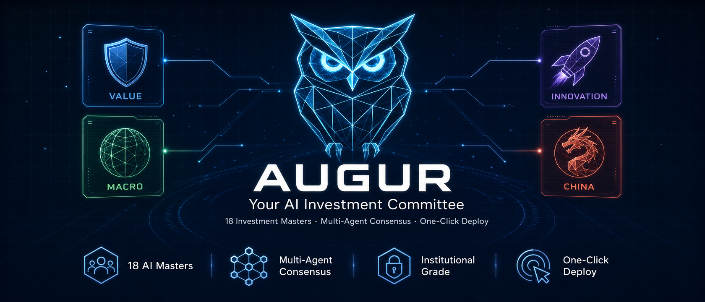

# 🦉 Augur

**手元のマシンで動く投資リサーチツール。18 人の投資マスターによるルールベースの採点と、後から検証できるリサーチ記録を提供します。**

[](CHANGELOG.md)
[](https://github.com/BruceLanLan/augur/actions/workflows/tests.yml)
[](#-18-人の投資マスター)
[](#-claude--agent-連携)
[](#-データとプライバシー)
[](LICENSE)

</div>

Augur は、著名投資家の公開された投資哲学をもとに書かれた 18 組の決定的なルール（以下「マスター」）で銘柄を分析し、コンセンサスのシグナルと Kelly ポジションサイズにまとめます。各実行は証拠とその出典ごと変更不能な記録として保存されるので、数か月後でも「当時何を知っていたか」「その後何が変わったか」「マスターたちがどの事実で意見を分けたか」を確認できます。採点に LLM は使わず、データは手元のマシンに保存されます。

**v14 の目玉は ETF ネイティブ分析です。** Augur は ETF を識別し、ETF 概要（純資産総額、経費率、NAV、乖離率など）とヘルスチェックを表示します。ファンドを企業として採点することはなくなりました。企業の財務データに依存するルールを持つマスターはファンドに対して棄権します。v14.0 で適用できるのは Dalio だけで、コンセンサスに必要な 3 人に届かないため、現時点では ETF にコンセンサスは出ません。このほか、RSI を Wilder 平滑化に変更し、米ドル以外の銘柄の金額を米ドルに換算するようにしました。詳しくは [v14 の新機能](#-v14-の新機能) を参照してください。

試してみる（Python 3.10 以上）：

```bash
git clone https://github.com/BruceLanLan/augur.git && cd augur
python3 -m venv .venv && source .venv/bin/activate && pip install -e ".[data]"
augur analyze AAPL     # 各マスターの判断、コンセンサス、Kelly サイズ
augur consensus SPY    # ETF：ETF 概要、ヘルスチェック、適用できるマスター
```

> ⚠️ **研究・教育目的のみです。投資助言ではありません。** マスターは公に知られた投資哲学をルールでシミュレーションしたもので、本人の見解ではありません。スコア、Kelly サイズ、バリュエーションはすべてデータの品質とモデルの前提に依存します。

**目次**：[なぜ Augur なのか](#-なぜ-augur-なのか) · [インストールと最初の一歩](#-インストールと最初の一歩) · [v14 の新機能](#-v14-の新機能) · [Augur の LLM の使い方](#-augur-の-llm-の使い方) · [決算リサーチの流れ](#-決算リサーチの流れ) · [18 人のマスター](#-18-人の投資マスター) · [ダッシュボード](#-ダッシュボード) · [Claude / Agent](#-claude--agent-連携) · [CLI](#-cli-チートシート) · [成熟度](#-機能の成熟度と既知の制限) · [アップグレード](#-アップグレード) · [データとプライバシー](#-データとプライバシー) · [開発](#-開発) · [ドキュメント](#-ドキュメント) · [変更履歴](#-変更履歴)

---

## 🤔 なぜ Augur なのか

多くの AI 銘柄推奨ツールは、大規模言語モデル（LLM）に答えを出させます。Augur の分析は LLM を呼び出さず、後から検証できるリサーチ記録を返します。

| | LLM 銘柄推奨ツール | Augur |
|---|---|---|
| 結論の出し方 | LLM が生成し、同じ質問でも答えが変わりうる | ルールで採点し、同じ入力なら同じスコア。バックテストできる |
| 得られるもの | 「一方では……他方では……」 | 18 人のマスターの独立した判断と、どこで一致しどこで分かれたか |
| データの出所 | 不明 | 各証拠に出典、業務時点、入手可能時点、取得時点が付く |
| 欠損データ | 黙って 0 で埋める | `missing` と明示し、そのフィールドに依存するマスターは理由を添えて棄権（`abstain`） |
| 3 か月後に見返すと | 前に何を言ったか覚えていない | 各実行は変更不能な RunBundle として保存され、エクスポート、比較、検証ができる |
| データの保存場所 | クラウド | ローカルの `~/.augur`（`AUGUR_DATA_DIR` で変更可）。テレメトリなし |

---

## 🚀 インストールと最初の一歩

Python 3.10 以上が必要です。

```bash
git clone https://github.com/BruceLanLan/augur.git && cd augur
python3 -m venv .venv && source .venv/bin/activate
pip install -e ".[data]"            # コア + yfinance のリアルタイムデータ
# 任意：pip install -e ".[data,mcp]"  MCP サーバー
#       pip install -e ".[export]"    PDF エクスポート

# SEC EDGAR はリクエストに実在の連絡先メールを求めます（米国株の決算データ用）
export AUGUR_EDGAR_CONTACT_EMAIL="you@example.com"
```

ダッシュボードを開く：

```bash
augur serve --open                 # http://localhost:8000、⌘K でコマンドパレット
```

よく使うコマンド：

```bash
augur analyze AAPL                 # 18 人のマスターが同時に分析 + 加重コンセンサス + Kelly サイズ
augur fetch SPY                    # ETF：ETF 概要（純資産総額、経費率、NAV、乖離率）+ ヘルスチェック
augur consensus SPY                # ETF：適用・棄権のマスター一覧。適用が 3 人未満ならコンセンサスなし
augur workflow AAPL                # 複数ステップの分析。RunBundle を保存し、最後に Run ID を表示
augur report from-run AAPL         # 直近の実行からレポート：コンセンサス、意見の分岐マップ、出典情報
augur export AAPL --format md      # 直近の実行をエクスポート（md / json / evidence-pack / pdf）
augur committee AAPL --preset value -q "堀は広がっているのか、狭まっているのか？"
augur valuation AAPL               # 2 段階 DCF。FCF・株式数・純有利子負債を自動取得し出典を明記
augur skill run earnings-prep AAPL # 組み込みリサーチスキル：決算前ドシエ（全 4 種、後述）
augur watchlist add AAPL           # ウォッチリストに追加
augur earnings --backfill          # SEC 8-K からウォッチリスト銘柄の決算日を補完（要ネットワーク）
augur cycle                        # ウォッチリストの決算サイクル：準備状況、不足項目、次の一手
```

`augur earnings --backfill` 以外のコマンドは、CI のオフラインスモークテストで新規インストールから実行されています。ネットワークがない場合は、`augur analyze NVDA --pe 60 --roe 0.45` で指標を手入力でき、`augur backtest AAPL --demo` はオフラインの合成データを使い、`augur cycle` はローカルの状態だけを読みます。

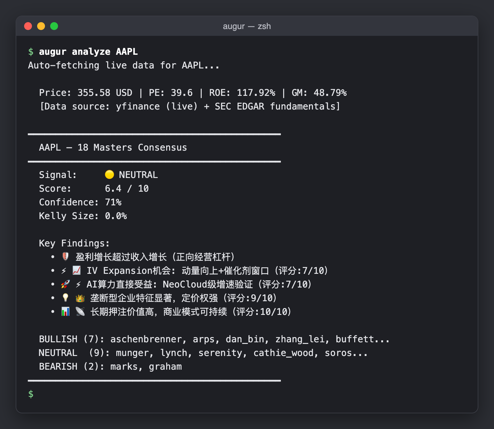

`augur analyze AAPL`：リアルタイムデータを自動取得し、18 人のマスターがそれぞれ採点した結果をコンセンサスのシグナル、スコア、確信度、Kelly サイズ（中立のコンセンサスでは 0）にまとめ、続いて要点と強気・中立・弱気のマスターを表示します。要点はマスターのルール出力をそのまま使っており、現在は大半が中国語です。

---

## ✨ v14 の新機能

### ETF ネイティブ分析

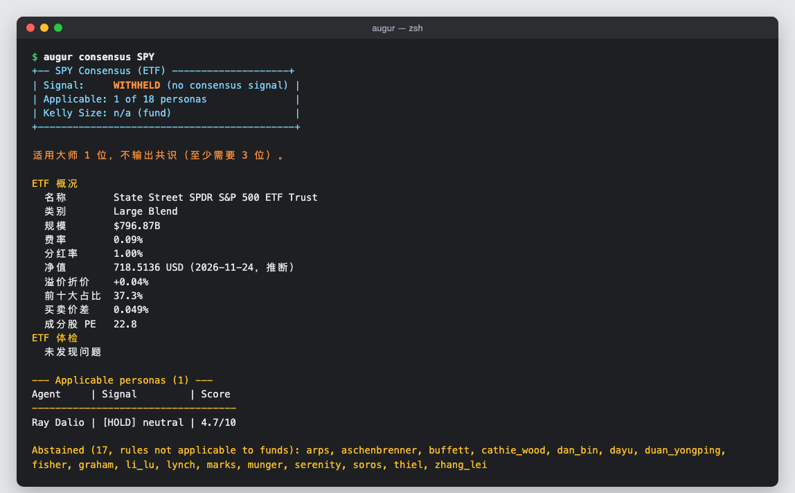

`augur consensus SPY` の出力：コンセンサスは WITHHELD（保留）で、その下に ETF 概要、ヘルスチェック、適用・棄権したマスターが続きます。

- **ETF の識別方法**：yfinance の `quoteType` が ETF または MUTUALFUND の場合、または A 株のファンドコード（上海は 51 / 56 / 58、深センは 15 で始まるもの）の場合です。`fetch`、`analyze`、`consensus`、`report` はファンドに対して企業のファンダメンタルズではなく ETF 概要を表示します。
- **ETF 概要**：純資産総額（米ドル）、経費率、分配利回り、カテゴリ、NAV とその日付、乖離率（NAV 日付の終値で計算）、上位 10 銘柄の比率、売買スプレッド、組入銘柄ベースの PER。
- **ヘルスチェック**：経費率が 0.50% または 1.00% を超える、純資産総額が 5,000 万ドル未満（償還リスク）、乖離率の絶対値が 1% を超える、上位 10 銘柄の比率が 50% を超える、スプレッドが 0.5% を超える場合に警告します。データ不足で確認できない項目は推測せず「未チェック」と表示します。
- **棄権**：企業の財務データを読むルールを持つマスターは、ファンドに対してスコアを出さず「適用外」を返します。どのマスターが適用できるかはテストで決めています。ETF 上で企業向けのフィールドを変え、スコアが動くマスターは適用外です。v14.0 で適用できるのは Dalio だけで、コンセンサスには適用できるマスターが 3 人以上必要なため、現在はすべての ETF でコンセンサスが WITHHELD になります。シグナルも Kelly サイズも出さず、学習記録にも書き込みません。
- **データソースと制限**：米国株・香港株の ETF の NAV は yfinance から取得しますが、日付が付いていません。Augur は最新の足の前営業日と推定し、「推定」と表示します。A 株 ETF の NAV と実際の NAV 日付は Sina の公開相場エンドポイントから取得します。無料のデータソースには A 株 ETF の純資産総額、経費率、保有銘柄がないため、これらは「未チェック」になります。乖離率は最新の 1 日分のみで、履歴やトラッキングエラーはありません。

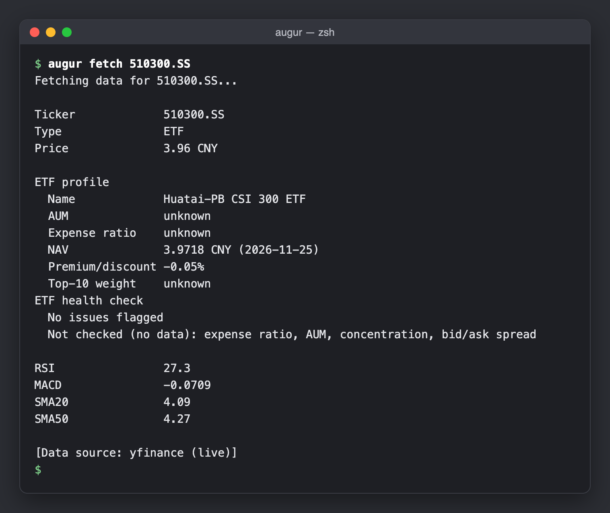

`augur fetch 510300.SS`：A 株 ETF には NAV、NAV 日付、乖離率があります。純資産総額、経費率、上位 10 銘柄の比率は `unknown` と表示され、ヘルスチェックではこれらの項目が `Not checked (no data)` になります。


ダッシュボードの銘柄ページ（`/stocks`）では、ファンドに ETF 概要カードが表示され、コンセンサスのカードは WITHHELD、ポジションは n/a になります。

### 正確性の修正

- **RSI を Wilder 平滑化に変更**（TA-Lib と一致）。以前は直近 14 個の変化だけを見ていました。RSI を読むマスター（arps、dalio、marks、munger、soros、serenity、dayu、カスタムの `da-yu.yaml`）のスコアが変わります。
- **米ドル以外の銘柄の金額を米ドル換算**：時価総額、FCF、売上高などを為替レートで換算します。テンセント（0700.HK）の時価総額は以前 $3,097.6B と読まれていましたが、現在は約 $397.5B です。レートが取得できない場合は換算せず、出力に現地通貨を明記します。
- **マスターのルール**：Dayu のボラティリティルールは単位の誤りで一度も発動していませんでした。Thiel とコンセンサスエンジンのセクター加重は Communication Services（GOOGL、META、テンセント）をテックとして扱うようになりました。中立のコンセンサスではポジションを 0 にします。
- **出力**：`--json` のとき stdout には JSON だけを出し、進捗は stderr に出します。ダッシュボードの恐怖・強欲指数を再調整しました（VIX 28 は Fear と表示）。バックテストページは的中率からリターン、ドローダウン、シャープレシオを推算するのをやめ、「未計測」と表示します。

また、この README に [Augur の LLM の使い方](#-augur-の-llm-の使い方) の節を追加し、`[llm]` extra は使っていない `anthropic` をインストールしなくなり、MCP ツール `augur_configure` は非推奨になりました。全項目は [CHANGELOG](CHANGELOG.md)、アップグレードの影響は [アップグレード](#-アップグレード) を参照してください。

---

## 🧠 Augur の LLM の使い方

採点には LLM を使わず、解釈は LLM に任せることができます。使い方は 3 通りです。

| モード | 考えるのは誰か | API キー | 使い方 |
|---|---|---|---|
| デフォルト：決定的なルール | 18 人のマスターのルールとコンセンサスエンジン | 不要 | `augur analyze` / `consensus` / `workflow` / ダッシュボード。指標を手入力すればオフラインでも動作 |
| MCP / スキル：ホスト側エージェントが解釈 | 普段使っているエージェント（Claude Code、Claude Desktop、Hermes など）が Augur のツールでスコアと証拠を取得し、自身のモデルで解釈 | ホスト側が用意。Augur には不要 | `claude mcp add augur -- augur-mcp`、または Claude Desktop に `augur-mcp` を設定（[Claude / Agent 連携](#-claude--agent-連携) を参照） |
| 任意：自前のキーで使うマスターとのチャット | 設定した OpenAI 互換エンドポイント | `OPENAI_API_KEY` が必要 | `pip install -e ".[llm]"` の後 `OPENAI_API_KEY` を設定。任意で `OPENAI_BASE_URL` と `AUGUR_CHAT_MODEL`（既定は `gpt-4o`）。`augur chat` とダッシュボードの `/chat` で使用。未設定ならテンプレートの返答になる |

もう一つ、既定でオフの有料機能があります。`AUGUR_EDGAR_GUIDANCE_EXTRACTION=1` を設定すると、`augur guidance` が同じ OpenAI 互換エンドポイントを使って 10-K / 10-Q から経営陣の見通しを抽出します。

---

## 📖 決算リサーチの流れ

新しいユーザーが実際にたどる順に説明します。ウォッチリストを作り、決算日を補完し、決算サイクルを回し、リサーチの成果物を確認します。スクリーンショットは AAPL、MSFT、NVDA の実データ（リアルタイム相場と SEC EDGAR）によるもので、ターミナルの画面は出力の主要部分だけを切り取っています。

### ウォッチリストを作り、決算日を補完する

```bash
augur watchlist add AAPL
augur watchlist add MSFT
augur watchlist add NVDA
augur earnings --backfill
```

ウォッチリストは決算サイクルの入力です。`augur earnings`、`augur cycle`、ダッシュボードの Earnings Queue はいずれもここから銘柄を読みます。

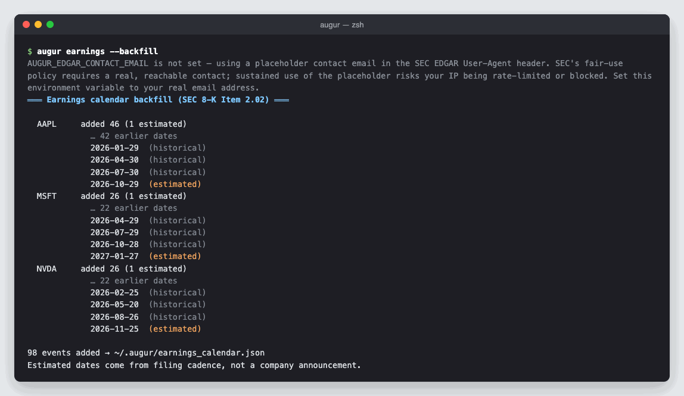

`augur earnings --backfill` は、ウォッチリストの各銘柄について SEC 8-K（Item 2.02、業績発表）から過去の決算日を読み取り、直近の発表間隔から次回の日付を推定して `estimated` と表示します。「確定」とは表示しません。決算カレンダーに手で書いた項目は上書きしません。ネットワーク接続と `AUGUR_EDGAR_CONTACT_EMAIL` が必要です。`-t AAPL` で特定の銘柄だけを補完できます。

### 決算サイクルをワンコマンドで

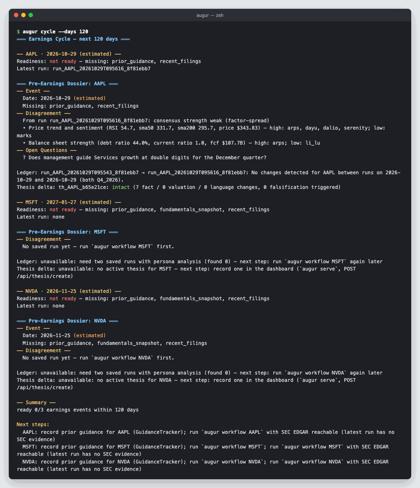

`augur cycle` は、今後 N 日以内（既定は 30 日、`--days` で変更）に決算を迎えるウォッチリストの各銘柄について、ドシエの準備状況、ドシエの内容、直近 2 回の実行間の変化、投資テーゼの変化を順に示し、最後に `ready X/Y` と銘柄ごとの次の一手をまとめます。保存済みのローカル状態だけを読み、ネットワークには接続しません。足りないものがあればそう書き、埋めるためのコマンドを示します。

### リサーチの成果物

`augur dossier AAPL` は決算前ドシエを、`augur report from-run AAPL` は直近の実行からリサーチレポートを作り、`augur skill run` は組み込みのリサーチスキルを実行します。以下のうち `skill run earnings-prep` と `report from-run` のスクリーンショットは v14 で撮影したものです。`filing-delta`、`risk-review`、`eval personas` の 3 枚は v11 で撮影したもので、レイアウトは現在と同じですが、数値や一部の表現は旧バージョンのものです。

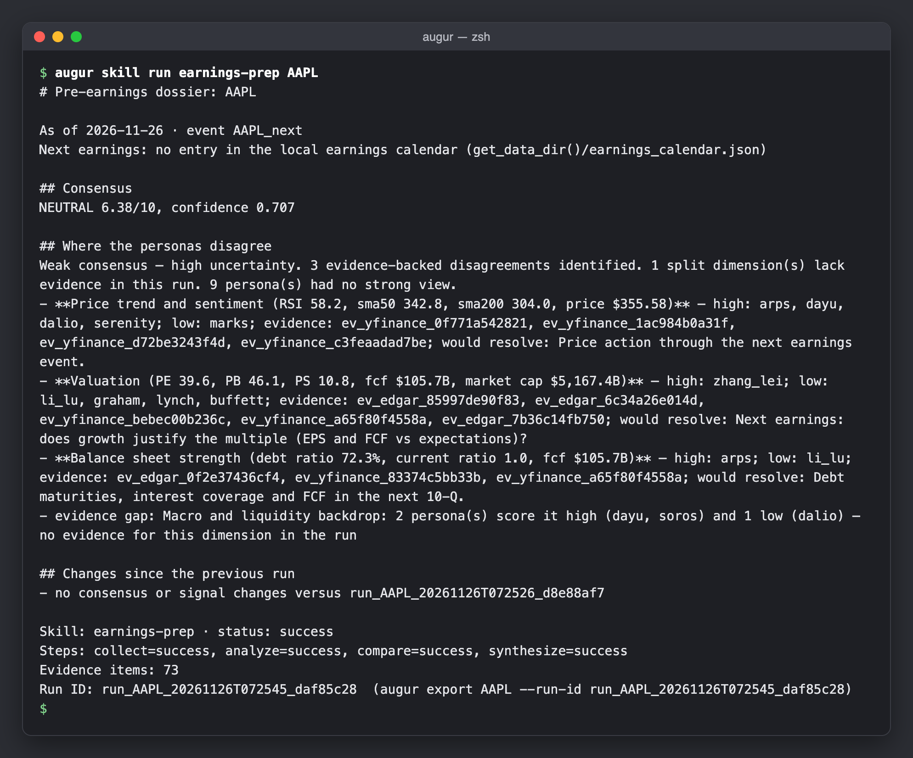

`augur skill run earnings-prep AAPL`：18 人のマスターのコンセンサス。意見の分岐ごとに証拠 ID を引用し、裏付けのない分岐は "evidence gap" として別に示し、前回の実行と比較します。次回の決算日はローカルの決算カレンダーから取り、`confirmed` か `estimated` かを明記します。カレンダーに記録がなければそう書きます。実行前に、各ステップが使う機能、ネットワークドメイン、ローカルリソースがマニフェストで宣言されているかを確認し、一つでも通らなければ実行しません。各実行は RunBundle として保存されます。

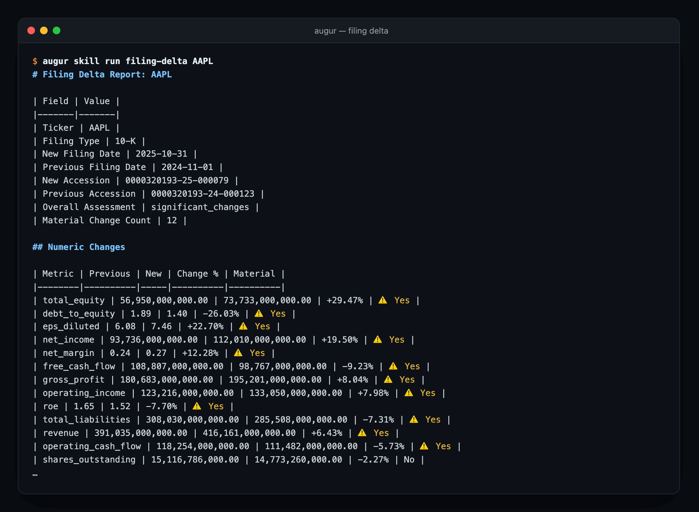

`augur skill run filing-delta AAPL`：直近 2 期の 10-K の XBRL データを自動で取得し、5% 以上変化した項目を一覧にします。ほかの組み込みスキルは `debt-covenant-review`（レバレッジとインタレスト・カバレッジ）と `insider-cluster-review`（Form 4 のインサイダー取引の集中）です。詳しくは [スキルガイド](docs/skills-guide.md)（中国語）を参照してください。

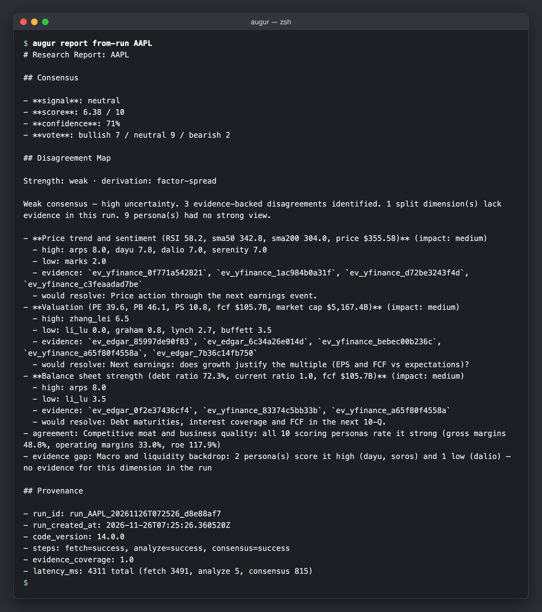

`augur report from-run AAPL`（先に `augur workflow AAPL` で実行を保存しておく）：強気・弱気の票数、マスターの意見が分かれた観点（それぞれ証拠 ID を引用し、どの事実が分岐を解消するかを示す）、一致している点、証拠のない分岐、そして実行 ID、コードのバージョン、ステップの状態、証拠のカバー率。

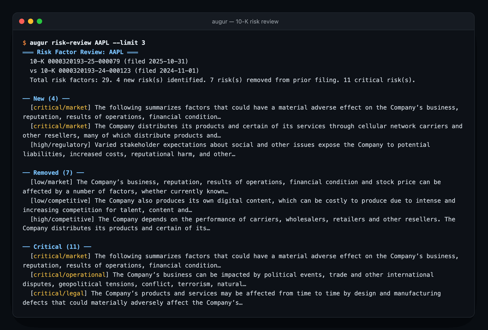

`augur risk-review AAPL`：直近 2 期の 10-K のリスク要因セクションを比較し、新規、削除、表現が強まったリスクを一覧にします。ルールベースの照合なので、わずかな言い換えが「新規」と「削除」の両方に出ることがあります。


`augur eval personas AAPL`：`augur backtest` が生成した記録を使い、マスターを 1 人ずつ外してコンセンサスの IC が良くなるか悪くなるかを調べます。スコアが常に一定で情報を持たないマスターは別に示します。先行リターンが日ごとに重なっているため信頼区間は楽観的です。スクリーニングとして使い、そのまま重みにはしないでください。`augur eval factors` は各マスターのスコアをファクターとして扱い、IC と t 検定を示します。

---

## 🎭 18 人の投資マスター

各マスターは公開された投資哲学をルールとして実装したもので、バリュー、グロース、マクロ、中国市場をカバーします。現在、大半のマスターは理由と要点を中国語で出力します。

| 流派 | マスター |
|------|------|
| 🏦 古典的バリュー | Warren Buffett · Benjamin Graham · Charlie Munger · Philip Fisher |
| 🚀 グロース・イノベーション | Peter Lynch · Cathie Wood · Peter Thiel · Leopold Aschenbrenner |
| 🌍 マクロ・サイクル | Ray Dalio · George Soros · Howard Marks · ARPS（暗号資産 / 金） |
| 🇨🇳 中国のバリュー | 段永平 · 張磊 · 李録 · 但斌 · 大宇（Dayu） |
| ⚙️ 特殊戦略 | Serenity（AI 計算資源のサプライチェーン） |

コンセンサスエンジンは確信度、データのカバー率、セクターとの関連度で各マスターを加重し、シグナル、スコア、確信度、Kelly ポジションサイズを返します。`augur list-personas` で全マスターの ID を一覧できます。

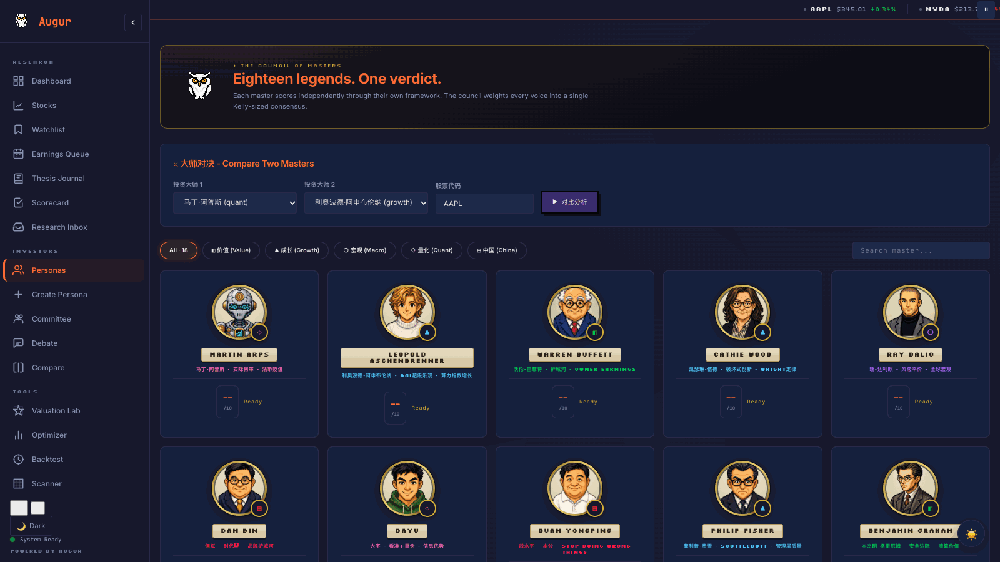

---

## 📊 ダッシュボード

`augur serve --open` でサーバーを起動し、http://localhost:8000 を開きます。サイドバーは Research、Investors、Tools、System の 4 グループです。

| ページ | パス | 内容 |
|---|---|---|
| ホーム | `/` | 相場とマスターの概要 |
| 銘柄分析 | `/stocks` | ティッカーを入力すると 18 人のマスターが同時に分析。ETF には ETF 概要カード |
| マスター / 委員会 / ディベート / 比較 | `/personas` · `/committee` · `/debate` · `/compare` | マスター一覧、プリセット委員会、複数ラウンドのディベート、5 軸レーダー |
| Earnings Queue / スコアカード | `/earnings` · `/scorecard` | 決算イベントとドシエの不足項目、決算後スコアカード |
| Thesis Journal / Research Inbox | `/thesis` · `/inbox` | 投資テーゼ、反証条件、意思決定ログ。未処理のイベント |
| Valuation Lab | `/valuation` | 2 段階 DCF と感応度グリッド |
| 履歴 / ポートフォリオ / ウォッチリスト / 設定 | `/history` · `/portfolio` · `/watchlist` · `/settings` | 実行履歴、Kelly の設定、定期分析、レイアウトとマスターの選択 |

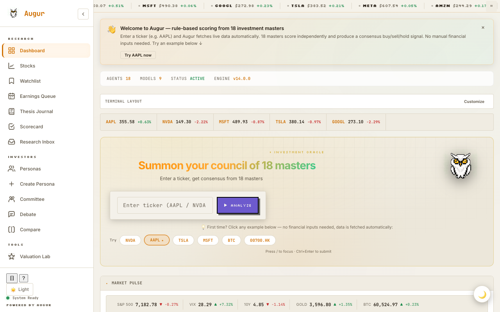

<details>
<summary>その他のスクリーンショット：Earnings Queue、スコアカード、Thesis Journal、Valuation Lab</summary>

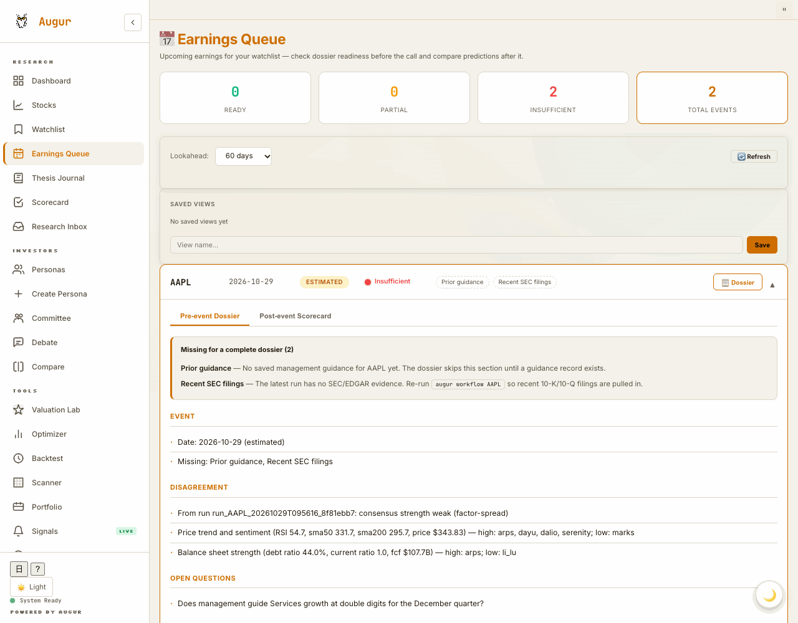

`/earnings`：Earnings Queue は `augur earnings` と同じウォッチリストと決算カレンダーを読みます。銘柄ごとにドシエで足りない項目と、それぞれを埋めるコマンドを示します。推定した日付には `estimated` と表示します。


`/scorecard`：決算後スコアカードは、決算前と決算後の実行がそれぞれどのリサーチクエスチョンに答えたかを照合します。データが足りなければ `unavailable` と理由を表示します。ダッシュボードにはまだ決算前後の実行ペアを保存する場所がないため、完全なスコアカードは作れません。コマンドラインの `augur scorecard` なら使えます。

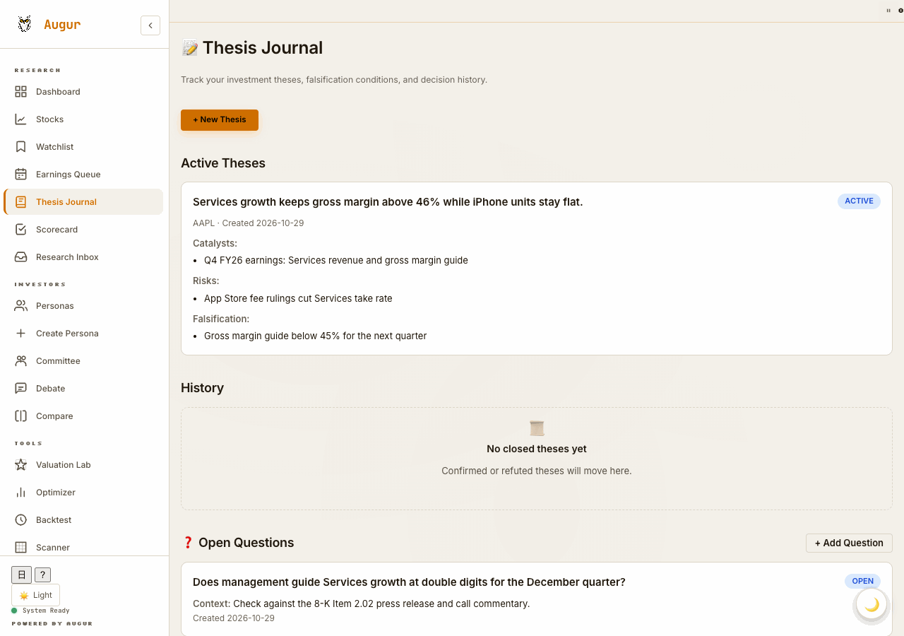

`/thesis`：投資テーゼのカタリスト、リスク、反証条件を記録し、横に未回答のリサーチクエスチョンと意思決定ログを表示します。リサーチクエスチョンはローカルに保存され、`augur dossier` からも読めます。スクリーンショットの内容は手入力した例です。

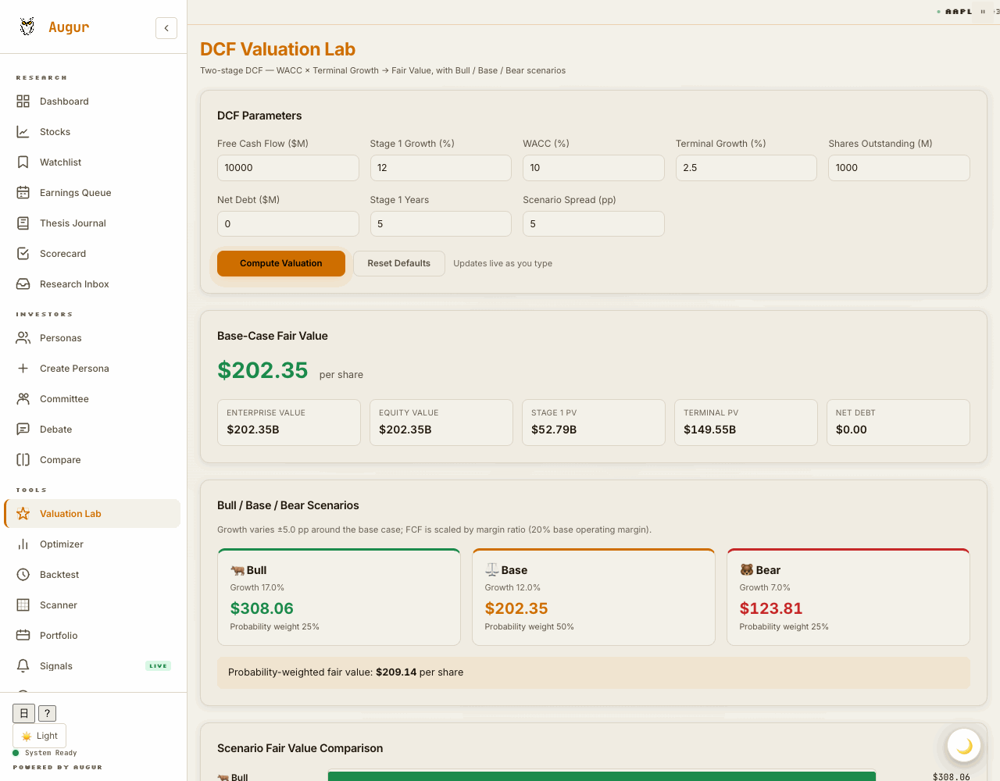

`/valuation`：入力を変えるとすぐに再計算する 2 段階 DCF です。強気・基本・弱気の 3 シナリオと確率加重の適正価値を示し、下に WACC × 永久成長率の感応度グリッドがあります。スクリーンショットのパラメータは入力例です。

</details>

---

## 🔌 Claude / Agent 連携

MCP サーバーは 14 個のツール（組み込みスキルを実行する `augur_run_skill` を含む）、7 個のリサーチ用プロンプト、5 種類の読み取り専用リソース（`augur://evidence/{id}`、`augur://runs/{id}`、`augur://thesis/{id}`、`augur://decisions/{id}`、`augur://ledger/{ticker}/{quarter}`）を提供し、`mcp` 1.x と 2.x の両方で実際の stdio セッションによって検証しています。

```bash
pip install -e ".[data,mcp]"
claude mcp add augur -- augur-mcp   # Claude Code：stdio MCP サーバーとして登録
```

Claude Desktop の設定例：

```json
{
  "mcpServers": {
    "augur": { "command": "augur-mcp", "env": { "AUGUR_EDGAR_CONTACT_EMAIL": "you@example.com" } }
  }
}
```

分析、コンセンサス、ディベート、委員会の 4 つのツールは `asset_type`（`equity` / `etf` / `fund`、空なら自動判定）を受け付けます。このほか Hermes / OpenClaw 用のスキルパック（`src/skills/`、[docs/en/hermes-setup-guide.md](docs/en/hermes-setup-guide.md) を参照）と、Telegram、Slack、Lark（飛書）、WeChat のボットがあります。詳しくは [docs/en/agent-integration-guide.md](docs/en/agent-integration-guide.md) を参照してください。

---

## 💻 CLI チートシート

```bash
# 分析
augur analyze AAPL [--persona buffett] [--json]
augur consensus SPY · augur fetch 510300.SS · augur report SPY   # ETF にも使える
augur workflow TSLA --steps fetch,analyze,consensus,committee,debate,sentiment
augur committee NVDA --agents buffett,munger,dalio
augur batch AAPL MSFT NVDA

# リサーチの成果物
augur report from-run AAPL [--format json]      # コンセンサス + 意見の分岐マップ + 出典と所要時間
augur export AAPL --format md|json|evidence-pack|pdf [-o パス] [--run-id ...]
augur records verify-pack pack.zip              # 証拠パック内の全ファイルの SHA-256 を検証
augur dossier AAPL                              # 決算前ドシエ
augur valuation AAPL [--fcf 100e9 --shares 15e9 --growth 0.08 --wacc 0.10]
augur risk-review AAPL                          # 直近 2 期の 10-K のリスク要因の変化
augur records ledger AAPL                       # 直近 2 回の実行間で何が変わったか
augur thesis-delta AAPL                         # 有効な投資テーゼと直近 2 回の実行の照合（オフライン）
augur scorecard AAPL [--pre RUN --post RUN]     # 決算後スコアカード
augur cycle [--days 30] [--format markdown]     # ウォッチリストの決算サイクル
augur filing-delta AAPL --new q3.json --prev q2.json

# 組み込みリサーチスキル（実行前に権限を確認し、結果を RunBundle として保存）
augur skill list · augur skill show filing-delta
augur skill run earnings-prep|filing-delta|debt-covenant-review|insider-cluster-review AAPL

# 評価（augur backtest が生成した記録を使う）
augur backtest AAPL --days 120 [--demo] · augur eval ic
augur eval personas AAPL [--horizon 20]         # コンセンサスの IC、的中率、マスターを 1 人ずつ外したときの寄与
augur eval factors AAPL                         # 各マスターのスコアをファクターとした IC、t 値、p 値

# リサーチ記録
augur records decisions list|resolve|report     # 意思決定の結果と勝率
augur records comments add|list|resolve         # 実行、テーゼ、意思決定、証拠へのコメント
augur records citations report|list|accept|reject|fixed   # 引用の訂正キュー
augur records audit [--action ...]              # 監査ログ

# データ
augur fetch AAPL · augur sentiment AAPL · augur insider AAPL · augur doctor
augur earnings --days 30 · augur earnings --backfill

# 監視とサービス
augur watchlist add AAPL · augur watchlist show · augur watchlist watch AAPL NVDA --interval 60
augur cron run · augur cron start
augur serve [--port 8000] · augur mcp-server · augur skill profiles · augur skill compat
```

`augur --help` には 38 個のトップレベルコマンドが並びます（pip でインストールした場合は `augur update` が隠れて 37 個）。v12.2 以降、関連するコマンドはグループ（`watchlist` / `cron` / `report` / `records` / `eval` / `skill`）にまとめられています。旧来のフラットな名前（`watchlist-add`、`research-report`、`ic-report`、`ledger` など）も v14 で引き続き使え、実行時に stderr へ新しい書き方を表示します。`augur report AAPL` は `augur report run AAPL` と同じです。


---

## 🧭 機能の成熟度と既知の制限

「コードがある」と「使える」を混同しないよう、正直に表示しています。

| 状態 | 範囲 |
|---|---|
| 安定 | 18 人のマスターによる分析とコンセンサス、上に挙げたコマンドラインのリサーチフロー、ダッシュボードの主要ページ、MCP サーバー、RunBundle とエクスポート、データソースのチェーン（yfinance。米国株の決算項目は SEC EDGAR で上書き） |
| 使えるが明確な制限あり | ETF 分析：v14.0 で適用できるのは Dalio だけなので、コンセンサスは常に WITHHELD。A 株 ETF は NAV と乖離率のみ。乖離率は最新の 1 日分のみ。次の箇所ではファンドの保留中のコンセンサスがまだ 5.0 と表示される：ダッシュボードのウォッチリスト、ポートフォリオ、スキャナー、履歴、Signals ページ（通知とライブフィード）、`augur cron` のサマリー、チャットボット、組み込みスキル（CLI、MCP、ダッシュボードの銘柄ページ・ホーム・委員会ページは WITHHELD を表示）。<br>組み込みスキル（4 種）：組み込みのマニフェストのみ実行。債務制限条項のレビューは参考しきい値を使い、実際の融資契約の条項ではない。<br>意見の分岐マップ：各マスターの観点別スコアから導き、証拠を引用。観点と指標の対応は固定の表。<br>`augur risk-review`：ルールベースの照合。わずかな言い換えが「新規」と「削除」の両方に出ることがある。<br>`augur eval`：単一銘柄の時系列 IC。先行リターンが重なるため有意性は楽観的で、スクリーニング専用。<br>`augur guidance`：`AUGUR_EDGAR_GUIDANCE_EXTRACTION=1` が必要で、有料の LLM を呼び出す。<br>PDF エクスポート：`[export]` が必要。 |
| 実験的（既定でオフ） | rolling-IC による動的な重み（`AUGUR_FORCE_RIC=1`）と学習した重み（`AUGUR_FORCE_LEARNED=1`）。どちらも事前登録したアウトオブサンプル検証をまだ通過していない |
| コードのみ、入口なし | `augur.experimental` 配下の会計品質、資本配分、ディベートエンジン（ダッシュボードの `/debate` は別の実装を使用）、相対バリュエーション、ポートフォリオリスク。単体テストはあるが CLI、ダッシュボード、MCP のどこからも呼ばれない。ライブラリとしては使えるが製品機能ではない |
| 未計測 | 実行記録のトークン使用量（現在は所要時間のみ記録） |

---

## 🔄 アップグレード

### v13 から v14 へ

コマンドの使い方は変わりませんが、一部のスコアと出力が変わります。

| 変更 | 影響と対処 |
|---|---|
| RSI を Wilder 平滑化に変更 | arps、dalio、marks、munger、soros、serenity、dayu、カスタムの `da-yu.yaml` のスコアが変わり、RSI が 30 / 70 付近の銘柄で特に目立つ。v13 のスコアを保存して比較している場合は注意 |
| Dayu のボラティリティルールが有効に | ポジションリスクの観点の v13 からの変化：20 日ボラティリティ 15% 未満は変化なし、15–25% は −1、25–40% は −2、40–60% は −3、60% 超は −4。この観点は Dayu のスコアの 20% |
| 米ドル以外の銘柄の金額は米ドル建て | 香港株、A 株、財務諸表が米ドル以外の銘柄（一部の ADR など）：`market_cap`、`fcf`、`revenue` などは 10 億米ドル単位。価格は取引通貨のまま。`MarketContext` を直接読むコードは単位に注意 |
| Communication Services をテックとして扱う | Thiel とコンセンサスエンジンのセクター加重で、GOOGL、META、テンセントなどの判断が変わる |
| 中立のコンセンサスはポジション 0 | 以前は `analyze` が 0.6% のような小さなポジションを出していた |
| ETF に 18 人のマスターのコンセンサスは出ない | ETF 概要、ヘルスチェック、適用できるマスターの結果を出力し、コンセンサスは WITHHELD。ファンドの `pe` / `pb` は 0 で、組入銘柄ベースの値は `etf` 辞書にある。以前 ETF を株式として分析した結果は使い続けないこと |
| `--json` の進捗表示は stderr へ | stdout は JSON のみ。stdout から進捗の文字列を解析しているスクリプトは stderr を読むよう変更 |
| `[llm]` が `anthropic` をインストールしなくなり、MCP の `augur_configure` は非推奨 | コード内で一度も使われていなかった。自作のコードで `anthropic` が必要なら各自でインストール |
| ダッシュボードのバックテスト API はリターン、ドローダウン、シャープレシオに `null` を返す | 以前の値は的中率から推算したもので、実測ではなかった |

学習データのスキーマは 2 のままで、リセットされません。旧 RSI で記録された未決済の予測はそのまま決済されます。v14 より前に ETF を分析したときに書き込まれた学習記録は残っており、関係するマスターの的中率にわずかなノイズを加えます。クリーンアップツールは今後のリリースで提供する予定です。

### それ以前のバージョンから

各バージョンの移行手順を順に適用してください。要点は次のとおりです。

- **v13**：Python 3.10 以上が必要。製品の入口がない 5 つのモジュールが `augur.experimental.<同名>` に移動（例：`augur.accounting` → `augur.experimental.accounting`）。互換用の再エクスポートモジュール `augur.coordinator`、`augur.skill_spec`、`augur.mcp_entry` を削除。
- **v12**：学習した重みのファイルがスキーマ 2 になり、v11 で記録した決済結果は初回読み込み時に破棄（未決済の予測は保持）。コマンドをグループ化し、旧来のフラットな名前も引き続き使用可能。
- **v11**：[docs/RELEASE_NOTES_v11.md](docs/RELEASE_NOTES_v11.md)（中国語）を参照。`Optional` になった保有比率フィールド、既定でオフの動的な重み、既定で `127.0.0.1` のみで待ち受けることなどを説明しています。

各バージョンの詳細は [CHANGELOG.md](CHANGELOG.md) にあります。

---

## 🔒 データとプライバシー

- すべての状態はローカルのデータディレクトリ（既定は `~/.augur`、`AUGUR_DATA_DIR` で変更）に保存されます。テレメトリはありません。既定はシングルユーザーで登録不要です（`AUGUR_MULTI_USER=1` でマルチユーザーモード）。
- Augur が行うネットワーク通信：相場、ファンダメンタルズ、為替レート（yfinance、SEC EDGAR）。A 株 ETF の NAV（Sina 相場、`hq.sinajs.cn`）。任意の LLM 呼び出し（`OPENAI_API_KEY` を設定してチャットかガイダンス抽出を使う場合のみ）。ダッシュボードは jsDelivr CDN から Chart.js を読み込みます。
- ダッシュボードは既定でローカルホストのみで待ち受けます。外部に公開する前に `AUGUR_API_TOKEN` を設定してください。詳しくは [docs/self-hosted-guide.md](docs/self-hosted-guide.md) を参照してください。

主な環境変数：

| 変数 | 用途 |
|---|---|
| `AUGUR_DATA_DIR` | データディレクトリ |
| `AUGUR_EDGAR_CONTACT_EMAIL` | SEC EDGAR が求める連絡先メール（未設定ならプレースホルダーを使い警告） |
| `AUGUR_API_TOKEN` / `AUGUR_MULTI_USER` | ダッシュボードの `/api/*` の認証 |
| `AUGUR_CORS_ORIGINS` | 許可する CORS オリジン |
| `AUGUR_FORCE_RIC` / `AUGUR_FORCE_LEARNED` | 実験的な動的な重みを有効化 |
| `AUGUR_SKIP_MACRO_FETCH` | VIX / SPY のマクロデータ取得を省略（オフラインや CI） |
| `AUGUR_EDGAR_GUIDANCE_EXTRACTION` | LLM によるガイダンス抽出を有効化（有料。下記の OpenAI 互換エンドポイントを使用） |
| `OPENAI_API_KEY` / `OPENAI_BASE_URL` | 任意：マスターとのチャットとガイダンス抽出に使う OpenAI 互換エンドポイント（`[llm]` が必要。URL 未設定なら OpenAI 公式） |
| `AUGUR_CHAT_MODEL` / `AUGUR_CHAT_MAXTOK` | 任意：チャットのモデル名（既定は `gpt-4o`）と最大出力トークン数（既定は 1024） |

---

## 🔧 開発

```bash
python3 -m venv .venv && source .venv/bin/activate
pip install -e ".[dev,data,mcp]" "ruff>=0.16,<0.17" build

make verify     # 全テスト + ruff + wheel / sdist のビルドと sha256 の出力
make lint       # ruff（ルールセットは E4/E7/E9/F に固定）
make test-wheel # 新しい仮想環境にビルド成果物をインストールしてスモークテスト
```

- テストは専用の一時的な `AUGUR_DATA_DIR` を使い、`~/.augur` には書き込みません。ネットワークが完全にない環境でもすべて通ります。
- CI：`Tests` は Python 3.10 / 3.11 / 3.12 で全テストを実行します。`Hermetic Smoke` は wheel と sdist からそれぞれ新規インストールし、ruff、pip-audit、上記の README のコマンドを実行します。
- コントリビュートの方法は [CONTRIBUTING.md](CONTRIBUTING.md) を参照してください。

---

## 📚 ドキュメント

| ドキュメント | 内容 |
|---|---|
| [docs/ROADMAP.md](docs/ROADMAP.md) | ロードマップ：現在のフェーズ、各ステップの検証、v14 以降の候補と未決事項（中国語） |
| [docs/en/RELEASE_NOTES.md](docs/en/RELEASE_NOTES.md) | ユーザー向けのリリースノート（英語） |
| [CHANGELOG.md](CHANGELOG.md) | 各バージョンの全変更（英語） |
| [docs/en/data-sources.md](docs/en/data-sources.md) | データソースと各フィールドの出所（英語） |
| [docs/schema-reference.md](docs/schema-reference.md) | EvidenceItem / Claim / StepResult / RunBundle / SkillSpec |
| [docs/api-reference-v11.md](docs/api-reference-v11.md) | Python API / REST / MCP |
| [docs/examples.md](docs/examples.md) | 実践例 |
| [docs/self-hosted-guide.md](docs/self-hosted-guide.md) | Docker / systemd / リバースプロキシ / 認証 |
| [docs/reviews/](docs/reviews/) | プロジェクトのレビュー記録 |
| [docs/INDEX.md](docs/INDEX.md) | 全ドキュメントの索引 |

---

## 📝 変更履歴

<details open>
<summary><strong>v14.0.0 — ETF ネイティブ分析、正確性の修正、LLM の役割の明確化 (current)</strong></summary>

- ETF ネイティブ分析：ETF を識別し、純資産総額、経費率、NAV（A 株は実際の NAV 日付付き）、NAV 日付に合わせた乖離率、上位 10 銘柄の比率、ヘルスチェックを表示。ルールが当てはまらないマスターは棄権し、適用できるマスターが 3 人未満ならコンセンサスもポジションも出さず、学習記録にも書き込まない。
- 正確性：Wilder RSI、米ドル以外の金額の米ドル換算、Dayu のボラティリティの単位、Communication Services のテック扱い、中立時のポジション 0、`--json` の JSON のみの出力、恐怖・強欲指数の再調整。
- LLM の役割：[Augur の LLM の使い方](#-augur-の-llm-の使い方) の節を追加。`augur_configure` は非推奨。`[llm]` は `anthropic` をインストールしない。

</details>

<details>
<summary><strong>それ以前のバージョン</strong></summary>

- v13.0.0：`augur earnings --backfill` で SEC 8-K から決算日を補完。Python 3.10 以上が必要。公開 API を縮小。
- v12.2.0：コマンドのグループ化（`augur --help` の項目が 47 から 38 に）。ダッシュボードのサイドバーをグループ化し、決算関連ページへのリンクを追加。
- v12.1.0：`augur cycle`、`augur scorecard`、`augur thesis-delta`。
- v12.0.0：学習の各予測をその予測日を基準に決済。Earnings Queue とドシエが実際のウォッチリストと保存済みの実行を使用。単独ではリリースされなかった v11.0.0 の内容を含む。
- v11.0.0-rc1：リサーチ基盤（EvidenceItem、RunBundle、SkillSpec）、Thesis Journal、意見の分岐マップ、Valuation Lab。
- v10.15.0 以前：SEC EDGAR のファンダメンタルズ、`augur doctor`、ターミナル UI、委員会、Hermes Agent 連携。

全履歴は [CHANGELOG.md](CHANGELOG.md) を参照してください。

</details>

---

<div align="center">

MIT License · 作者 [BruceLanLan](https://github.com/BruceLanLan)（X：[@BruceBlue](https://x.com/BruceBlue)）

*研究・教育目的のみです。投資助言ではありません。*

</div>
